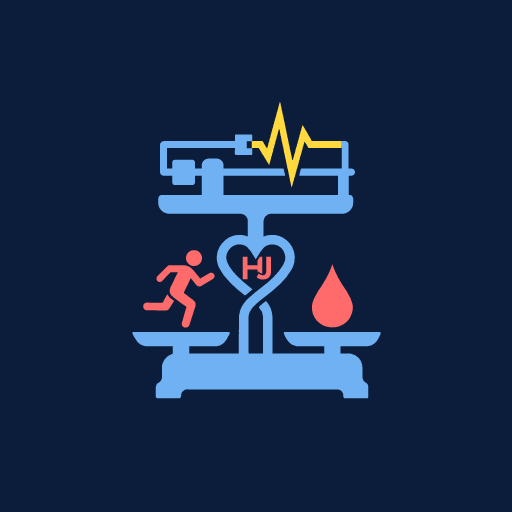
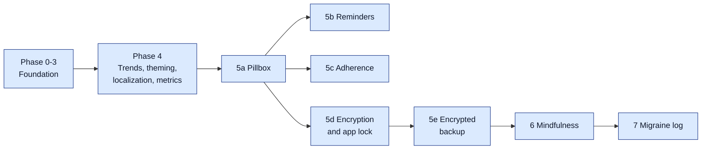

<div align="center">



# Health Journal

**An offline-first, privacy-focused Android health journal.**

[](https://github.com/mannetje/health_journal/actions/workflows/android.yml)
[](https://github.com/mannetje/health_journal/releases/latest)

[Download](#-download-apk) · [Developer docs](docs/dev/README.md) · [Contributing](CONTRIBUTING.md) · [Architecture decisions](docs/adr/) · [Changelog](CHANGELOG.md)

</div>

An offline-first, privacy-focused Android health logging application built with Kotlin, Jetpack Compose, and Hexagonal Architecture (Ports and Adapters).

> **Want to build on it or contribute?** Start with the [Developer Docs](docs/dev/README.md): getting started, an architecture tour and how-to guides. See also [CONTRIBUTING.md](CONTRIBUTING.md).

---

## 📥 Download APK

You can download the ready-to-install Android APK directly from GitHub:

👉 **[Download Latest APK (v1.6.2)](https://github.com/mannetje/health_journal/releases/latest)**  
See the [CHANGELOG](CHANGELOG.md) for what changed in each release.

---

## Screenshots

| Log | Weight trend | Glucose trend |
|---|---|---|
|  |  |  |

More screenshots (dark theme, graphs and statistics, migraine log, medication reminders, adherence, history timeline, app icon): **[all screenshots](docs/screenshots.md)**. They use synthetic sample data.

---

## Overview & Vision

**Health Journal** empowers individuals to track and understand their vital health metrics locally on their device, with zero reliance on cloud services or external servers. All evaluation logic adheres strictly to clinical standards, defaulting to the official guidelines of the **Dutch College of General Practitioners** (*Nederlands Huisartsen Genootschap* / NHG).

### Key Features

#### 📊 Tracked Health Metrics
- **Body Weight & BMI:** Record weight in kg or lb; automatically calculates Body Mass Index (BMI) categorized against NHG/WHO standards. *([spec](openspec/specs/health-metrics/weight/spec.md), [ADR 0005](docs/adr/0005-dutch-nhg-guidelines.md))*
- **Waist Circumference (optional):** Record waist measurement in cm; evaluated against Voedingscentrum's sex-specific healthy-range thresholds when profile sex is set. *([spec](openspec/specs/health-metrics/weight/spec.md))*
- **Blood Pressure & Pulse:** Record systolic, diastolic (mmHg), and pulse (30–250 bpm); evaluated against NHG 3-band categories (Normal, High, Seriously raised). *([spec](openspec/specs/health-metrics/blood-pressure/spec.md), [ADR 0005](docs/adr/0005-dutch-nhg-guidelines.md))*
- **Blood Glucose:** Record fasting and postprandial levels in mmol/L or mg/dL; evaluated against NHG context-specific target ranges. *([spec](openspec/specs/health-metrics/glucose/spec.md), [ADR 0005](docs/adr/0005-dutch-nhg-guidelines.md))*
- **Migraine log:** A step-by-step log of headaches and migraines on its own tab of the Log screen: start and end (or still ongoing), intensity 0 to 10, where it hurts, type, symptoms, triggers, medication taken, relief and a comment, with your own trigger and relief tags. History shows one compact card per migraine and a graph view with counts, a timeline, durations, weekdays and a time-of-day heat map. Plain facts only: no advice, no diagnosis and no comparisons. *([change](openspec/changes/archive/2026-10-24-add-migraine-log/proposal.md), [spec](openspec/specs/migraine/spec.md), [ADR 0025](docs/adr/0025-migraine-log-data-model.md), [dev doc](docs/dev/migraine.md))*
- **Physical Activity:** Track duration and distance for workout sessions manually or via bulk import. *([spec](openspec/specs/health-metrics/activity/spec.md))*
- **Medication Pillbox (💊):** Manage medications (tablets, liquids, sprays, injectables) with flexible schedule versions, daily time slots, and intake logs. *([spec](openspec/specs/medication/spec.md), [ADR 0020](docs/adr/0020-medication-model-and-pillbox.md), [dev doc](docs/dev/pillbox.md))*
- **Mindfulness (🪷):** A calm corner next to the pillbox, with no advice and no record of your practice. Breathe: box, 4-7-8, physiological sigh or belly breathing for 1, 3 or 5 minutes, drawn as a soft lotus, circle or rounded square. Meditate: a quiet timer of 5, 10, 15, 20 or 30 minutes with optional interval bells. Guided: three recorded exercises from the Free Mindfulness Project, played on the device and credited in the app. Start here: a three-step first-time ladder. Tones, vibration and spoken cues (the phone's offline voice) can each be switched on or off, and a short safety note is shown on first open. Only your display choices are saved. Tapping the logo in the top bar takes you back to the Log screen. *([spec](openspec/specs/mindfulness/spec.md), [decisions and wording](docs/dev/mindfulness.md), [how it works](docs/dev/mindfulness-feature.md), [credits](docs/credits.md))*
- **Entry Comments:** Add an optional single-line note (up to 200 characters) to any measurement or activity entry. *([spec](openspec/specs/entry-comments/spec.md), [ADR 0019](docs/adr/0019-entry-comments.md))*

#### 🎛️ Smart Input & User Experience
- **Interactive Number Pickers:** Tactile horizontal measuring tape ruler pickers for Weight and Waist (0.1 step precision) and stacked color-coded rows for Blood Pressure & Pulse. *([ADR 0018](docs/adr/0018-smart-input-pickers.md))*
- **Pickers start from your own entries:** the log pickers start at your latest measurement. Without one they show a plain starting position that is not recorded until you set a value. *([ADR 0018](docs/adr/0018-smart-input-pickers.md), [ADR 0033](docs/adr/0033-picker-starts-from-own-entries-only.md))*
- **Medication Reminders & Adherence:** Scheduled time slot notifications with Taken/Snooze actions, plus 7/30/90-day adherence statistics and streak tracking. *([ADR 0022](docs/adr/0022-medication-reminders.md), [ADR 0021](docs/adr/0021-medication-compliance-and-privacy.md))*
- **Timeline & Trend Visualizations:** Interactive pinch-zoom trend charts, moving averages, range gauges, and interleaved chronological history timeline with month/year quick navigation. *([spec](openspec/specs/health-trends/spec.md), [ADR 0006](docs/adr/0006-health-trend-visualizations.md), [dev doc](docs/dev/graphs.md))*

#### 🔒 Privacy, Security & Data Sovereignty
- **100% Offline-First:** No network permissions required (`INTERNET` permission absent). Zero telemetry, tracking, or cloud sync. *([spec](openspec/specs/privacy/spec.md), [privacy and security](docs/dev/privacy-and-security.md))*
- **SQLCipher AES-256 Encryption:** Database encrypted at rest using a hardware-backed key generated via Android Keystore (TEE/StrongBox). *([ADR 0023](docs/adr/0023-database-encryption-and-app-lock.md), [database](docs/dev/database.md))*
- **Opt-in App Lock:** Secure app access using system Device Credentials (PIN/pattern/password) or Biometrics (fingerprint/face) with configurable auto-lock timeouts. *([ADR 0023](docs/adr/0023-database-encryption-and-app-lock.md))*
- **Secure Screen Protection:** Optional `FLAG_SECURE` mode blocks screenshots and hides app switcher preview cards. *([privacy and security](docs/dev/privacy-and-security.md))*
- **Encrypted Backup:** One passphrase-protected `.hjbackup` file (Argon2id, AES-256-GCM) with all profiles, entries, migraines and medication. Restore on any device, merging without overwriting, or after a lost key. The [file format](docs/backup-format/README.md) is published, so the data can be recovered [without the app](docs/backup-format/recover-your-data.md).
- **Complete Data Portability:** Standardized UTF-8 CSV import and export for all health metrics, medications, and comments (unencrypted, with a warning). Supports auto-detecting Libra CSV files. *([spec](openspec/specs/data-export/spec.md))*

#### 🌍 Customization & Localization
- **Dutch & English Localization:** Fully localized UI text in English and Dutch, with manual language selection or system default. *([spec](openspec/specs/localization/spec.md), [add a translation](docs/dev/how-to/add-a-translation.md))*
- **Independent Regional Formats:** Custom date and number formatting styles (Netherlands / US / System) independent of language choice. *([spec](openspec/specs/localization/spec.md))*
- **Presentation Units:** Toggle between Metric (kg, cm, m) and Imperial (lb, mi, ft/in) as well as mmol/L or mg/dL glucose units. *([spec](openspec/specs/units-presentation/spec.md), [ADR 0014](docs/adr/0014-units-presentation.md))*
- **Light & Dark Themes:** Automatic system theme matching or manual System/Light/Dark selection. *([spec](openspec/specs/theming/spec.md), [ADR 0017](docs/adr/0017-in-app-theme-choice.md))*

---

## Technical Architecture

The application enforces **Hexagonal Architecture** (Ports and Adapters) paired with **Domain-Driven Design (DDD)**.

### Core Architectural Directives
1. **Strict Isolation:** The `:domain` module is pure Kotlin. It has zero dependencies on `android.*`, `androidx.*`, or database persistence libraries.
2. **Dependency Rule:** All dependencies point inward toward `:domain`. Presentation (`:app`) and Infrastructure (`:data`) are outer adapters implementing or consuming domain ports.
3. **Dependency Minimization:** We strictly prioritize the native Android SDK, official AndroidX/Jetpack libraries, and official Kotlinx libraries over third-party dependencies. Any external library must be justified via an [Architecture Decision Record (ADR)](docs/adr/).
4. **Offline-First:** Room SQLite with SQLCipher serves as the encrypted local source of truth.

> More views: [C4 diagrams](docs/dev/c4.md) (context, containers, components, scenarios, deployment), [Design page](docs/dev/design.md), and [Privacy & Security](docs/dev/privacy-and-security.md).

### Hexagonal Architecture & Boundary Flow

```mermaid
flowchart TD
    subgraph Presentation["Presentation Adapter (:app)"]
        UI["Jetpack Compose UI (Screens, Theme & branded top bar)"]
        VM["AndroidX ViewModel & UI State"]
        LANG["LanguagePreference (SharedPreferences), Language + region applied on Activity base context (ADR 0013)"]
        UNITS["UnitPreference + LocalDisplayUnits, display units only, storage stays metric (ADR 0014)"]
        UITEXT["UiText: ViewModels hold message resource ids, screens resolve them (ADR 0015)"]
        REM["Reminders: alarm, notification, Taken all and Snooze receivers (ADR 0022)"]
        LOCK["App Lock & Security: AppLockManager, BiometricPrompt, FLAG_SECURE (ADR 0023)"]
        UI --> VM
        UI --> LANG
        UI --> UNITS
        UI --> LOCK
        VM --> UITEXT
    end

    subgraph Domain["Hexagonal Core (:domain - Pure Kotlin)"]
        subgraph PrimaryPorts["Driving / Primary Ports"]
            UC["Use Cases (Record, Update, Delete per metric)"]
        end

        subgraph DomainModel["Domain Model"]
            AR["Profile Aggregate Root"]
            VO["Value Objects (GlucoseLevel, BloodPressureReading, WaistCircumferenceCm)"]
            MIG["Migraine model: MigraineEntry, MigraineTag, MigraineStatistics"]
            MED["Medication model: Medication, ScheduleVersion, Intake, Pillbox, Adherence"]
            NHG["NHG Clinical Evaluation Rules"]
            AR --> VO
            AR --> NHG
            MED --> VO
            MIG --> VO
        end

        subgraph SecondaryPorts["Driven / Secondary Ports"]
            PRP["ProfileRepositoryPort (interface)"]
            HLP["HealthLogRepositoryPort (save, update, delete, history)"]
            MRP["MedicationRepositoryPort (medications, schedule versions, intakes)"]
            MGP["MigraineRepositoryPort (migraines, personal tags)"]
            RSP["ReminderSchedulerPort (one alarm for the next slot)"]
            ALP["AppLockPort (lock state & security)"]
            DEP["DataExportPort / DataImportPort (interface)"]
        end

        UC --> AR
        UC --> SecondaryPorts
    end

    subgraph Infrastructure["Infrastructure Adapters (:data)"]
        subgraph Persistence["Room SQLite & SQLCipher Adapter"]
            DB["Room Database & DAOs (Encrypted at Rest)"]
            KEY["DatabaseKeyProvider (Android Keystore AES-GCM)"]
            Mappers["Entity <-> Domain Mappers"]
            DB --> KEY
            DB --> Mappers
        end

        subgraph CSV["CSV File Adapter"]
            Parser["UTF-8 CSV Parser & Generator"]
        end
    end

    VM -->|"Invokes Use Cases"| UC
    Mappers -->|"Implements"| PRP
    Mappers -->|"Implements"| HLP
    Mappers -->|"Implements"| MRP
    Mappers -->|"Implements"| MGP
    LOCK -->|"Implements"| ALP
    REM -->|"Implements"| RSP
    REM -->|"Invokes Use Cases"| UC
    Parser -->|"Implements"| DEP
```



---

## Installation & Sideloading

### Method 1: Download from GitHub Releases (Easiest)

1. Open **[GitHub Releases](https://github.com/mannetje/health_journal/releases/latest)** on your Android device.
2. Download `health-journal-v1.6.2-debug.apk`.
3. Tap the downloaded file in your browser/file manager.
4. When prompted with *"Install unknown apps"*, allow permission and tap **Install**.

> **Verifying:** each release also has a `.sha256` file. Run `sha256sum health-journal-v1.6.2-debug.apk` (or `Get-FileHash` on Windows) and compare. These are personal, sideloaded builds signed with a public debug key, not store builds ([ADR 0008](docs/adr/0008-fixed-debug-signing-key.md)).
>
> **Updating:** builds from v1.4.4 onward share one fixed signing key ([ADR 0008](docs/adr/0008-fixed-debug-signing-key.md)) and install over the previous version. If your installed copy is v1.4.3 or older, Android will report a signature conflict once: export your data as CSV (History → Export) or make an encrypted backup (Profile), uninstall, install the new APK, then import the CSV again.

---

### Method 2: Sideload via ADB

If you build locally or have the Android SDK:

```bash
# Build the APK locally
./gradlew assembleDebug

# Install to connected device or emulator
adb install -r app/build/outputs/apk/debug/app-debug.apk
```

---

## Core Technologies

| Category | Technology | Rationale / Constraints |
|---|---|---|
| **Language** | Kotlin 2.4 (KSP 2.3, Room 2.8) | Modern, concise, expressive, type-safe language. |
| **Domain Layer** | Pure Kotlin (JVM) | Completely isolated from Android SDK and UI frameworks. |
| **Presentation** | Jetpack Compose (BOM) | Declarative UI framework with reactive state management. |
| **Architecture** | AndroidX ViewModel & Flow | Reactive state holding aligned with lifecycle management. |
| **Persistence** | Jetpack Room + SQLCipher | Type-safe, compile-time verified local encrypted database. |
| **Security** | Android Keystore & BiometricPrompt | Hardware-backed key wrapping and native authentication. |
| **CI/CD** | GitHub Actions, CodeQL, Dependabot | Tests, coverage, lint, spec validation and APK builds on push. |

---

## Supported Data Import & Export Formats

All data files must be encoded in **UTF-8**.

| Metric | Format | Headers | Example Row |
|---|---|---|---|
| **Weight & BMI** | CSV | `timestamp,weight_kg,bmi,comment` | `2026-09-09T10:00:00Z,74.5,23.5,After breakfast` |
| **Blood Pressure** | CSV | `timestamp,systolic_mmhg,diastolic_mmhg,pulse_bpm,classification,comment` | `2026-09-09T08:30:00Z,124,78,68,NORMAL,` |
| **Blood Glucose** | CSV | `timestamp,glucose_mmol_l,context,classification,comment` | `2026-09-09T07:15:00Z,5.4,FASTING,NORMAL,"Felt dizzy, rested"` |
| **Waist Circumference** | CSV | `timestamp,waist_cm,classification,comment` | `2026-09-09T08:00:00Z,86.5,INCREASED_RISK,` |
| **Activity Session** | CSV | `start_timestamp,end_timestamp,distance_m,duration_s,comment` | `2026-09-09T18:00:00Z,2026-09-09T18:45:00Z,5200,2700,Evening walk` |
| **Migraine** | CSV (several values in one cell are joined with a pipe) | `start_timestamp,woke_up_with_it,end_timestamp,intensity,areas,pain_character,type,symptoms,triggers,took_something,medication_text,second_dose,intensity_after_2h,relief_methods,custom_triggers,custom_relief_methods,medication_helped_me,relief_helped_me,activities,comment` | `2026-10-20T06:30:00Z,false,2026-10-20T10:00:00Z,6,LEFT_SIDE\|TEMPLES,THROBBING,WITH_AURA,AURA\|NAUSEA,STRESS,false,,false,,,,,false,false,,` |
| **Weight (Libra)** | Libra CSV (`net.cachapa.libra`) | `#Units: kg\|lbs`, `#date;weight;...` (semicolon-delimited) | `2026-09-09T08:00:00.000Z;74.5;;;` |

---

## Developer Documentation

New here? The [developer docs](docs/dev/README.md) explain how the code and the architecture fit together and include how-to guides. Contributions are welcome: see [CONTRIBUTING.md](CONTRIBUTING.md).

### Automated checks

| Check | Runs | What it does |
|---|---|---|
| **Android CI & Build APK** | every push and pull request, and on `v*` tags | docs check, unit tests, coverage summary, debug APK |
| **Android Lint** | every push and pull request | Android Lint checks |
| **OpenSpec** | when `openspec/` changes | validates all specs in strict mode |
| **CodeQL** | every push and pull request, and weekly | security analysis of the Kotlin code |
| **Dependabot** | weekly (Monday) | grouped pull requests for Gradle dependencies |

To run local checks before pushing: `./gradlew test :app:lintDebug` and `bash scripts/check-docs.sh`.

---

## Architecture Decision Records (ADRs)

Key architectural choices are preserved in [`docs/adr/`](docs/adr/):
- [ADR 0001: Record Architecture Decisions](docs/adr/0001-record-architecture-decisions.md)
- [ADR 0002: Hexagonal Architecture (Ports and Adapters)](docs/adr/0002-hexagonal-architecture.md)
- [ADR 0003: Dependency Minimization Policy](docs/adr/0003-dependency-minimization.md)
- [ADR 0004: Room SQLite for Offline-First Persistence](docs/adr/0004-room-for-offline-first-persistence.md)
- [ADR 0005: Dutch NHG Clinical Guidelines](docs/adr/0005-dutch-nhg-guidelines.md)
- [ADR 0006: Health Trend Visualizations](docs/adr/0006-health-trend-visualizations.md)
- [ADR 0007: Build Toolchain Upgrade](docs/adr/0007-build-toolchain-upgrade.md)
- [ADR 0008: Fixed Debug Signing Key for Sideloaded APKs](docs/adr/0008-fixed-debug-signing-key.md)
- [ADR 0009: Localized Context and the Activity Result Registry](docs/adr/0009-localized-context-activity-result-registry.md)
- [ADR 0010: Responsive Layout and Dutch UI Wording](docs/adr/0010-responsive-dutch-ui-layout.md)
- [ADR 0011: App Icon, Dark-Tile Adaptive Icon and Branded Top Bar](docs/adr/0011-app-icon-and-adaptive-layers.md)
- [ADR 0012: Edit and Delete Entries](docs/adr/0012-edit-and-delete-entries.md)
- [ADR 0013: Apply the App Language and Region on the Activity Base Context](docs/adr/0013-activity-base-context-for-app-language.md)
- [ADR 0014: Units: Metric Storage, Locale-Aware Presentation](docs/adr/0014-units-presentation.md)
- [ADR 0015: Localized ViewModel Messages (UiText)](docs/adr/0015-localized-viewmodel-messages.md)
- [ADR 0016: Updating the Profile Edits the Active Profile](docs/adr/0016-profile-update-edits-active-profile.md)
- [ADR 0017: In-App Theme Choice (System, Light, Dark)](docs/adr/0017-in-app-theme-choice.md)
- [ADR 0018: Smart Input Pickers, Pulse and Standalone Waist](docs/adr/0018-smart-input-pickers.md)
- [ADR 0019: Optional Comment on Every Entry](docs/adr/0019-entry-comments.md)
- [ADR 0020: Medication Model and Pillbox](docs/adr/0020-medication-model-and-pillbox.md)
- [ADR 0021: Medication Compliance and Privacy](docs/adr/0021-medication-compliance-and-privacy.md)
- [ADR 0022: Medication Reminders](docs/adr/0022-medication-reminders.md)
- [ADR 0023: Database Encryption and App Lock](docs/adr/0023-database-encryption-and-app-lock.md)
- [ADR 0024: Portable Encrypted Backup](docs/adr/0024-portable-encrypted-backup.md)
- [ADR 0025: Migraine Log Data Model](docs/adr/0025-migraine-log-data-model.md)
- [ADR 0026: Oxygen Saturation Without Assessment, and zibs as a Naming Guide](docs/adr/0026-oxygen-saturation-without-assessment.md)
- [ADR 0027: Sleep Log Without Assessment](docs/adr/0027-sleep-log-without-assessment.md)
- [ADR 0028: Mood Log Without Assessment](docs/adr/0028-mood-log-without-assessment.md)
- [ADR 0029: Body Temperature Without Assessment](docs/adr/0029-body-temperature-without-assessment.md)
- [ADR 0030: Fluid Intake as a Quick Log Without Target](docs/adr/0030-fluid-intake-quick-log-without-target.md)
- [ADR 0031: Daily Activity Typed by Hand, Without Targets or Sensors](docs/adr/0031-daily-activity-typed-by-hand-without-targets.md)
- [ADR 0032: Energy Level as a 0-10 Rating Without Assessment](docs/adr/0032-energy-level-without-assessment.md)
- [ADR 0033: Pickers Start from the Person's Own Entries Only](docs/adr/0033-picker-starts-from-own-entries-only.md)

---

## Roadmap

| Phase | Scope | Status | Released in |
|---|---|---|---|
| 0 to 3 | Specs, governance, domain model, Room and CSV adapters, Compose UI | Done | before 1.5 |
| 4 | Trend charts, dark theme, localization, edit and delete, waist, pickers, comments | Done | up to 1.5.2 |
| 5a | Medication management and the pillbox | Done | 1.5.3 |
| 5b | Medication reminders | Done | 1.5.4 |
| 5c | Medication adherence | Done | 1.5.4 |
| 5d | Database encryption and app lock | Done | 1.5.9 |
| 5e | Portable encrypted backup (manual) | Done | 1.6.0 |
| 6 | Mindfulness (🪷): breathing, meditation timer, guided recordings, Start here, credits and safety note | Done | 1.6.1 |
| 7 | Migraine log: step form, personal tags, History card, graph and calendar, backup and CSV (database 6 to 7) | Done | 1.6.2 |



- [x] **Phase 0: Specifications & Architecture Governance** — OpenSpec change definition, initial ADR, living README, Hexagonal boundary definition.
- [x] **Phase 1: Gradle Build & Pure Kotlin Domain Model** — Multi-module Gradle build, Value Objects (`ProfileId`, `GlucoseLevel`, `BloodPressureReading`), `Profile` Aggregate Root, and Dutch NHG evaluation rules.
- [x] **Phase 2: Data Infrastructure Layer** — Room SQLite Database, DAOs, Entity-to-Domain mappers, and CSV parser/generator adapters.
- [x] **Phase 3: Jetpack Compose Presentation Layer** — Material 3 UI screens, metric entry forms, and NHG category feedback indicators.
- [x] **Phase 4: Trends, Theming, Localization & New Metrics** (implemented — see the linked OpenSpec change for each):
  - [x] [Per-metric trend charts](openspec/changes/archive/2026-09-28-add-health-trend-visualizations/proposal.md) — Weight/BP/Glucose graphs on the History screen, shown when a single metric filter is selected.
  - [x] [Dark theme](openspec/changes/archive/2026-09-28-add-dark-theme/proposal.md) — full light/dark support, following the system setting by default with a System, Light or Dark choice in Profile ([ADR 0017](docs/adr/0017-in-app-theme-choice.md)).
  - [x] [Dutch/English localization](openspec/changes/archive/2026-09-28-add-localization/proposal.md) — system-language-following UI text, overridable from Profile settings.
  - [x] [Optional Profile sex field](openspec/changes/archive/2026-09-28-add-profile-sex-field/proposal.md) — selectable male/female, not required, no effect on existing BMI/BP/glucose calculations.
  - [x] [Edit and delete entries](openspec/changes/archive/2026-09-30-feature-edit-delete-entries/proposal.md) — Edit/Delete icon buttons on History entries, pre-filled edit dialog, delete confirmation.
  - [x] [Optional waist circumference tracking](openspec/changes/archive/2026-10-05-add-waist-circumference-tracking/proposal.md) — sex-specific Voedingscentrum thresholds; low-priority/optional.
  - [x] [Smart Pre-fill and Scrolling Number Pickers](openspec/changes/archive/2026-10-05-feature-smart-input-pickers/proposal.md) — canvas ruler pickers, stacked BP/pulse scrolling rows, and smart pre-fill fallback chain.
  - [x] [Optional comments on all entries](openspec/changes/archive/2026-10-06-add-entry-comments/proposal.md) — single-line note (max 200 characters) on every entry type, shown in History, in CSV and in the Libra import (1.5.1).
- [x] **Phase 5: Medication management (💊 pillbox) & Security**:
  - [x] [Phase 5a: Medication management](openspec/changes/archive/2026-10-07-add-medication-management/proposal.md): medications, schedule versions, pillbox day view with grouped time slots, intake log, CSV.
  - [x] [Phase 5b: Reminders](openspec/changes/archive/2026-10-07-add-medication-reminders/proposal.md): one notification per time slot with Taken all and Snooze actions, neutral text, permission flow (ADR 0022).
  - [x] [Phase 5c: Adherence](openspec/changes/archive/2026-10-07-add-medication-adherence/proposal.md): percentages for 7, 30 and 90 days, streak and missed list as a view in the pillbox.
  - [x] [Phase 5d: Database encryption and app lock](openspec/changes/archive/2026-10-19-add-database-encryption-and-lock/proposal.md): encrypted database (SQLCipher AES-256), opt-in lock with device credentials/biometrics, secure screen (`FLAG_SECURE`), backup rules (ADR 0023).
  - [x] [Phase 5e: Portable encrypted backup](openspec/changes/archive/2026-10-21-add-portable-backup/proposal.md) (manual backup and restore, 1.6.0; scheduled backup is a later decision): passphrase-protected `.hjbackup` file (Argon2id, AES-256-GCM) that can be restored on any device, with a [published format](docs/backup-format/README.md) and a [recovery guide](docs/backup-format/recover-your-data.md) for use without the app (ADR 0024).
- [x] **Phase 6: Mindfulness (🪷)** ([change](openspec/changes/archive/2026-10-21-add-mindfulness/proposal.md), [spec](openspec/specs/mindfulness/spec.md), released in 1.6.1): breathing exercise with lotus, circle and square pictures, meditation timer with bells, guided recordings player, Start here, safety note, saved display choices and credits. Tones, vibration and spoken cues. No session log, English and Dutch.
- [x] **Phase 7: Migraine log** ([change](openspec/changes/archive/2026-10-24-add-migraine-log/proposal.md), [spec](openspec/specs/migraine/spec.md), [dev doc](docs/dev/migraine.md), released in 1.6.2): step form on the Log screen, personal tags, History card, graph view and calendar, backup and CSV adapters, database 6 to 7 (ADR 0025).

## License

The source code is licensed under the [Apache License 2.0](LICENSE). You may use, copy, modify and fork it, including for commercial use, as long as you keep the copyright notice and the [NOTICE](NOTICE) file, state your changes, and include a copy of the licence.

Copyright 2026 [marvinstorage](https://github.com/marvinstorage) and [mannetje](https://github.com/mannetje).

The licence covers the code only. Third-party material bundled with the app, such as recordings, stays under its own licence, listed with its author and source in the credits.
