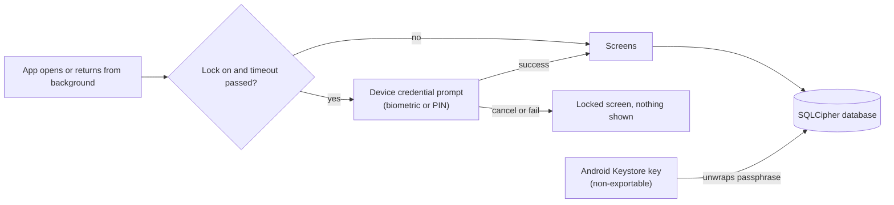

# 23. Database Encryption and App Lock

- **Date:** 2026-10-11
- **Status:** Accepted
- **Deciders:** Architecture Team, AI Coding Assistant

## Context

The Health Journal holds personal health and medication data. Two complementary protections address different threats:

1. **App lock (opt-in):** Stops a person who holds the unlocked phone from viewing the data. Uses the device's own credential (biometric + PIN/pattern/password fallback) via `BiometricPrompt`. No secret is stored by the app.

2. **Encrypted database at rest:** Stops anyone who obtains the database file without the phone's keys (extracted file, rooted/forensic read). Uses SQLCipher with a random 256-bit passphrase wrapped by a non-exportable Android Keystore key (hardware-backed when available). The key requires no user authentication, so biometric changes never invalidate the data.

Both protections were part of the original medication proposal but are split into their own change because they touch all existing data, add the first dependencies since ADR 0003, and have their own risks (a one-way migration of every existing user's database).

## Decision

### App Lock (Domain + App)

- **Port:** `AppLockPort` in `:domain` with states `Locked`, `Unlocked`, `Timeout`. The setting (enabled, timeout) is stored in existing `SharedPreferences`.
- **Authentication:** `BiometricPrompt` with `BIOMETRIC_STRONG | DEVICE_CREDENTIAL` (API 29+). On API 26–28 falls back to `createConfirmDeviceCredentialIntent`. If no screen lock is set, the setting is disabled with an explanation.
- **Overlay:** While locked, no health data is composed. The lock overlay is the only content.
- **Timeouts:** Immediately, 1 minute, 5 minutes (user choice). Background time tracked via `ProcessLifecycleOwner`.
- **Reminders integration:** Tapping a reminder notification requires unlock before opening Today. "Taken all" is allowed without unlock (writes only, shows nothing).
- **Secure screen:** Opt-in `FLAG_SECURE` hides content in app switcher and blocks screenshots.

### Database Encryption (Data)

- **SQLCipher:** Room opened through `net.zetetic:sqlcipher-android` `SupportOpenHelperFactory` (AES-256).
- **Key management:** A random 256-bit passphrase generated once, wrapped (AES-GCM) by a non-exportable Android Keystore key (`RSA/ECB/OAEPWithSHA-256AndMGF1Padding` for wrapping, or AES-GCM with a symmetric Keystore key). The wrapped value is stored in `noBackupFilesDir`. The Keystore key is created with `setUserAuthenticationRequired(false)` so it works without user auth and survives biometric changes.
- **Migration (one-time, independent of schema version):**
  1. Detect plain database on first run after update.
  2. Generate passphrase, create Keystore key, wrap passphrase, store wrapped key.
  3. Create encrypted database via `sqlcipher_export` from the plain database.
  4. Verify row counts per table match.
  5. Only on success: set the plain database and its `-wal`/`-shm`/`-journal` files aside (`.pre-encryption`), move the encrypted file in, then delete the set-aside files. A crash in between is recovered at the next start: the set-aside files are restored, or dropped when the encrypted file is already in place.
  6. On any failure: keep plain database, show a localized banner on every tab (dismissible per session, with a shortcut to the Profile tab) and the notice in Profile, retry on next start.
- **Schema version:** Unchanged (stays at 6). Encryption is a file-level change, not a schema change.

### Backup and Data Extraction

- `android:allowBackup="true"` remains (preferences keep current behaviour).
- `dataExtractionRules` and `fullBackupContent` exclude:
  - The encrypted database (`health_journal.db*`)
  - The wrapped key file
- Rationale: A restored encrypted file would be unreadable without the Keystore key (which does not move), turning a restore into silent data loss. CSV export is the way to move data.

### Dependencies (Exceptions to ADR 0003)

Both are recorded here as exceptions to ADR 0003 with the required checks:

1. **`net.zetetic:sqlcipher-android`** (BSD-3-Clause-like "Zetetic" licence)
   - No network code, native library (~4 MB per ABI, total ~12–16 MB), supports 16 KB page size (tested on API 35+). Version 4.19.1 since the dependabot bump; it needs compileSdk 36.
   - Fallback if review fails: field-level AES-GCM envelope on selected tables only (keeps Room plain, encrypts only sensitive columns via TypeConverters).

2. **`androidx.biometric`** (Apache-2.0)
   - Handles API 26–29 differences for `BiometricPrompt` and device credential fallback.
   - Part of AndroidX, small, no network code.
   - Fallback if review fails: framework `BiometricPrompt` on API 28+ and `createConfirmDeviceCredentialIntent` on API 26–27 directly.

### Privacy Notice

- States that data cannot be restored from backup or moved between devices.
- Names CSV export as the way to move data.
- English and Dutch.

## Threat Model & Honest Limits

| Threat | Mitigated By | Residual Risk |
|--------|--------------|---------------|
| Casual access to unlocked phone | App lock (opt-in) | None if enabled and timeout not passed |
| Database file copied/extracted | SQLCipher + Keystore-wrapped key | None without phone's Keystore |
| Rooted/forensic read of app data | SQLCipher + Keystore (hardware-backed when available) | Keystore key in TEE/StrongBox; extraction requires hardware compromise |
| Backup/restore to another device | Extraction rules exclude DB and key | Data not in backup; CSV export required |
| Factory reset / clear app data | — | Keystore key lost → data lost (mitigated by CSV export + notice) |
| Malware with user's access | — | Not protected (app runs unlocked) |
| Biometric/screen lock change | Keystore key has no auth binding | None — key remains usable |

**CodeQL alert `java/android/insecure-local-authentication`:** the scanner reports that the `BiometricPrompt` success callback in `BiometricAuthHelper` does not use a `CryptoObject`. This is the decision above, not an oversight: binding the key to the prompt would make the data unreadable after a fingerprint change. The alert was dismissed as "won't fix" with a link to this ADR.

**Not claimed:** Protection while app is unlocked and running, protection against malware with user's access, cloud key escrow, key export, own PIN/password or recovery flow.

## Consequences

### Positive
- Encrypted at rest by default for all users (new installs).
- Existing users migrated safely with verification.
- Opt-in app lock with system credential (no custom PIN to forget).
- No network code added; offline-first preserved.
- Dependencies reviewed for licence, size, 16 KB page size, no network code.

### Negative / Trade-offs
- Two new dependencies (exception to ADR 0003, documented here).
- SQLCipher adds ~12–16 MB to APK (native libs per ABI).
- One-way migration for existing users; failure keeps plain DB and retries.
- Keystore key lost on factory reset / clear data → data lost (CSV export is the recovery).
- Users without screen lock cannot enable app lock (setting disabled with explanation).

### Follow-up
- Monitor SQLCipher updates for security patches.
- Test migration on seeded databases (empty, large, interrupted).
- Real-device verification including biometric enrolment change, reboot, interrupted migration, restore on another device.

## Mermaid Diagram

