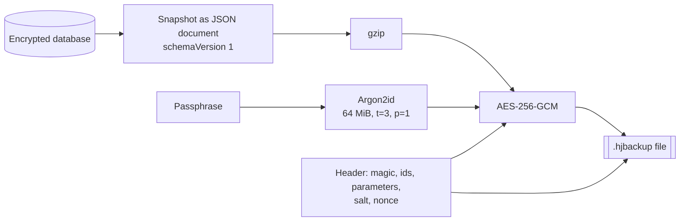

# 24. Portable Encrypted Backup

- **Date:** 2026-10-21
- **Status:** Accepted
- **Deciders:** Architecture Team, AI Coding Assistant

## Context

ADR 0023 encrypts the database with a key that is bound to the phone's Keystore. That is the right protection at rest, and it means three things: Android Auto Backup of the database is useless (it would restore a file nobody can open, so the data is excluded), a new phone starts empty, and a lost key ends in a recovery screen whose only action is to delete the data. CSV export exists, but it is plaintext, covers only measurements, and cannot rebuild the profile or the medication.

The requirements for a backup, from the owner of the project:

1. **Safe:** useless to anyone without a secret the user controls.
2. **Vendor-free:** no Google, no cloud account, no network (the app has no INTERNET permission, ADR 0021 and 0023).
3. **Platform-neutral:** the format is a documented specification, so an iPhone port or any other system can import it.
4. **Survives the project:** if the app is no longer maintained, the user must still be able to get their data out with only the file, the passphrase and public documentation.

## Decision

A backup is one file, `.hjbackup`, made of a small binary container around a JSON document. Created and restored by the user, through the system document picker.

### Format

Defined byte by byte in [docs/backup-format/README.md](../backup-format/README.md) and in the `data-backup` OpenSpec capability. In short:

- **Container:** 28-byte header (magic `HJBACKUP`, container version, KDF id, cipher id, compression id, Argon2 parameters), 16-byte salt, 12-byte nonce, ciphertext plus GCM tag. The header, salt and nonce are the GCM associated data.
- **Key:** Argon2id (RFC 9106) from the NFKC-normalised UTF-8 passphrase. Parameters are stored in the header, so they can be raised without a new container version.
- **Document:** JSON validated by [healthjournal-backup.schema.json](../backup-format/healthjournal-backup.schema.json). Its own `schemaVersion` is independent of the Room schema version. Additive changes keep the version, breaking changes raise it.
- **Conventions:** the CSV contract's: metric, ISO-8601 UTC, decimal point, unlocalised enumeration names; decimals as strings.

### Decisions

- **Document, not the database file.** The format must not depend on Room, SQLCipher or the device key.
- **Argon2id + AES-256-GCM.** Standard primitives with support in CryptoKit, JCA, libsodium, OpenSSL 3.2+ and Python `cryptography`. Rejected: PBKDF2 (no memory hardness), a key from the Keystore (does not survive the lost-key case, which is the point), a custom scheme.
- **User passphrase, no escrow.** The price is that a forgotten passphrase makes the file unreadable. That is stated at creation. The alternative, an unencrypted health file, is rejected.
- **Merge restore keyed by identifier.** Restoring twice is harmless; existing entries are never overwritten; one transaction.
- **Reachable from the lost-key screen.** Decrypt and validate first, delete the unreadable data only after that, so a wrong passphrase never destroys anything.
- **Manual first.** A scheduled backup needs the passphrase at run time, which means keeping a secret on the device. That is a separate decision.
- **CSV export stays**, as the plaintext spreadsheet export, with a warning that it is not encrypted.

### Argon2 implementation

The Android SDK has no Argon2, and writing one ourselves is not acceptable. The implementation is hidden behind a `:domain` port (`BackupKeyDerivationPort`), so the library can change without touching the format. Candidates:

| Candidate | Notes |
|-----------|-------|
| `argon2kt` (native build of the Argon2 reference implementation, MIT) | Smallest surface and fast. Adds a native library, like SQLCipher already does. Must ship 16 KB page-aligned `.so` files for current Android versions. Maintenance activity to be checked at implementation time. |
| Bouncy Castle `Argon2BytesGenerator` (pure Java, MIT-style) | No native code. Large artifact and known class-name clashes with Android's own stripped Bouncy Castle; needs R8 care. Slower. |
| Own implementation | Rejected (no home-made cryptography). |

**Decision: Bouncy Castle `org.bouncycastle:bcprov-jdk18on` 1.86, used only for `Argon2BytesGenerator`.** `argon2kt` was the preferred candidate but was not chosen: its last release is about two years old, 16 KB page alignment of its `.so` files could not be confirmed, and native code cannot be exercised by JVM unit tests, so the published test vectors could not be decoded in CI. Bouncy Castle is pure Java (no alignment risk), and `Argon2BytesGenerator` is not part of Android's own stripped provider, so there is no class clash for this class. The same library is used on the JVM, so the unit tests decode the published vectors. The price is a larger APK (release minification is off). This is an exception to [ADR 0003](0003-dependency-minimization.md), like SQLCipher in ADR 0023.

## Consequences

### Positive
- Safe at rest, tamper-evident, and independent of any vendor or network.
- Survives a lost key, a new phone and a factory reset.
- A second platform or a person without the app can read it from the published documents: specification, schema, test vectors, reference decoder, and a recovery guide.
- The Room schema can keep migrating; the backup format changes only on purpose.

### Negative / Trade-offs
- A forgotten passphrase cannot be recovered by anyone.
- One new dependency (Bouncy Castle, for Argon2id only) that makes the APK larger; pure Java, no native library.
- The backup is only as safe as its passphrase; Argon2id slows guessing but does not rescue a weak one.
- A restored file is plaintext inside the app's database again; where the backup file lives is the user's responsibility.
- Format changes need discipline: specification, schema, vectors and reference decoder change together (enforced by the shared test vectors).

## Related
- [ADR 0003](0003-dependency-minimization.md), [ADR 0021](0021-medication-compliance-and-privacy.md), [ADR 0023](0023-database-encryption-and-app-lock.md)
- [Backup format](../backup-format/README.md), [Recover your data](../backup-format/recover-your-data.md), [Developer guide: backup](../dev/backup.md)
