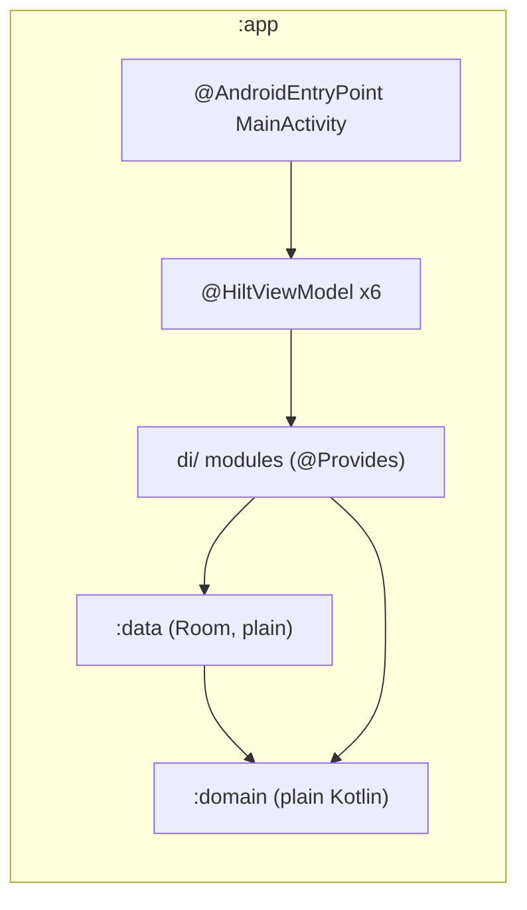

# 35. Hilt for Dependency Injection

- **Date:** 2026-11-02
- **Status:** Proposed
- **Deciders:** Architecture Team, AI Coding Assistant

## Context

Dependencies are wired by hand in `HealthJournalApp` and, for the ViewModels, in six `ViewModelProvider.Factory` classes built in `MainActivity`. That is simple and has no dependency ([ADR 0003](0003-dependency-minimization.md)), but each new use case touches two or three wiring sites and a wrong wire shows up at run time. Hilt is Google's recommended library for this. The size of the project does not require it: this is a decision to take when the wiring cost is felt, after the Activity no longer owns any ViewModel dependency (the lock state and the ViewModel lambdas moved to the Application).

## Decision

Use Hilt in `:app` only, with the compiler running through KSP. `:domain` and `:data` stay free of DI annotations and are bound with `@Provides` in a `di/` package. ViewModels use `@HiltViewModel`; receivers use an `@EntryPoint`. The hand-written factories are removed. If the measured build-time or size cost is out of proportion, the fallback is one `AppContainer` with a single generic ViewModel factory, which needs no dependency.

## Consequences

### Positive
- A missing or mistyped dependency fails the build.
- No factory boilerplate; a new use case is added in one module.
- A test can replace a binding.

### Negative / Trade-offs
- A new dependency, a Gradle plugin and KSP, so more build time and a slightly larger APK.
- Generated code and annotation errors are harder to read.
- The database is replaced under a live graph during a restore, so it must stay behind a holder.
