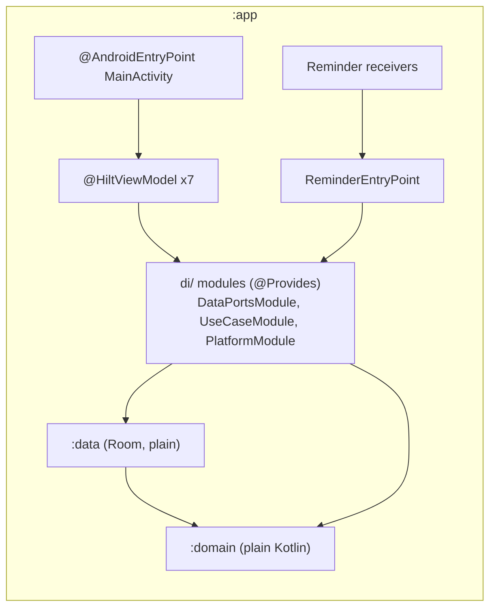

# 35. Hilt for Dependency Injection

- **Date:** 2026-11-02
- **Status:** Accepted
- **Deciders:** Architecture Team, AI Coding Assistant

## Context

Dependencies were wired by hand in `HealthJournalApp` and, for the ViewModels, in six `ViewModelProvider.Factory` classes built in `MainActivity`. That is simple and has no dependency ([ADR 0003](0003-dependency-minimization.md)), but each new use case touched two or three wiring sites and a wrong wire showed up at run time. Hilt is Google's recommended library for this. The size of the project does not require it: this is a decision to take when the wiring cost is felt, after the Activity no longer owns any ViewModel dependency (the lock state and the ViewModel lambdas moved to the Application).

## Decision

Use Hilt in `:app` only, with the compiler running through KSP. `:domain` and `:data` stay free of DI annotations and are bound with `@Provides` in a `di/` package. ViewModels use `@HiltViewModel`; receivers use an `@EntryPoint`. The hand-written factories are removed. If the measured build-time or size cost had been out of proportion, the fallback was one `AppContainer` with a single generic ViewModel factory, which needs no dependency. It was not needed (see Measured cost).

As built:

- `HealthJournalApp` is the `@HiltAndroidApp`; `MainActivity` is an `@AndroidEntryPoint` that gets each ViewModel with `by viewModels()` (no `hilt-navigation-compose`).
- Three modules in `app/di/`, all in the singleton component: `DataPortsModule` creates the one `DataModule` and exposes each port from it, `UseCaseModule` builds every use case from its ports, `PlatformModule` provides the preferences, `AppLockManager`, `AlarmReminderScheduler` and `ReminderCoordinator` as singletons.
- All six ViewModels and `RecoveryBackupViewModel` are `@HiltViewModel`. Each keeps its plain primary constructor for the JVM unit tests and adds a secondary `@Inject` one. The lost-key screen gets `RecoveryBackupViewModel`, a subclass of the open `BackupViewModel`, so the two never share an instance.
- `ReminderEntryPoint` (`@EntryPoint`) gives the three broadcast receivers the `ReminderCoordinator` through `EntryPointAccessors.fromApplication`; if the graph cannot be read they return without doing anything.
- The database stays behind the single `DataModule` singleton, so a restore never swaps it under a live graph.
- A guardrail test (`RepositoryGuardrailsTest.domainAndDataDoNotUseHiltDaggerOrJavaxInject`) fails the build if `:domain` or `:data` import Hilt, Dagger or `javax.inject`, or name them in their build files.
- Versions: Hilt 2.58, because 2.59 and later need AGP 9 and the build is on AGP 8.13.2; `kotlin-metadata-jvm` is forced to the Kotlin version because Hilt 2.58 bundles an older one. Dependabot groups Hilt on its own and ignores 2.59 and later until the AGP upgrade.

## Measured cost

Measured against the commit before the change, on the same machine and emulator:

| | Before | With Hilt | Difference |
|---|---|---|---|
| Clean `assembleDebug assembleRelease`, warm daemon | 1m 7s (153 tasks) | 1m 10s (177 tasks) | +3 s |
| Debug APK | 36,557,684 B | 36,640,922 B | +83,238 B (+0.23%) |
| Release APK (unsigned) | 31,860,534 B | 31,911,004 B | +50,470 B (+0.16%) |
| Cold start, median (`am start -W`, empty database, lock on) | 1140 ms | 1085 ms | no regression |

Preferences, `AppLockManager` and `ReminderCoordinator` are now created when the application starts instead of on first use; the cold start numbers include that.

## Consequences

### Positive
- A missing or mistyped dependency fails the build.
- No factory boilerplate; a new use case is one `@Provides` function in `UseCaseModule`.
- A test can replace a binding.

### Negative / Trade-offs
- A new dependency, a Gradle plugin and KSP, so more build time and a slightly larger APK (small, see above). This is an exception to [ADR 0003](0003-dependency-minimization.md) for `:app` only.
- Generated code and annotation errors are harder to read.
- Each ViewModel carries two constructors (one for tests, one for Hilt), and a secondary constructor that delegates to the primary one needs an upcast so it does not delegate to itself.
- The domain stays annotation-free, so every use case needs a hand-written `@Provides` function.
