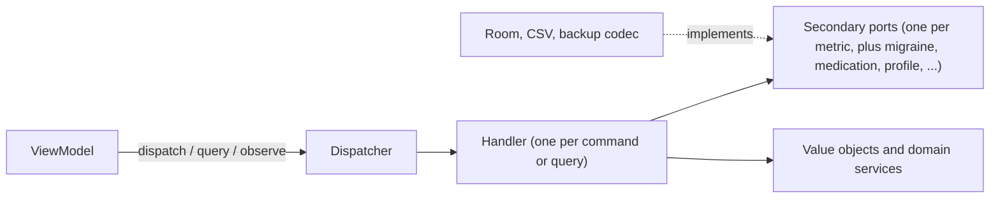

# 36. Application boundary: commands and queries

- **Date:** 2026-11-05
- **Status:** Accepted
- **Deciders:** Architecture Team, AI Coding Assistant

## Context

[ADR 0002](0002-hexagonal-architecture.md) put the business rules in `:domain` behind ports and named "Use Cases", but it never defined the *primary* side: what a ViewModel calls. Over time that left four problems:

- One port, `HealthLogRepositoryPort`, had 30 methods. Every fake in every test had to implement all of them.
- ViewModels injected secondary ports (profile, migraine, export, import) next to use case bundles (`EntryUseCases` with 14 members, `MedicationUseCases` with 8). Six ViewModels reached past the application layer.
- Each metric needed three use case classes (record, update, delete) that only forwarded to the port, plus one `@Provides` function each in `UseCaseModule`.
- Failures were exceptions caught with `catch (e: Exception)` in the ViewModels. That swallowed `CancellationException` once already (the 1.6.5 backup fix).

## Decision

The model is **hexagonal with a command and query application layer**. A ViewModel knows one thing, the `Dispatcher`.

1. **Requests are typed.** In `:domain/command` a `Command<R>` changes state, a `Query<R>` reads once and an `ObserveQuery<R>` streams. The result type `R` is part of the request class, so a call site cannot state a wrong one.
2. **One handler per request.** `CommandHandler`, `QueryHandler` and `ObserveQueryHandler` are plain Kotlin classes named `FooCommand` and `FooHandler`. Every handler returns `DomainResult<R>`, or a `Flow` of it for an observe query ([ADR 0037](0037-typed-domain-errors-and-single-source-for-rules.md)).
3. **The dispatcher is an interface.** `Dispatcher` has `dispatch`, `query` and `observe`. `DefaultDispatcher` in `:app/command` finds the handler by request class in a Hilt `@Multibinds` map with `@ClassKey`. `CommandModule` registers each handler with one `@Provides @IntoMap` function. `:domain` stays free of Hilt ([ADR 0035](0035-hilt-for-dependency-injection.md)).
4. **A missing handler fails a test, not a user.** `HandlerRegistryTest` enumerates every request class and checks that it is registered.
5. **Segregated ports.** There is one secondary port per metric, so a handler and its fake see only what they use. Several operations over many kinds go through one small `EntryGateway`, not seven constructor parameters.
6. **Use cases with real logic stay.** The pillbox day, adherence, history, re-arming reminders and the backup use cases are not CRUD. They stay as classes and a handler wraps them where a ViewModel needs them.
7. **Platform entry points are adapters.** Alarm receivers, the app lock and the reminder coordinator are driving or driven adapters themselves and keep their narrow ports.
8. **Main-safety.** The dispatcher does not switch threads and handlers do not call `withContext`. Room already dispatches its suspend functions and flows off the main thread. Work that is heavy for another reason (key derivation for a backup) is moved off the main thread by the caller that knows it is heavy. Nobody adds `withContext` per handler.
9. **Cancellation.** The dispatcher and `domainCatching` rethrow `CancellationException`. It is never turned into a `Storage` error.

`ArchitectureGuardrailsTest` keeps this in place: no ViewModel imports a secondary port, uses a `*UseCases` bundle or catches `Exception` around a dispatch, and every handler returns a `DomainResult`.

### Alternatives considered

| Option | Why not |
|---|---|
| Grouped application services (`EntryService`, `ExchangeService`, `PillboxService`) injected directly | Smaller and easier to read, but the groups grow with every metric and repeat the old bundles. It was the fallback if the dispatcher spike failed; it did not (see below). |
| Per-use-case classes with a presenter and response model (full Clean Architecture) | The ViewModel already maps a typed result to state, so a presenter layer is more code with no new boundary. Only the *use case* idea is borrowed. |
| A generic `EntryStore<E>` base port | The entries differ in shape (`ActivitySession` against `*Entry`) and named ports read better. The six ports share method shapes, so a base stays possible. |
| Domain events | There is no procedural chaining to fix: re-arming reminders is driven from `ReminderCoordinator` in `:app`. |

## Consequences

### Positive
- A new metric is one port, one command set and one handler per kind, not a fat port plus a use case trio plus providers.
- ViewModels are tested with real handlers over in-memory fakes, or with a fake `Dispatcher`. The nullable test-only constructor parameters are gone.
- The spike compiled under KSP and Hilt. Each handler costs two lines of wiring, there are three unchecked casts in `DefaultDispatcher` (one each in `dispatch`, `query` and `observe`, covered by tests) and no reflection, so no R8 keep rules are expected.

### Negative
- "Find usages" on a use case no longer lands in a ViewModel. The naming rule (`FooCommand` and `FooHandler`) and `HandlerRegistryTest` make up for it.
- A registration is one more line to write. A forgotten one fails the unit tests.
- There are more small classes than before, though fewer per metric than the old trio.
