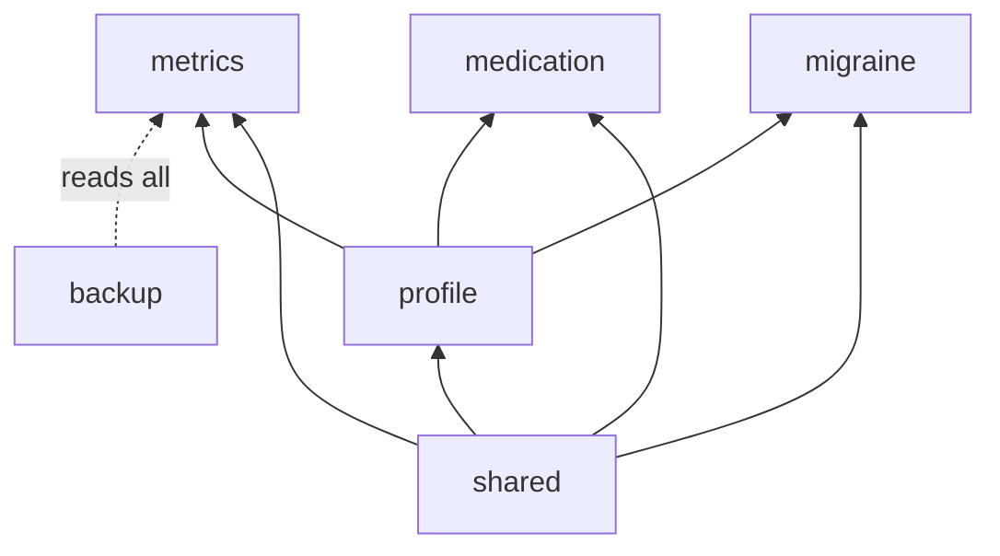

# 38. Bounded contexts and tactical roles

- **Date:** 2026-11-05
- **Status:** Accepted
- **Deciders:** Architecture Team, AI Coding Assistant

## Context

The domain was already split into folders by subject (`profile`, `metrics`, `medication`, `migraine`, `mindfulness`, `backup`, `lock`, `nhg`, `common`), but nothing said which folder may use which. An import scan of `model/` found four couplings: `EntryComment` lived in `metrics` yet `medication` and `migraine` used it; `Profile` used `metrics.HeightCm` and `WeightKg`; `metrics` entries held `nhg` categories while `nhg` read `metrics` readings (a cycle); and `Profile.classifyWaistCircumference` reached into `metrics`.

## Decision

### Context map

| Context | Holds | May import |
|---|---|---|
| `shared` (`shared/model`) | ids, units, `EntryComment`, `HeightCm`, `WeightKg` | nothing |
| `profile` | `Profile`, `Sex` | `shared` |
| `metrics` (with `nhg`) | readings, entries, range classifiers | `shared`, `profile` |
| `medication` | `Medication`, `Pillbox`, adherence | `shared`, `profile` |
| `migraine` | `MigraineEntry`, tags | `shared`, `profile` |
| `backup` | backup document, codec port | every context |
| `mindfulness`, `lock` | their own models | nothing |

- `nhg` is part of `metrics`: the NHG classifiers are metric domain services.
- `profile` and `metrics` stay separate, with one direction only (`profile` upstream). Body measures used by both live in the shared kernel. Waist classification takes the sex as an argument and lives in `metrics`.
- `metrics`, `medication` and `migraine` do not import each other.
- `ArchitectureGuardrailsTest` scans `model/` imports against this map and names the file and the forbidden edge. `knownCouplings` is empty, so any new edge fails.

### Tactical roles

| Role | In this code | Rule |
|---|---|---|
| Entity | entries with an id (`WeightEntry`, `MigraineEntry`), `Profile` | identity by id; `MigraineEntry.endedAt(at)` holds the end-of-episode rule |
| Value object | `WeightKg`, `BloodPressureReading`, `EntryComment` | immutable, validated by the constructor, `of(...)` returns `DomainResult` ([ADR 0037](0037-typed-domain-errors-and-single-source-for-rules.md)) |
| Aggregate root | `Medication` (with its schedule) | only roots with invariants over time; plain metrics stay plain records on purpose |
| Domain service | NHG classifiers, `Pillbox`, adherence, statistics | pure functions, no ports |
| Application service | command and query handlers ([ADR 0036](0036-application-boundary-commands-and-queries.md)) | uses ports, a `Clock` and transactions; no UI types |

### Where new code goes

New code lives in its context: `domain/<context>/{model,usecase,port,command}` (for example `metrics/command/WeightCommands.kt`, `metrics/port/WeightRepositoryPort.kt`). The framework types (`Dispatcher`, `DomainResult`, `DomainError`, `Rules`) and the delete and CSV commands are in `shared/command`. The move into this layout was made by the change `move-code-into-context-packages`, with no behaviour change.

### Language

The glossary in `docs/dev` fixes the words: slot, intake, pillbox, range label (never a verdict) and episode.

## Consequences

### Positive
- A reader knows where a new class goes and what it may import. A forbidden import fails a test.
- The cycle between `metrics` and `nhg` is gone.
- The `Medication` aggregate and `Pillbox` are untouched.

### Negative
- There is no Gradle module per context. The boundary is enforced by a test, not the compiler.
- No domain events: contexts do not react to each other.
