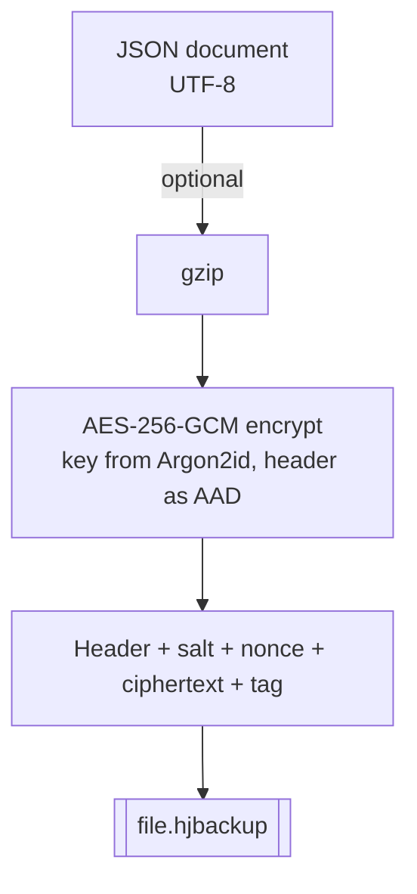
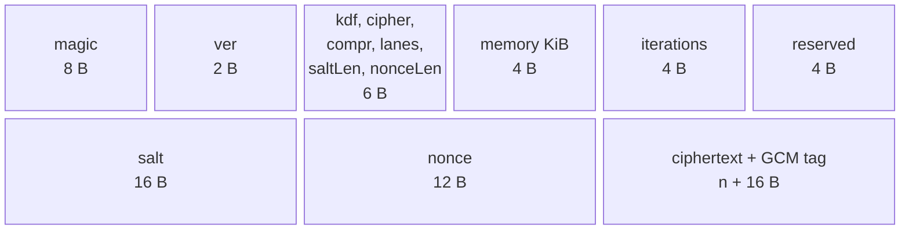
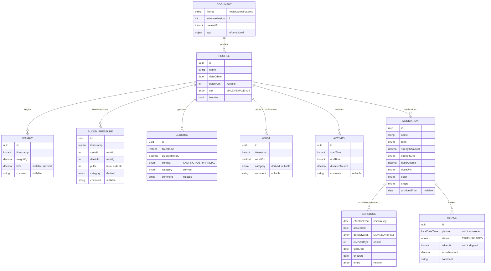

# Health Journal backup format (`.hjbackup`), version 1

This page is the complete, byte-level specification of the backup file that Health Journal creates. It is written so that someone who has never seen the app can read a backup, and so that another platform (for example an iPhone app) can write and read the same files. Nothing here depends on Android, Room or SQLCipher.

| File | What it is |
|------|------------|
| this page | The container and the rules for the document |
| [healthjournal-backup.schema.json](healthjournal-backup.schema.json) | JSON Schema (draft 2020-12) of the document inside the file |
| [hjbackup.py](hjbackup.py) | Reference decoder and encoder (Python, one file) |
| [test-vectors/](test-vectors/README.md) | Known files with passphrase and expected content, to check an implementation |
| [recover-your-data.md](recover-your-data.md) | Step-by-step: get your data out without the app |

The rules are normative in the OpenSpec capability `data-backup`; the decision record is [ADR 0024](../adr/0024-portable-encrypted-backup.md).

## 1. Overview



To read a file: parse the header, derive the key from the passphrase, decrypt (this also checks the passphrase and that nothing was changed), gunzip if the header says so, parse the JSON.

## 2. Container

All integers are **big-endian**. Offsets are in bytes from the start of the file.

| Offset | Size | Field | Value |
|-------:|-----:|-------|-------|
| 0 | 8 | magic | ASCII `HJBACKUP` (`48 4A 42 41 43 4B 55 50`) |
| 8 | 2 | container version | `1` |
| 10 | 1 | KDF id | `1` = Argon2id, version 1.3 (0x13) |
| 11 | 1 | cipher id | `1` = AES-256-GCM |
| 12 | 1 | compression id | `0` = none, `1` = gzip |
| 13 | 1 | Argon2 parallelism (lanes) | `1` for files written by the app |
| 14 | 1 | salt length | `16` |
| 15 | 1 | nonce length | `12` |
| 16 | 4 | Argon2 memory in KiB | `65536` (64 MiB) for new files |
| 20 | 4 | Argon2 iterations | `3` for new files |
| 24 | 4 | reserved | zero |
| 28 | 16 | salt | random, new per file |
| 44 | 12 | nonce | random, new per file |
| 56 | n + 16 | ciphertext, then the 16-byte GCM tag | |

- The **header** is bytes 0 to 55 (fixed part, salt and nonce). It is passed unchanged as the **associated data** of AES-GCM, so any change to it makes decryption fail.
- A reader MUST read the Argon2 parameters from the header, never assume the defaults.
- A reader MUST refuse, before deriving a key, a file with: wrong magic, an unknown container version, KDF id, cipher id or compression id, non-zero reserved bytes, a salt length other than 16 or a nonce length other than 12, memory above 1 GiB (1048576 KiB), memory below 8 times the lanes, iterations outside 1 to 100, or lanes outside 1 to 16. This stops a hostile file from using all memory of the device.
- The file extension is `.hjbackup`. There is no registered media type; use `application/octet-stream`.



## 3. Key and encryption

```text
secret     = UTF-8( NFKC( passphrase ) )
key        = Argon2id( secret, salt, iterations = t, memory = m KiB, lanes = p, tag length = 32 )
             (version 0x13, no secret value, no associated data, as in RFC 9106)
plaintext  = AES-256-GCM-Decrypt( key, nonce, ciphertext || tag, aad = header )
document   = UTF-8 text of gunzip( plaintext )     if compression id = 1
           = UTF-8 text of plaintext               if compression id = 0
```

- **NFKC** is Unicode normalisation form KC. It makes the same visible passphrase produce the same key whether a keyboard typed "é" as one character or as "e" plus an accent.
- **Wrong passphrase and damaged file look the same**: the GCM tag does not verify. That is by design.
- A writer generates a fresh random salt and nonce for every file (never reuse a nonce with the same key; with a random salt per file the key differs anyway).
- New files use Argon2id with 65536 KiB, 3 iterations and 1 lane. These can be raised later; old files stay readable because the parameters are in the header.

Where to find the primitives: Python `cryptography` 44 or newer (`Argon2id`, `AESGCM`), OpenSSL 3.2 or newer (`argon2id` KDF), libsodium (`crypto_pwhash` with `ALG_ARGON2ID13`, `crypto_aead_aes256gcm`), Apple CryptoKit (`AES.GCM`) with an Argon2 package, Java (`javax.crypto` AES/GCM/NoPadding) with an Argon2 library. Check any implementation against the [test vectors](test-vectors/README.md).

## 4. The document

The decrypted text is one JSON object. [healthjournal-backup.schema.json](healthjournal-backup.schema.json) is the formal definition; this section explains it.



### Conventions

| Topic | Rule |
|-------|------|
| Units | Always metric canonical: kg, cm, m, mmol/L, mmHg, bpm. No display units, no locale. |
| Instants | ISO-8601 UTC with a trailing `Z`, e.g. `2026-10-21T09:30:00Z`. Fractional seconds only when non-zero. |
| Local dates | `YYYY-MM-DD`. Planned dose times are `YYYY-MM-DDTHH:mm` on the user's wall clock, with no zone, because "08:00" means 08:00 wherever the user is. Daily times are `HH:mm`. |
| Decimals | Strings in plain decimal form with a point (`"82.4"`, `"2.5"`), never an exponent. Strings avoid binary floating-point rounding. |
| Integers | JSON numbers (systolic, diastolic, pulse, height, interval). |
| Enumerations | Upper-case names, never translated, e.g. `NORMAL`, `HIGH`, `SERIOUSLY_RAISED`. Allowed values are in the schema. |
| Identifiers | Opaque strings (UUIDs), unique within their list. An importer keeps them so that importing the same file twice adds nothing. |
| Derived fields | `bmi` and every `category` are values that were derived when the entry was saved. A reader MAY recompute them from the raw values and its own rules. The raw values are the truth. |
| Nulls | A missing optional value is `null` or absent; both mean "not set". |
| Order | Lists are written oldest first. Readers MUST NOT depend on order. |
| Not included | Language, region, units, theme, lock and secure-screen settings. They belong to the device, not to the journal. |

### Medication

A medication has **schedule versions**: each entry in `schedules` is the schedule that applies from `effectiveFrom` until the next version. A schedule is either as needed (`asNeeded` true, no times), or has daily `times` and a pattern: `daysOfWeek` (a list of `MON`..`SUN`) **or** `intervalDays` with a `startDate`; `endDate` may end it. An intake is the recorded outcome of one planned dose (`planned` set, unique per medication) or of an as-needed dose (`planned` null); `status` is `TAKEN` (with `takenAt`) or `SKIPPED`. Doses that are planned but have no outcome are not stored; they are derived from the schedule.

## 5. Versioning and compatibility

There are two independent version numbers.

| Version | Where | Changes when |
|---------|-------|--------------|
| container version | header, offset 8 | the byte layout or the meaning of an id changes (rare). A reader that sees a higher number refuses the file. |
| `schemaVersion` | document | a property is removed, renamed or reinterpreted. Adding a property does not change it. |

Rules for readers: ignore properties you do not know; refuse a `schemaVersion` you cannot interpret and say that a newer version is needed; never guess. Rules for writers: when the format changes, update this page, the schema, the test vectors and `hjbackup.py` in the same commit. The Room database version of the Android app is unrelated to both numbers.

## 6. Building a reader or writer on another platform

1. Implement the container (section 2) and key derivation (section 3).
2. Decode every file in [test-vectors/](test-vectors/README.md) and compare with `sample.json`. Do the reverse too: your writer's output must decode with [hjbackup.py](hjbackup.py).
3. Map the document (section 4) to your own storage. Keep the identifiers.
4. Merge on import: add what is missing, keep what exists (matching on `id`; schedule versions on `effectiveFrom`; intakes on `planned` per medication), in one transaction. Importing the same file twice must add nothing.
5. Validate with the schema before importing, and treat comments and names as untrusted text.

## 7. Security notes

- The passphrase is the only secret. Argon2id makes each guess cost 64 MiB of memory and some time, which slows an attacker down; it does not make a short or common passphrase safe. Use a long passphrase or a passphrase manager.
- There is no recovery: nobody, including the project, can open a backup without its passphrase.
- The file is not hidden: its size reveals roughly how much data it holds. Keep it where you would keep any private document.
- The reference decoder derives the key with 64 MiB of memory and writes the decrypted data to disk when you ask it to. Delete those copies when done.
