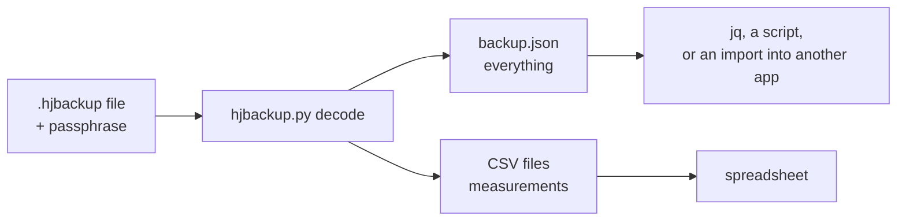

# Recover your data without the app

You have a Health Journal backup file (`something.hjbackup`) and you remember its passphrase, but the app is gone: it is not maintained any more, it no longer installs on your phone, or you moved to another system. This guide gets your data out as JSON and CSV files that any spreadsheet can open. You need no account and no network service, only the file, the passphrase and a computer.

> **No passphrase, no data.** The backup is encrypted so that nobody, including the author of the app, can open it without the passphrase. If it is lost, the file cannot be recovered.

The technical details of the format are in [README.md](README.md); this page is the practical route.



## Option 1: the reference script (recommended)

1. **Install Python 3.9 or newer** from [python.org](https://www.python.org/downloads/) (Windows, macOS) or your package manager (Linux).
2. **Install the one library the script needs.** It must be version 44 or newer, because that is the first one with Argon2id:

   ```bash
   python -m pip install "cryptography>=44"
   ```

3. **Get the script.** It is the file `hjbackup.py` next to this page in the repository ([docs/backup-format/hjbackup.py](hjbackup.py)). Download that one file (or clone the repository, or use a release archive). If the repository is gone too, use the short script in option 2.
4. **Decode your backup.** Put `hjbackup.py` and your file in one folder and run:

   ```bash
   python hjbackup.py decode my-backup.hjbackup --out backup.json --csv csv-files
   ```

   You are asked for the passphrase (it is not shown while you type). The first run takes a second or two, because the key derivation is slow on purpose. Instead of typing it you can set the environment variable `HJ_BACKUP_PASSPHRASE`, but then the passphrase is visible in your shell history.
5. **Open the result.**
   - `backup.json` holds everything: all profiles, measurements, comments, medication with its schedule history and intake log. Its structure is explained in [README.md](README.md#4-the-document) and defined by [the schema](healthjournal-backup.schema.json).
   - `csv-files/` holds one CSV per profile and metric (weight, blood pressure, glucose, waist, activity), oldest first, with the same columns as the app's own CSV export. Open them in any spreadsheet program (choose UTF-8 and the comma as separator). Medication is only in the JSON file.
6. **Clean up.** These files are not encrypted. Move them somewhere safe or delete them when you are done.

### If you get an error

| Message | Meaning |
|---------|---------|
| `Wrong passphrase, or the file is damaged.` | The passphrase does not match, or the file changed (a truncated download counts). Check capitals, keyboard layout and spaces. Copy the file again from where it came from. |
| `Not a Health Journal backup (wrong magic bytes).` | The file is not a `.hjbackup` file, or it was converted (for example by an email program or an editor). |
| `Unsupported container version` | The file was made by a newer format than the script knows. Look for a newer version of this page and script. |
| `Key derivation parameters are out of range.` | The header asks for something unreasonable. Do not use a file you do not trust. |
| `ImportError` for `Argon2id` | The `cryptography` package is older than version 44. Upgrade it (step 2). |

## Option 2: a minimal script, if even `hjbackup.py` is gone

This is the whole decoder in about twenty lines. Save it as `decode.py` and run `python decode.py my-backup.hjbackup`. It asks for the passphrase and writes the JSON to `backup.json` (as raw UTF-8 bytes, so accents and symbols survive on Windows).

```python
import getpass, gzip, struct, sys, unicodedata
from cryptography.hazmat.primitives.ciphers.aead import AESGCM
from cryptography.hazmat.primitives.kdf.argon2 import Argon2id

data = open(sys.argv[1], "rb").read()
(magic, version, kdf, cipher, comp, lanes, salt_len, nonce_len, memory_kib, iterations, _reserved) = \
    struct.unpack(">8sHBBBBBBII4s", data[:28])
assert magic == b"HJBACKUP" and version == 1 and kdf == 1 and cipher == 1
salt = data[28:28 + salt_len]
nonce = data[28 + salt_len:28 + salt_len + nonce_len]
header_end = 28 + salt_len + nonce_len
secret = unicodedata.normalize("NFKC", getpass.getpass("Passphrase: ")).encode("utf-8")
key = Argon2id(salt=salt, length=32, iterations=iterations, lanes=lanes, memory_cost=memory_kib).derive(secret)
plain = AESGCM(key).decrypt(nonce, data[header_end:], data[:header_end])  # raises InvalidTag if wrong
open("backup.json", "wb").write(gzip.decompress(plain) if comp == 1 else plain)  # UTF-8 JSON
```

What it does, step by step, so you can redo it in any language:

1. The first 28 bytes are the header (big-endian numbers): magic, version, algorithm ids, Argon2 settings.
2. The next 16 bytes are the salt and the next 12 the nonce.
3. The key is Argon2id of your passphrase (Unicode-normalised with NFKC, as UTF-8), with that salt and those settings, 32 bytes long.
4. The rest of the file is AES-256-GCM ciphertext followed by a 16-byte tag. The first 56 bytes of the file (the header) are the associated data.
5. If the header says compression 1, the decrypted bytes are gzip; unpack them. The result is UTF-8 JSON.

## Option 3: another language or tool

Any language with Argon2id and AES-256-GCM can do the same five steps: for example Node.js (`crypto` plus an Argon2 package), Go (`golang.org/x/crypto/argon2` and `crypto/cipher`), Rust (`argon2` and `aes-gcm` crates), Swift (CryptoKit plus an Argon2 package), or libsodium. Verify your result against the files in [test-vectors](test-vectors/README.md) before you trust it with your own file.

## What to do with the data

- **Spreadsheet:** the CSV files.
- **Another health app or your own program:** the JSON; its fields and units are described in [README.md](README.md#4-the-document). Values are metric (kg, cm, mmol/L, mmHg). Classification fields (`category`) are labels the app derived when the entry was saved; you can ignore or recompute them.
- **A new Health Journal compatible app:** any app that implements this format imports the file directly ([README.md, section 6](README.md#6-building-a-reader-or-writer-on-another-platform)).
- **Plain Health Journal CSV import:** the generated CSV files use the same columns as the app's CSV export, so a version of the app that still runs can import them.

## Checking that the script works

The folder [test-vectors](test-vectors/README.md) holds example backups. Decode `sample-default.hjbackup` with the passphrase `correct horse battery staple`. If you get the sample journal, your setup works, and a failure with your own file is about the file or the passphrase.
