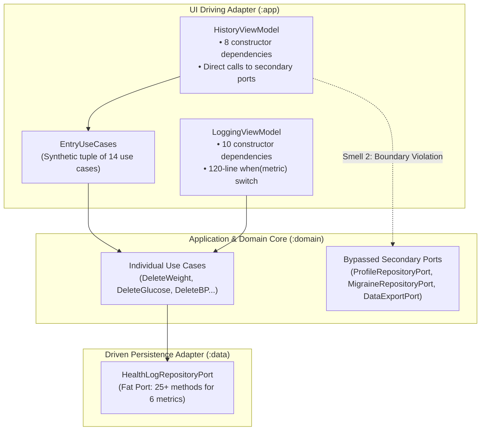
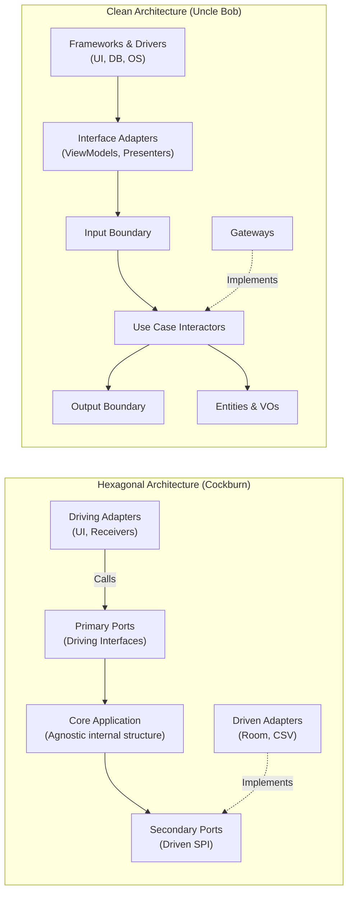
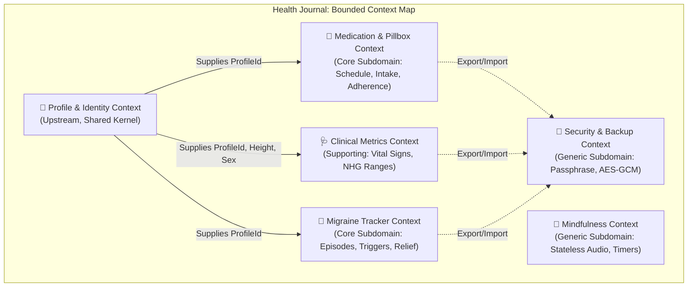
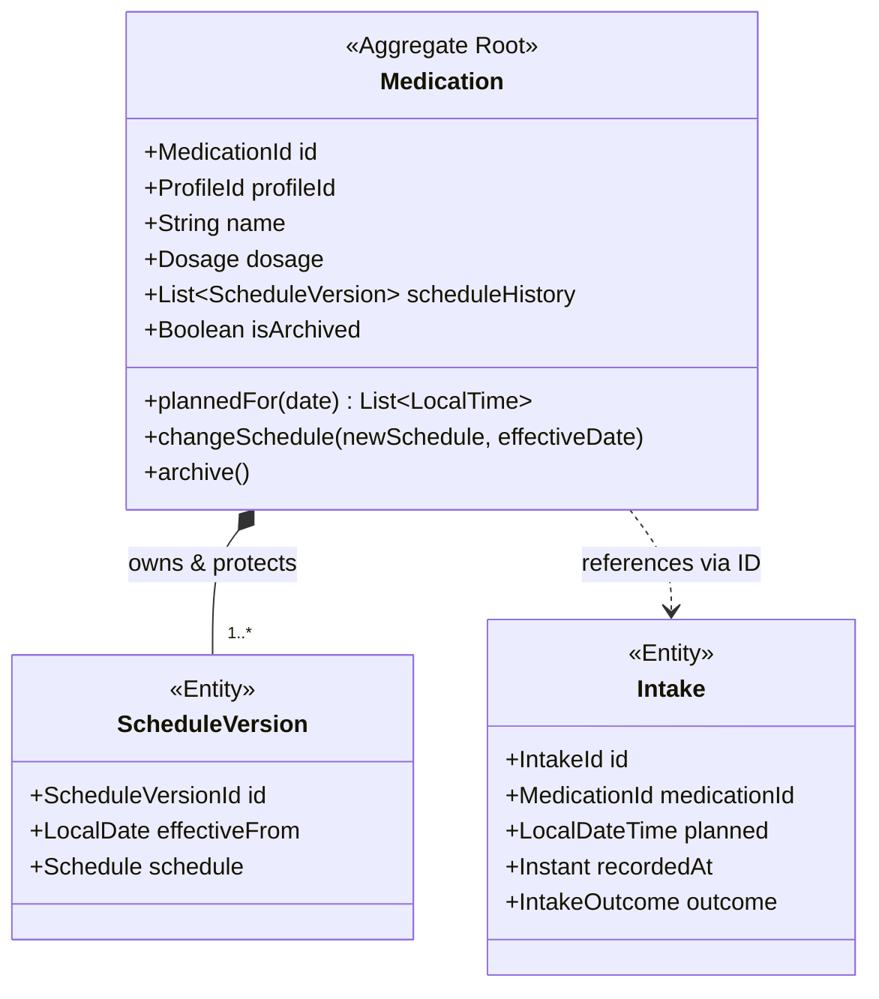
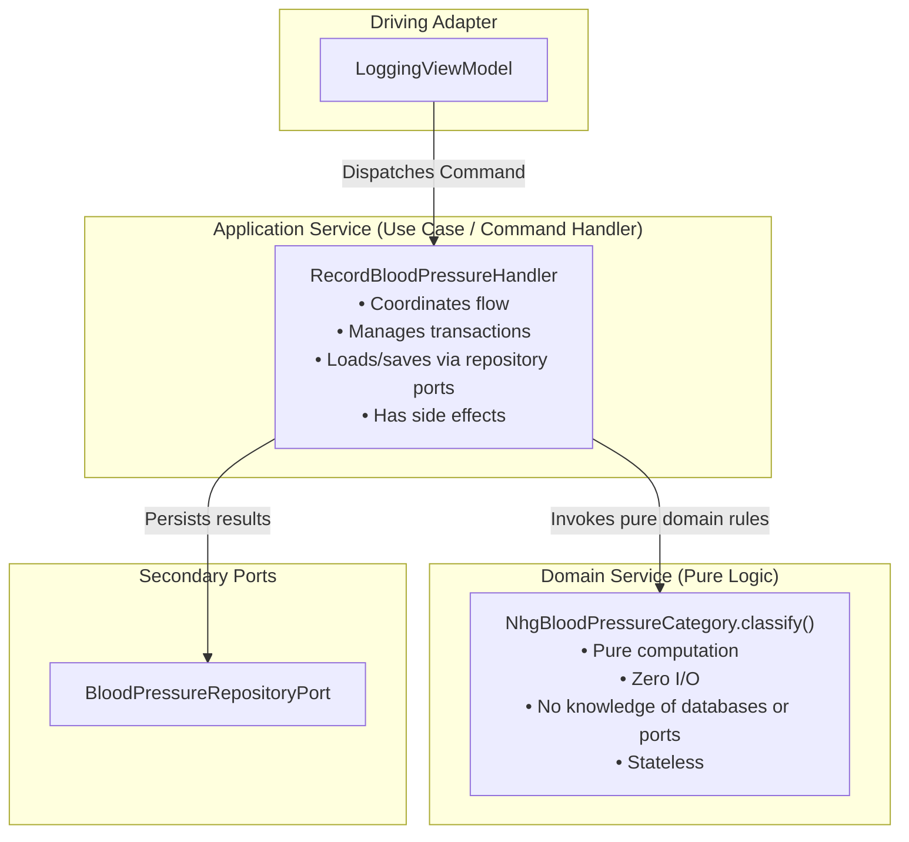
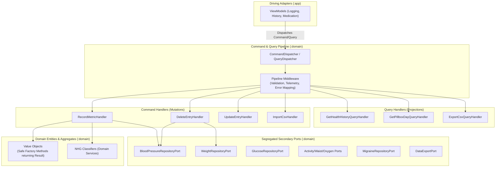

# Architectural Review & Modernization Blueprint

**Document Owner:** Principal Software Architect & Principal Engineer  
**Target System:** `Health Journal` (Android, Kotlin, Jetpack Compose, Room, Multi-Module Gradle)  
**Date:** November 2026  
**Document Locations:**
- Project Repository: [`docs/dev/architecture-review-and-recommendations.md`](file:///home/scrape/development/code/health_journal/docs/dev/architecture-review-and-recommendations.md)
- Agent Artifact Directory: `/home/scrape/.gemini/antigravity-cli/brain/6400ddce-f214-4d46-8127-cce5fb45a1ea/architecture_review_and_recommendations.md`

---

## 1. Executive Summary & Architectural Scorecard

The `Health Journal` codebase demonstrates commendable technical discipline:
- Strong physical module isolation via Gradle (`:domain`, `:data`, `:app`).
- Zero framework pollution in the pure Kotlin JVM core (`:domain`).
- Automated architectural enforcement ([`RepositoryGuardrailsTest.kt`](file:///home/scrape/development/code/health_journal/app/src/test/java/nl/healthjournal/app/RepositoryGuardrailsTest.kt#L99-L112)).
- Rich, side-effect-free domain derivation for medication and adherence calculation ([`Pillbox.kt`](file:///home/scrape/development/code/health_journal/domain/src/main/kotlin/nl/healthjournal/domain/model/medication/Pillbox.kt)).

However, as features have grown across six distinct health metrics, medication, migraines, and mindfulness, the system has developed serious structural friction:
1. **Use Case Explosion**: Fine-grained, single-method classes have proliferated, forcing ViewModels to invent synthetic parameter bundles (e.g., `EntryUseCases` containing 14 use cases).
2. **Layer Boundary Erosion**: UI ViewModels bypass the application layer to call secondary driven ports (`ProfileRepositoryPort`, `MigraineRepositoryPort`, `DataExportPort`) directly.
3. **Fat Ports (ISP Violation)**: `HealthLogRepositoryPort` has become an omnibus 25+ method interface coupling unrelated metric aggregates together.
4. **Domain Invariant Leakage**: ViewModels pre-validate business rules, while domain models throw unchecked `IllegalArgumentException`s that are swallowed by generic UI catch blocks.

### Architectural Health Scorecard

| Quality Attribute | Current Rating | Target State | Notes / Root Cause |
| :--- | :---: | :---: | :--- |
| **Physical Modularity** | **A+** | **A+** | Clear Gradle boundaries (`:domain` has zero dependencies). |
| **Domain Purity** | **A** | **A+** | Pure Kotlin models, but validation relies on throwing `IllegalArgumentException`. |
| **Interface Segregation (ISP)** | **D** | **A** | `HealthLogRepositoryPort` bundles 6 distinct aggregates into 1 monolithic port. |
| **Layer Encapsulation** | **C** | **A** | ViewModels directly invoke secondary repository and export ports. |
| **Application Layer Granularity** | **D** | **A** | 30+ single-method use cases; synthetic grouping tuples in UI layer. |
| **Domain Model Expressiveness (DDD)** | **B** | **A** | Strong Value Objects & Medication aggregate, but metrics are anemic CRUD records. |
| **Error Handling Consistency** | **C-** | **A** | Untyped exceptions thrown in domain, caught with `catch (e: Exception)` in UI. |

---

## 2. In-Depth Root-Cause Analysis of Architectural Smells



### Smell 1: Use Case Explosion & Synthetic Parameter Bundling

#### Location
[`HistoryViewModel.kt#L66-L82`](file:///home/scrape/development/code/health_journal/app/src/main/java/nl/healthjournal/app/ui/history/HistoryViewModel.kt#L66-L82) and [`UseCaseModule.kt#L46-L65`](file:///home/scrape/development/code/health_journal/app/src/main/java/nl/healthjournal/app/di/UseCaseModule.kt#L46-L65).

#### Symptom
To avoid an unmanageable constructor signature in `HistoryViewModel`, the developers created synthetic parameter carrier classes:

```kotlin
// In HistoryViewModel.kt
data class EntryUseCases(
    val updateWeight: UpdateWeightUseCase,
    val updateBloodPressure: UpdateBloodPressureUseCase,
    val updateGlucose: UpdateGlucoseUseCase,
    val updateActivity: UpdateActivityUseCase,
    val updateWaistCircumference: UpdateWaistCircumferenceUseCase,
    val updateOxygenSaturation: UpdateOxygenSaturationUseCase,
    val deleteWeight: DeleteWeightUseCase,
    val deleteBloodPressure: DeleteBloodPressureUseCase,
    val deleteGlucose: DeleteGlucoseUseCase,
    val deleteActivity: DeleteActivityUseCase,
    val deleteWaistCircumference: DeleteWaistCircumferenceUseCase,
    val deleteOxygenSaturation: DeleteOxygenSaturationUseCase,
    val deleteMigraine: DeleteMigraineUseCase,
    val endMigraine: EndMigraineUseCase
)
```

Similarly, [`MedicationViewModel.kt`](file:///home/scrape/development/code/health_journal/app/src/main/java/nl/healthjournal/app/ui/medication/MedicationViewModel.kt) relies on `MedicationUseCases` containing 8 separate use cases.

#### Architectural Impact
Creating individual single-action classes (`DeleteWeightUseCase`, `DeleteBloodPressureUseCase`, `DeleteGlucoseUseCase`, etc.) when all they do is invoke `repository.delete*(id)` is procedural decomposition disguised as object orientation. The ViewModel is still coupled to 14 separate classes, and every new metric demands creating two new use case files, registering them in Hilt, and updating the wrapper tuple.

---

### Smell 2: Layer Boundary Leakage (Secondary Ports in Driving Adapters)

#### Location
[`HistoryViewModel.kt#L125-L135`](file:///home/scrape/development/code/health_journal/app/src/main/java/nl/healthjournal/app/ui/history/HistoryViewModel.kt#L125-L135).

#### Symptom
`HistoryViewModel` directly injects and invokes secondary (driven) SPI ports alongside its use cases:
- `ProfileRepositoryPort`
- `MigraineRepositoryPort`
- `DataExportPort`
- `DataImportPort`
- `MigraineExportPort`
- `MigraineImportPort`

#### Architectural Impact
In both Hexagonal and Clean Architecture, **driving adapters (UI ViewModels) must only interact with Application Use Cases (Primary Ports)**. They must never directly invoke *secondary ports*. Direct invocation bypasses domain invariant enforcement, scatters coordination logic across ViewModels, and makes mocking during UI unit testing arduous.

---

### Smell 3: The "Fat Port" Anti-Pattern (ISP Violation)

#### Location
[`HealthLogRepositoryPort.kt#L13-L67`](file:///home/scrape/development/code/health_journal/domain/src/main/kotlin/nl/healthjournal/domain/port/secondary/HealthLogRepositoryPort.kt#L13-L67).

#### Symptom
While `Migraine` and `Medication` were given dedicated ports ([`MigraineRepositoryPort`](file:///home/scrape/development/code/health_journal/domain/src/main/kotlin/nl/healthjournal/domain/port/secondary/MigraineRepositoryPort.kt) and [`MedicationRepositoryPort`](file:///home/scrape/development/code/health_journal/domain/src/main/kotlin/nl/healthjournal/domain/port/secondary/MedicationRepositoryPort.kt)), all standard health metrics were lumped into a single 67-line port containing 25+ CRUD and observer methods:

```kotlin
interface HealthLogRepositoryPort {
    // Weight (save, get, observe, update, delete)
    // Blood Pressure (save, get, observe, update, delete)
    // Glucose (save, get, observe, update, delete)
    // Activity (save, get, observe, update, delete)
    // Waist Circumference (save, get, observe, update, delete)
    // Oxygen Saturation (save, get, observe, update, delete)
}
```

#### Architectural Impact
This violates the **Interface Segregation Principle (ISP)**. Classes that only care about blood pressure (such as `RecordBloodPressureUseCase`) depend on an interface that changes whenever oxygen saturation or activity tracking requirements change. Testing any use case requires mocking a 25-method interface.

---

### Smell 4: Invariant Duplication & Untyped Exception Handling

#### Location
[`LoggingViewModel.kt#L451-L572`](file:///home/scrape/development/code/health_journal/app/src/main/java/nl/healthjournal/app/ui/logging/LoggingViewModel.kt#L451-L572) and [`BloodPressureReading.kt#L8-L23`](file:///home/scrape/development/code/health_journal/domain/src/main/kotlin/nl/healthjournal/domain/model/metrics/BloodPressureReading.kt#L8-L23).

#### Symptom
1. In `LoggingViewModel.kt`:
   ```kotlin
   val cm = _uiState.value.waistInput.toDoubleOrNull()
       ?.takeIf { it in WaistCircumferenceCm.MIN_CM..WaistCircumferenceCm.MAX_CM }
       ?: throw UiTextException(UiText.Res(R.string.log_err_waist))
   ```
   The UI layer duplicates the exact bounds defined in the domain value object.
2. In domain entities, validation uses Kotlin's `require(...)`, which throws `IllegalArgumentException`.
3. In `LoggingViewModel.kt`, all failures fall into a blanket catch block:
   ```kotlin
   } catch (e: Exception) {
       _uiState.value = _uiState.value.copy(errorMessage = e.toUiText(R.string.log_err_save_failed))
   }
   ```

#### Architectural Impact
- Domain rules are duplicated in the presentation layer.
- Exceptions are used for control flow in normal business scenarios (invalid input).
- Specific validation failures (e.g., "diastolic cannot exceed systolic") lose their semantic identity and get mapped to generic fallback error messages.

---

### Smell 5: The "God-Class" Mutation Switch in `LoggingViewModel`

#### Location
[`LoggingViewModel.kt#L131-L165`](file:///home/scrape/development/code/health_journal/app/src/main/java/nl/healthjournal/app/ui/logging/LoggingViewModel.kt#L131-L165) & [`#L460-L564`](file:///home/scrape/development/code/health_journal/app/src/main/java/nl/healthjournal/app/ui/logging/LoggingViewModel.kt#L460-L564).

#### Symptom
`LoggingViewModel` injects 10 dependencies (6 record use cases, 2 repositories, preferences, display orders). Its `saveCurrentMetric()` method is a monolithic 105-line `when (_uiState.value.selectedMetric)` branch handling conversions, timestamps, and use case invocations for every metric in the app.

---

## 3. Hexagonal Architecture vs. Clean Architecture

Understanding the theoretical divergence between Alistair Cockburn's Hexagonal Architecture and Robert C. Martin's Clean Architecture clarifies why `Health Journal` encountered these pain points.



### Theoretical Matrix

| Architectural Dimension | Hexagonal Architecture (Ports & Adapters) | Clean Architecture | Health Journal's Actual State |
| :--- | :--- | :--- | :--- |
| **Foundational Concept** | **Symmetry across the boundary.** The app is an isolated entity; the outside world consists of driving actors and driven infrastructure. | **Concentric Rings & Dependency Rule.** Dependencies point strictly inwards toward Enterprise Business Rules. | Labelled as Hexagonal ([ADR 0002](file:///home/scrape/development/code/health_journal/docs/adr/0002-hexagonal-architecture.md)), but borrows Clean Architecture's Use Case concept. |
| **Internal Organization** | **Unspecified.** The inside of the hexagon can be DDD aggregates, transaction scripts, or functional pipelines. | **Prescriptive.** Explicit 4-tier stratification: Entities $\rightarrow$ Use Cases $\rightarrow$ Interface Adapters $\rightarrow$ Frameworks. | Prescribes Use Cases (`usecase/`) + Domain Models (`model/`). |
| **Primary (Driving) Boundary** | Requires **Driving Port interfaces**. UI adapters call ports; the core implements them. | Requires **Input Boundaries** (interfaces implemented by Interactors) and **Request Models**. | **Missing.** No primary ports or input boundaries exist. ViewModels depend directly on concrete Use Case classes. |
| **Secondary (Driven) Boundary** | Requires **Driven Port interfaces** (SPIs implemented by driven adapters). | Requires **Gateways / Output Boundaries** implemented by interface adapters. | **Present.** Well-defined secondary interfaces under [`domain/port/secondary/`](file:///home/scrape/development/code/health_journal/domain/src/main/kotlin/nl/healthjournal/domain/port/secondary/). |
| **Output / Return Mechanics** | Ports return domain models or result primitives directly. | Interactors pass `ResponseModel` DTOs to an **Output Boundary**, which the **Presenter** converts to UI ViewModel state. | Direct invocation: Use Cases return domain models or throw exceptions directly to the ViewModel. |

### Architectural Diagnosis

`Health Journal` is an **asymmetric hybrid**:
- It enforces Secondary Ports with high rigor.
- It omits Primary Ports completely, relying on concrete Use Case classes.
- Because each action is isolated into an individual concrete class with primitive parameter signatures, the application layer suffered from **exponential class growth**, eventually causing constructor bloat in ViewModels and triggering the creation of `EntryUseCases`.

---

## 4. Domain-Driven Design (DDD): Strategic & Tactical Review

Domain-Driven Design (Eric Evans) provides the foundational patterns that give meaning to the code inside the hexagon. Below is a rigorous critique of how `Health Journal` models its problem domain.



---

### 4.1 Strategic DDD: Bounded Contexts & Ubiquitous Language

A major strength of `Health Journal` is that it avoids a single monolithic "God Aggregate". Instead, it naturally partitions into five distinct **Bounded Contexts**:

1. **Profile & Identity Context (`model/profile/`)**:
   - *Concepts:* [`Profile`](file:///home/scrape/development/code/health_journal/domain/src/main/kotlin/nl/healthjournal/domain/model/profile/Profile.kt), [`ProfileId`](file:///home/scrape/development/code/health_journal/domain/src/main/kotlin/nl/healthjournal/domain/model/common/ProfileId.kt), `Sex`, `BirthDate`, `HeightCm`.
   - *Role:* Upstream supplier for personal context. It defines the identity anchor for all health history.
2. **Medication & Pillbox Context (`model/medication/`)**:
   - *Concepts:* [`Medication`](file:///home/scrape/development/code/health_journal/domain/src/main/kotlin/nl/healthjournal/domain/model/medication/Medication.kt), [`ScheduleVersion`](file:///home/scrape/development/code/health_journal/domain/src/main/kotlin/nl/healthjournal/domain/model/medication/Schedule.kt), [`Intake`](file:///home/scrape/development/code/health_journal/domain/src/main/kotlin/nl/healthjournal/domain/model/medication/Intake.kt), [`PillboxDay`](file:///home/scrape/development/code/health_journal/domain/src/main/kotlin/nl/healthjournal/domain/model/medication/Pillbox.kt), [`Adherence`](file:///home/scrape/development/code/health_journal/domain/src/main/kotlin/nl/healthjournal/domain/model/medication/Adherence.kt).
   - *Ubiquitous Language:* "Slots" (planned dosage times), "Intakes" (recorded outcomes: Taken/Skipped), "Pillbox" (pure daily projection).
3. **Clinical Metrics Context (`model/metrics/`, `model/nhg/`)**:
   - *Concepts:* `BloodPressureEntry`, `GlucoseEntry`, `WeightEntry`, `WaistCircumferenceEntry`, `OxygenSaturationEntry`, `ActivitySession`.
   - *Ubiquitous Language:* Dutch NHG classification categories ("Normal", "Elevated", "Pre-hypertension"), "Range Labels" (never clinical verdicts).
4. **Migraine Context (`model/migraine/`)**:
   - *Concepts:* [`MigraineEntry`](file:///home/scrape/development/code/health_journal/domain/src/main/kotlin/nl/healthjournal/domain/model/migraine/MigraineEntry.kt), `MigraineTag`, `MigraineStatistics`.
   - *Ubiquitous Language:* Episodes with optional duration (ongoing vs. resolved), aura, pain areas, triggers, relief methods.
5. **Mindfulness Context (`model/mindfulness/`)**:
   - *Concepts:* `BreathingPattern`, `BreathingTimer`, `MeditationTimer`, `GuidedExercise`, `ToneSynth`.
   - *Ubiquitous Language:* Stateless audio cue generators and countdown timers. No persisted sessions.

---

### 4.2 Tactical DDD: Aggregates & Aggregate Roots

An **Aggregate** is a cluster of associated objects treated as a unit for data changes. Every Aggregate has a single **Aggregate Root** through which all external mutations must pass, guaranteeing business invariants within the transactional boundary.



#### Where Health Journal Excels: The `Medication` Aggregate Root
The pillbox design in [`Medication.kt`](file:///home/scrape/development/code/health_journal/domain/src/main/kotlin/nl/healthjournal/domain/model/medication/Medication.kt) is an exemplary DDD aggregate:
- It protects its internal history: when a dosage schedule changes, it appends a new `ScheduleVersion` with an `effectiveFrom` date, preserving previous days' plans.
- It computes state purely: `plannedFor(date)` calculates doses on the fly.
- Outside code cannot put `Medication` into an invalid temporal state.

#### Where the Code Falters: "Anemic Metric Aggregates"
In contrast to `Medication`, the clinical metrics context is modeled anemically:
- `BloodPressureEntry`, `WeightEntry`, and `GlucoseEntry` are treated as flat tabular data rows.
- They are manipulated via primitive CRUD ports (`saveWeight`, `updateWeight`, `deleteWeight`).
- There is no aggregate root enforcing clinical coherence over time (e.g., verifying whether an entry is an erratic outlier or checking that a profile exists before appending an entry).
- The use case layer was forced to absorb all invariant logic because the metric models are passive data containers.

---

### 4.3 Entities vs. Value Objects

| Trait | Entity | Value Object (VO) |
| :--- | :--- | :--- |
| **Identity** | Has a persistent identity (`id`) across state changes. | Defined solely by its attributes. No identity. |
| **Equality** | Reference or ID equality (`id == other.id`). | Structural value equality (`a.equals(b)`). |
| **Mutability** | Mutable state lifecycle over time. | **Immutable**. Changes produce a new instance. |
| **Validation** | Invariants enforced by methods on the entity. | Self-validating on creation. Cannot exist in invalid state. |

#### Analysis of Value Objects in Health Journal
The codebase uses Value Objects effectively in many areas:
- [`BloodPressureReading`](file:///home/scrape/development/code/health_journal/domain/src/main/kotlin/nl/healthjournal/domain/model/metrics/BloodPressureReading.kt): encapsulates `systolic`, `diastolic`, `pulse`, ensuring `systolic > diastolic`.
- [`GlucoseLevel`](file:///home/scrape/development/code/health_journal/domain/src/main/kotlin/nl/healthjournal/domain/model/metrics/GlucoseLevel.kt): encapsulates raw decimal concentration and handles unit conversions (`fromMgDl`) while enforcing positive bounds.
- [`MeasurementId`](file:///home/scrape/development/code/health_journal/domain/src/main/kotlin/nl/healthjournal/domain/model/common/MeasurementId.kt), [`ProfileId`](file:///home/scrape/development/code/health_journal/domain/src/main/kotlin/nl/healthjournal/domain/model/common/ProfileId.kt): Strongly typed ID value objects preventing ID-swapping bugs.

#### The Value Object Flaw: Exception Throwing in Constructors
A significant flaw in the current Value Objects is reliance on Kotlin's `init { require(...) }`:
```kotlin
// In BloodPressureReading.kt
init {
    require(systolic > diastolic) { "Systolic must be strictly greater than diastolic" }
}
```
**Why this violates DDD best practices:**
1. In Domain-Driven Design, creating a Value Object should be an expected operation that can fail gracefully without tearing down the call stack with an unchecked `IllegalArgumentException`.
2. When constructors throw raw exceptions, ViewModels either crash or are forced to replicate validation logic ahead of time (`LoggingViewModel.kt#L532`).

#### The Solution: The Safe VO Factory Pattern
Value Objects should expose private constructors and explicit factory methods returning `CommandResult<VO>` or `Result<VO>`:

```kotlin
data class BloodPressureReading private constructor(
    val systolic: Int,
    val diastolic: Int,
    val pulse: Int?
) {
    companion object {
        fun create(systolic: Int, diastolic: Int, pulse: Int? = null): CommandResult<BloodPressureReading> {
            if (systolic <= diastolic) {
                return CommandResult.Failure(
                    DomainError.ValidationFailed("Systolic must be strictly greater than diastolic", "systolic")
                )
            }
            if (systolic !in MIN_SYSTOLIC..MAX_SYSTOLIC) {
                return CommandResult.Failure(
                    DomainError.ValidationFailed("Systolic pressure out of range", "systolic")
                )
            }
            return CommandResult.Success(BloodPressureReading(systolic, diastolic, pulse))
        }
    }
}
```

---

### 4.4 Domain Services vs. Application Services

A common source of confusion in hexagonal applications is confusing **Domain Services** with **Application Services** (Use Cases / Command Handlers).



| Trait | Domain Service | Application Service (Command / Use Case) |
| :--- | :--- | :--- |
| **Purpose** | Encapsulates business logic that doesn't naturally belong to a single Entity or Value Object. | Orchestrates application workflows, use cases, and cross-aggregate transactions. |
| **Dependencies** | Pure domain objects only. **Zero I/O, zero ports.** | Secondary repository ports, clock, dispatcher. |
| **Side Effects** | None. Pure mathematical / algorithmic derivation. | Reads/writes databases, sends notifications, triggers side effects. |
| **Examples in Codebase** | `NhgBloodPressureCategory.classify`, `Pillbox.dayOf`, `Adherence.calculate`, `BreathingTimer`. | `RecordBloodPressureHandler`, `DeleteEntryHandler`, `RearmRemindersUseCase`. |

#### DDD Critique of Current State
In [`LoggingViewModel.kt`](file:///home/scrape/development/code/health_journal/app/src/main/java/nl/healthjournal/app/ui/logging/LoggingViewModel.kt#L389), the ViewModel invokes Domain Services directly (`profile.classifyWaistCircumference(...)`, `NhgGlucoseCategory.classify(...)`) to provide live UI previews.  
This is actually **good, clean DDD**: Domain Services are pure functions of domain models and can be safely evaluated in presentation state machines without going through the persistence layer.

However, the mutation logic (`saveCurrentMetric`) in `LoggingViewModel` acts like an ad-hoc Application Service rather than delegating to one.

---

### 4.5 Domain Events: The Missing Link for Decoupling

Currently, workflows spanning multiple aggregates are glued together imperatively in use cases:
- In `TakeAllForSlotUseCase.kt`, the use case records all doses in `MedicationRepositoryPort` and then manually invokes `RearmRemindersUseCase`.
- In `SaveMedicationUseCase.kt`, saving a new schedule manually invokes reminder recalculation.

This creates tight procedural coupling. In modern DDD, Aggregates publish **Domain Events**:

```kotlin
// Domain Events representing business facts that occurred in the past
sealed interface DomainEvent {
    val occurredAt: Instant
}

data class IntakeRecordedEvent(
    val intakeId: IntakeId,
    val medicationId: MedicationId,
    val outcome: IntakeOutcome,
    override val occurredAt: Instant = Instant.now()
) : DomainEvent

data class ScheduleChangedEvent(
    val medicationId: MedicationId,
    val effectiveFrom: LocalDate,
    override val occurredAt: Instant = Instant.now()
) : DomainEvent
```

#### Event-Driven Reactive Decoupling
By allowing `RecordIntakeHandler` or `ChangeScheduleHandler` to publish domain events, secondary concerns (such as scheduling reminders or refreshing adherence statistics) become independent subscribers (`DomainEventListener`), eliminating orchestrator bloat.

---

### 4.6 Big Picture Event Storming Board

Event Storming (Alberto Brandolini) visualizes the domain lifecycle across time by modeling **Domain Events (🟧)**, **Commands (🟦)**, **Aggregates (🟨)**, **Read Models (🟩)**, **Policies (🟪)**, **External Systems (🌐)**, and **Hot Spots / Pain Points (🟥)**.

Below is the Big Picture Event Storming board synthesizing Health Journal's end-to-end domain lifecycles:

```mermaid
flowchart LR
    %% Styles for Event Storming Sticky Notes
    classDef event fill:#ff9800,stroke:#e65100,stroke-width:2px,color:#000
    classDef command fill:#2196f3,stroke:#0d47a1,stroke-width:2px,color:#fff
    classDef aggregate fill:#fff59d,stroke:#fbc02d,stroke-width:2px,color:#000
    classDef readmodel fill:#a5d6a7,stroke:#2e7d32,stroke-width:2px,color:#000
    classDef policy fill:#ce93d8,stroke:#6a1b9a,stroke-width:2px,color:#000
    classDef external fill:#f48fb1,stroke:#880e4f,stroke-width:2px,color:#000
    classDef hotspot fill:#ff8a80,stroke:#b71c1c,stroke-width:2px,color:#000

    subgraph Legend["Event Storming Legend"]
        L_CMD["🟦 Command (Intent)"]:::command
        L_AGG["🟨 Aggregate (Invariant Root)"]:::aggregate
        L_EVT["🟧 Domain Event (Past Fact)"]:::event
        L_RM["🟩 Read Model (Projection)"]:::readmodel
        L_POL["🟪 Policy (Reactive Rule)"]:::policy
        L_EXT["🌐 External System"]:::external
        L_HOT["🟥 Hot Spot (Smell/Friction)"]:::hotspot
    end

    subgraph Stream1["Stream 1: Onboarding & Identity"]
        U1((👤 User)) --> C_CP["CreateProfile"]:::command
        C_CP --> A_PROF["Profile"]:::aggregate
        A_PROF --> E_PC["ProfileCreated"]:::event
        E_PC --> RM_PROF["ActiveProfileView"]:::readmodel
    end

    subgraph Stream2["Stream 2: Clinical Vitals & Observation"]
        U1 --> C_RBP["RecordBloodPressure"]:::command
        C_RBP --> A_BP["BloodPressureEntry"]:::aggregate
        A_BP --> E_BPR["BloodPressureRecorded"]:::event
        E_BPR --> POL_NHG["Whenever BloodPressureRecorded<br/>Then Classify via NHG"]:::policy
        POL_NHG --> RM_HIST["HistoryTimeline & ScatterChart"]:::readmodel
        A_BP -.- HS_ANEMIC["Hotspot: Anemic CRUD Aggregate<br/>No aggregate root over time"]:::hotspot
    end

    subgraph Stream3["Stream 3: Medication, Pillbox & Adherence (Core Subdomain)"]
        U1 --> C_SM["SaveMedication"]:::command
        C_SM --> A_MED["Medication"]:::aggregate
        A_MED --> E_MC["MedicationCreated"]:::event
        A_MED --> E_SC["ScheduleChanged"]:::event
        
        E_SC --> POL_REARM["Whenever ScheduleChanged<br/>Then RearmReminders"]:::policy
        POL_REARM --> C_RR["RearmReminders"]:::command
        C_RR --> EXT_ALARM["Android AlarmManager"]:::external
        
        EXT_ALARM -->|Alarm Fires| C_POST["PostReminderNotification"]:::command
        C_POST --> EXT_NOTIF["Android NotificationManager"]:::external
        
        U1 -->|Taps Action| C_TI["RecordIntake (Taken / Skipped)"]:::command
        C_TI --> A_MED
        A_MED --> E_IR["IntakeRecorded"]:::event
        
        E_IR --> POL_RECALC["Whenever IntakeRecorded<br/>Then Project Pillbox & Adherence"]:::policy
        POL_RECALC --> RM_PB["TodayPillboxView"]:::readmodel
        POL_RECALC --> RM_ADH["90-Day Adherence Percentage"]:::readmodel
        
        POL_RECALC -.- HS_PROC["Hotspot: Imperative Procedural Calls<br/>Direct use case chaining instead of events"]:::hotspot
    end

    subgraph Stream4["Stream 4: Neurological Tracking (Migraine)"]
        U1 --> C_SMIG["StartMigraine (Aura, Pain Area)"]:::command
        C_SMIG --> A_MIG["MigraineEntry"]:::aggregate
        A_MIG --> E_MS["MigraineStarted"]:::event
        
        U1 --> C_EMIG["EndMigraine (Relief, Triggers)"]:::command
        C_EMIG --> A_MIG
        A_MIG --> E_ME["MigraineEnded"]:::event
        
        E_ME --> RM_MIG["MigraineCalendar & PatternStats"]:::readmodel
    end

    subgraph Stream5["Stream 5: Security, Backup & Portability"]
        U1 --> C_CB["CreateEncryptedBackup"]:::command
        C_CB --> A_BACKUP["HjBackupCodec"]:::aggregate
        A_BACKUP --> E_BE["BackupExported (.hjbackup)"]:::event
        E_BE --> EXT_FS["Storage Access Framework"]:::external
    end
```



#### Key Architectural Takeaways from the Board
1. **The Core Dynamic Loop lives in Stream 3 (Medication)**:  
   Notice how `ScheduleChanged` triggers `RearmReminders`, configuring the system `AlarmManager`. When the user records an intake, `IntakeRecorded` updates the pure `TodayPillboxView` and `Adherence` projections. Decoupling this through explicit Domain Events (Section 4.5) eliminates the procedural chaining between `TakeAllForSlotUseCase` and `RearmRemindersUseCase`.
2. **Clinical Metrics (Stream 2) are currently disconnected from Aggregates**:  
   The board makes the **Anemic Aggregate Hot Spot** obvious: while `Medication` and `Migraine` have clear state lifecycles, `BloodPressureEntry` and `WeightEntry` are isolated data leaves.
3. **Policies clarify reactive business rules**:  
   Rather than burying reactive logic in ViewModels or Use Cases, policies (`Whenever ScheduleChanged Then RearmReminders`) highlight cross-cutting workflows in the ubiquitous language of the domain.

---

## 5. Target Architecture: Command & Query Separation (CQRS)

To resolve the identified smells without adding excessive ceremony, the application layer must adopt the **Command & Handler pattern** (CQS / CQRS at the application boundary).



### Architectural Benefits

1. **Elimination of Constructor Bloat**: ViewModels inject a single `CommandDispatcher` instead of 10–14 use case classes.
2. **Consolidation of Generic Mutations**: 7 distinct `DeleteXUseCase` classes collapse into a single `DeleteEntryCommand` and `DeleteEntryHandler`.
3. **Restoration of Layer Encapsulation**: Data import/export operations are modeled as Commands and Queries; ViewModels never touch secondary ports directly.
4. **Interface Segregation**: `HealthLogRepositoryPort` is broken into focused, aggregate-aligned ports.
5. **Type-Safe Domain Results**: Domain validation failures become explicit `CommandResult.Failure(DomainError)` variants instead of runtime exceptions.

---

## 6. Detailed Implementation Blueprint & Code Solutions

### Step 1: Segregate `HealthLogRepositoryPort` (ISP Compliance - Clean Cut)

Decompose [`HealthLogRepositoryPort.kt`](file:///home/scrape/development/code/health_journal/domain/src/main/kotlin/nl/healthjournal/domain/port/secondary/HealthLogRepositoryPort.kt) into isolated, focused repository interfaces under `domain/port/secondary/`:

```kotlin
package nl.healthjournal.domain.port.secondary

import kotlinx.coroutines.flow.Flow
import nl.healthjournal.domain.model.common.MeasurementId
import nl.healthjournal.domain.model.common.ProfileId
import nl.healthjournal.domain.model.metrics.BloodPressureEntry
import nl.healthjournal.domain.model.metrics.WeightEntry

/** Focused port for Weight persistence. */
interface WeightRepositoryPort {
    suspend fun saveWeight(entry: WeightEntry)
    suspend fun getWeightHistory(profileId: ProfileId): List<WeightEntry>
    fun observeWeightHistory(profileId: ProfileId): Flow<List<WeightEntry>>
    suspend fun updateWeight(entry: WeightEntry): Boolean
    suspend fun deleteWeight(id: MeasurementId): Boolean
}

/** Focused port for Blood Pressure persistence. */
interface BloodPressureRepositoryPort {
    suspend fun saveBloodPressure(entry: BloodPressureEntry)
    suspend fun getBloodPressureHistory(profileId: ProfileId): List<BloodPressureEntry>
    fun observeBloodPressureHistory(profileId: ProfileId): Flow<List<BloodPressureEntry>>
    suspend fun updateBloodPressure(entry: BloodPressureEntry): Boolean
    suspend fun deleteBloodPressure(id: MeasurementId): Boolean
}

// GlucoseRepositoryPort, ActivityRepositoryPort, WaistCircumferenceRepositoryPort, OxygenSaturationRepositoryPort follow identical single-responsibility contracts.
```

---

### Step 2: Define Domain Errors, Commands & Results (`:domain`)

Create `domain/src/main/kotlin/nl/healthjournal/domain/command/Contracts.kt`:

```kotlin
package nl.healthjournal.domain.command

import nl.healthjournal.domain.model.common.MeasurementId
import nl.healthjournal.domain.model.common.ProfileId
import java.time.Instant

// --- Base Command & Query Markers ---
interface Command
interface Query<out R>

// --- Domain Error Hierarchy ---
sealed interface DomainError {
    data class ValidationFailed(val message: String, val field: String? = null) : DomainError
    data class NotFound(val id: String, val entityName: String) : DomainError
    data class Conflict(val message: String) : DomainError
    data class InfrastructureFailure(val cause: Throwable) : DomainError
}

// --- Result Monad ---
sealed interface CommandResult<out T> {
    data class Success<out T>(val data: T) : CommandResult<T>
    data class Failure(val error: DomainError) : CommandResult<Nothing>

    fun isSuccess(): Boolean = this is Success
    fun isFailure(): Boolean = this is Failure
    fun getOrNull(): T? = (this as? Success)?.data
    fun errorOrNull(): DomainError? = (this as? Failure)?.error
}

inline fun <T, R> CommandResult<T>.map(transform: (T) -> R): CommandResult<R> = when (this) {
    is CommandResult.Success -> CommandResult.Success(transform(data))
    is CommandResult.Failure -> this
}

// --- Handler Contracts ---
interface CommandHandler<in C : Command, R> {
    suspend fun handle(command: C): CommandResult<R>
}

interface QueryHandler<in Q : Query<R>, R> {
    suspend fun execute(query: Q): CommandResult<R>
}

// --- Mediator Dispatch Contract ---
interface CommandDispatcher {
    suspend fun <C : Command, R> dispatch(command: C): CommandResult<R>
    suspend fun <Q : Query<R>, R> execute(query: Q): CommandResult<R>
}
```

---

### Step 3: Implement Consolidated Mutation Commands (`:domain`)

#### A. Consolidated `DeleteEntryCommand`
Replaces 7 individual delete use cases:

```kotlin
package nl.healthjournal.domain.command.entry

import nl.healthjournal.domain.command.*
import nl.healthjournal.domain.model.common.MeasurementId
import nl.healthjournal.domain.port.secondary.*

enum class EntryMetricType {
    WEIGHT, BLOOD_PRESSURE, GLUCOSE, ACTIVITY, WAIST, OXYGEN, MIGRAINE
}

data class DeleteEntryCommand(
    val id: MeasurementId,
    val type: EntryMetricType
) : Command

class DeleteEntryHandler(
    private val weightRepo: WeightRepositoryPort,
    private val bpRepo: BloodPressureRepositoryPort,
    private val glucoseRepo: GlucoseRepositoryPort,
    private val activityRepo: ActivityRepositoryPort,
    private val waistRepo: WaistCircumferenceRepositoryPort,
    private val oxygenRepo: OxygenSaturationRepositoryPort,
    private val migraineRepo: MigraineRepositoryPort
) : CommandHandler<DeleteEntryCommand, Unit> {

    override suspend fun handle(command: DeleteEntryCommand): CommandResult<Unit> {
        val deleted = when (command.type) {
            EntryMetricType.WEIGHT -> weightRepo.deleteWeight(command.id)
            EntryMetricType.BLOOD_PRESSURE -> bpRepo.deleteBloodPressure(command.id)
            EntryMetricType.GLUCOSE -> glucoseRepo.deleteGlucose(command.id)
            EntryMetricType.ACTIVITY -> activityRepo.deleteActivity(command.id)
            EntryMetricType.WAIST -> waistRepo.deleteWaistCircumference(command.id)
            EntryMetricType.OXYGEN -> oxygenRepo.deleteOxygenSaturation(command.id)
            EntryMetricType.MIGRAINE -> {
                migraineRepo.deleteMigraine(command.id)
                true
            }
        }

        return if (deleted) {
            CommandResult.Success(Unit)
        } else {
            CommandResult.Failure(DomainError.NotFound(command.id.value.toString(), command.type.name))
        }
    }
}
```

#### B. `RecordBloodPressureCommand` with Safe Domain Validation
Replaces raw parameter passing and exceptions with an encapsulated command returning `CommandResult`:

```kotlin
package nl.healthjournal.domain.command.entry

import nl.healthjournal.domain.command.*
import nl.healthjournal.domain.model.common.MeasurementId
import nl.healthjournal.domain.model.common.ProfileId
import nl.healthjournal.domain.model.metrics.*
import nl.healthjournal.domain.model.nhg.NhgBloodPressureCategory
import nl.healthjournal.domain.port.secondary.BloodPressureRepositoryPort
import java.time.Instant

data class RecordBloodPressureCommand(
    val profileId: ProfileId,
    val systolic: Int,
    val diastolic: Int,
    val pulse: Int? = null,
    val timestamp: Instant = Instant.now(),
    val comment: String? = null
) : Command

class RecordBloodPressureHandler(
    private val bpRepository: BloodPressureRepositoryPort
) : CommandHandler<RecordBloodPressureCommand, BloodPressureEntry> {

    override suspend fun handle(command: RecordBloodPressureCommand): CommandResult<BloodPressureEntry> {
        // Business Invariant Validation
        if (command.systolic <= command.diastolic) {
            return CommandResult.Failure(
                DomainError.ValidationFailed("Systolic pressure must be strictly greater than diastolic", "systolic")
            )
        }
        if (command.systolic !in BloodPressureReading.MIN_SYSTOLIC..BloodPressureReading.MAX_SYSTOLIC) {
            return CommandResult.Failure(
                DomainError.ValidationFailed("Systolic must be between ${BloodPressureReading.MIN_SYSTOLIC} and ${BloodPressureReading.MAX_SYSTOLIC} mmHg", "systolic")
            )
        }
        if (command.diastolic !in BloodPressureReading.MIN_DIASTOLIC..BloodPressureReading.MAX_DIASTOLIC) {
            return CommandResult.Failure(
                DomainError.ValidationFailed("Diastolic must be between ${BloodPressureReading.MIN_DIASTOLIC} and ${BloodPressureReading.MAX_DIASTOLIC} mmHg", "diastolic")
            )
        }

        return try {
            val reading = BloodPressureReading(command.systolic, command.diastolic, command.pulse)
            val entry = BloodPressureEntry(
                id = MeasurementId.generate(),
                profileId = command.profileId,
                timestamp = command.timestamp,
                reading = reading,
                category = NhgBloodPressureCategory.classify(reading),
                comment = EntryComment.ofOrNull(command.comment)
            )
            bpRepository.saveBloodPressure(entry)
            CommandResult.Success(entry)
        } catch (t: Throwable) {
            CommandResult.Failure(DomainError.InfrastructureFailure(t))
        }
    }
}
```

---

### Step 4: Lightweight In-Process Command & Query Dispatcher (`:domain` & `:app`)

Create a zero-reflection dispatcher leveraging Dagger/Hilt multibindings.

#### Implementation in `:app/command/DefaultCommandDispatcher.kt`:
```kotlin
package nl.healthjournal.app.command

import nl.healthjournal.domain.command.*
import javax.inject.Inject
import javax.inject.Provider
import javax.inject.Singleton

@Singleton
class DefaultCommandDispatcher @Inject constructor(
    private val commandHandlers: Map<Class<out Command>, @JvmSuppressWildcards Provider<CommandHandler<*, *>>>,
    private val queryHandlers: Map<Class<out Query<*>>, @JvmSuppressWildcards Provider<QueryHandler<*, *>>>
) : CommandDispatcher {

    @Suppress("UNCHECKED_CAST")
    override suspend fun <C : Command, R> dispatch(command: C): CommandResult<R> {
        val provider = commandHandlers[command::class.java]
            ?: return CommandResult.Failure(
                DomainError.InfrastructureFailure(IllegalStateException("No handler registered for command: ${command::class.qualifiedName}"))
            )
        val handler = provider.get() as CommandHandler<C, R>
        return handler.handle(command)
    }

    @Suppress("UNCHECKED_CAST")
    override suspend fun <Q : Query<R>, R> execute(query: Q): CommandResult<R> {
        val provider = queryHandlers[query::class.java]
            ?: return CommandResult.Failure(
                DomainError.InfrastructureFailure(IllegalStateException("No handler registered for query: ${query::class.qualifiedName}"))
            )
        val handler = provider.get() as QueryHandler<Q, R>
        return handler.execute(query)
    }
}
```

---

### Step 5: Refactored ViewModels

#### Refactored `HistoryViewModel`
- Injected dependencies drop from **8 ports/usecases + 14 bundled use cases** down to **1 dispatcher + display preferences**.
- Direct dependencies on secondary ports (`DataExportPort`, `MigraineRepositoryPort`) are completely eliminated.

```kotlin
package nl.healthjournal.app.ui.history

import androidx.lifecycle.ViewModel
import androidx.lifecycle.viewModelScope
import dagger.hilt.android.lifecycle.HiltViewModel
import kotlinx.coroutines.flow.*
import kotlinx.coroutines.launch
import nl.healthjournal.app.settings.MetricDisplayOrderPreference
import nl.healthjournal.app.ui.common.UiText
import nl.healthjournal.domain.command.*
import nl.healthjournal.domain.command.entry.*
import nl.healthjournal.domain.command.query.*
import javax.inject.Inject

@HiltViewModel
class HistoryViewModel @Inject constructor(
    private val dispatcher: CommandDispatcher,
    metricDisplayOrder: MetricDisplayOrderPreference
) : ViewModel() {

    private val _uiState = MutableStateFlow(HistoryUiState(isLoading = true))
    val uiState: StateFlow<HistoryUiState> = _uiState.asStateFlow()

    fun deleteEntry(ref: EntryRef) {
        viewModelScope.launch {
            val command = DeleteEntryCommand(
                id = ref.id,
                type = when (ref) {
                    is EntryRef.Weight -> EntryMetricType.WEIGHT
                    is EntryRef.BloodPressure -> EntryMetricType.BLOOD_PRESSURE
                    is EntryRef.Glucose -> EntryMetricType.GLUCOSE
                    is EntryRef.Activity -> EntryMetricType.ACTIVITY
                    is EntryRef.WaistCircumference -> EntryMetricType.WAIST
                    is EntryRef.OxygenSaturation -> EntryMetricType.OXYGEN
                    is EntryRef.Migraine -> EntryMetricType.MIGRAINE
                }
            )

            when (val result = dispatcher.dispatch<DeleteEntryCommand, Unit>(command)) {
                is CommandResult.Success -> {
                    _uiState.update { it.copy(pendingDelete = null) }
                    loadHistory()
                }
                is CommandResult.Failure -> {
                    _uiState.update { it.copy(errorMessage = result.error.toUiText()) }
                }
            }
        }
    }

    fun exportCsv() {
        viewModelScope.launch {
            val profile = _uiState.value.activeProfile ?: return@launch
            when (val result = dispatcher.execute(ExportCsvQuery(profile.id))) {
                is CommandResult.Success -> _uiState.update { it.copy(exportedCsvContent = result.data) }
                is CommandResult.Failure -> _uiState.update { it.copy(errorMessage = result.error.toUiText()) }
            }
        }
    }
}
```

#### Error Mapping Extension
Translate domain error variants into localized UI representations without losing context:

```kotlin
package nl.healthjournal.app.ui.common

import nl.healthjournal.app.R
import nl.healthjournal.domain.command.DomainError

fun DomainError.toUiText(): UiText = when (this) {
    is DomainError.ValidationFailed -> UiText.Dynamic(message)
    is DomainError.NotFound -> UiText.Res(R.string.err_entity_not_found)
    is DomainError.Conflict -> UiText.Dynamic(message)
    is DomainError.InfrastructureFailure -> UiText.Res(R.string.log_err_save_failed)
}
```

---

## 7. Comprehensive Refactoring Plan & Work Breakdown (Clean Cut Strategy)

This execution plan incorporates your decisions (**1: Clean Cut**, **2: Option A Dispatcher**, **3: Option A Structured Results**).

```mermaid
flowchart TD
    subgraph P1["Phase 1: Clean-Cut Port Segregation"]
        T11["Task 1.1: Create segregated port interfaces in :domain"]
        T12["Task 1.2: Implement segregated ports on RoomHealthLogRepository"]
        T13["Task 1.3: Update DataModule & DataPortsModule bindings"]
        T14["Task 1.4: Delete HealthLogRepositoryPort & verify tests"]
    end

    subgraph P2["Phase 2: CQRS & Result Infrastructure"]
        T21["Task 2.1: Add Contracts.kt to :domain"]
        T22["Task 2.2: Implement DefaultCommandDispatcher in :app"]
        T23["Task 2.3: Configure Hilt Map Multibindings in CommandModule"]
        T24["Task 2.4: Unit test CommandDispatcher on JVM"]
    end

    subgraph P3["Phase 3: Consolidated CRUD Handlers"]
        T31["Task 3.1: Create DeleteEntryCommand & Handler"]
        T32["Task 3.2: Create RecordMetricCommands & Handlers with safe validation"]
        T33["Task 3.3: Implement ExportCsvQuery & ImportCsvCommand"]
        T34["Task 3.4: JVM unit tests for all new handlers"]
    end

    subgraph P4["Phase 4: ViewModel Migration & Cleanup"]
        T41["Task 4.1: Refactor HistoryViewModel to use CommandDispatcher"]
        T42["Task 4.2: Delete EntryUseCases struct"]
        T43["Task 4.3: Refactor LoggingViewModel to dispatch commands"]
        T44["Task 4.4: Remove legacy Delete*UseCase classes"]
    end

    subgraph P5["Phase 5: Automated Architectural Guardrails"]
        T51["Task 5.1: Add ViewModel port-import lint rule"]
        T52["Task 5.2: Enforce CommandResult return types in handlers"]
        T53["Task 5.3: Run full CI regression check"]
    end

    P1 --> P2 --> P3 --> P4 --> P5
```



---

### Phase 1: Port Segregation (Clean-Cut Replacement)
**Goal:** Replace `HealthLogRepositoryPort.kt` with six segregated interfaces across all modules.

#### File Changes
| Action | File Path | Description |
| :--- | :--- | :--- |
| **CREATE** | `domain/src/main/kotlin/nl/healthjournal/domain/port/secondary/WeightRepositoryPort.kt` | Segregated interface for weight CRUD & flows. |
| **CREATE** | `domain/src/main/kotlin/nl/healthjournal/domain/port/secondary/BloodPressureRepositoryPort.kt` | Segregated interface for blood pressure CRUD & flows. |
| **CREATE** | `domain/src/main/kotlin/nl/healthjournal/domain/port/secondary/GlucoseRepositoryPort.kt` | Segregated interface for glucose CRUD & flows. |
| **CREATE** | `domain/src/main/kotlin/nl/healthjournal/domain/port/secondary/ActivityRepositoryPort.kt` | Segregated interface for activity session CRUD & flows. |
| **CREATE** | `domain/src/main/kotlin/nl/healthjournal/domain/port/secondary/WaistCircumferenceRepositoryPort.kt` | Segregated interface for waist circumference CRUD & flows. |
| **CREATE** | `domain/src/main/kotlin/nl/healthjournal/domain/port/secondary/OxygenSaturationRepositoryPort.kt` | Segregated interface for oxygen saturation CRUD & flows. |
| **MODIFY** | `data/src/main/java/nl/healthjournal/data/repository/RoomHealthLogRepository.kt` | Implement all 6 segregated interfaces directly. |
| **MODIFY** | `data/src/main/java/nl/healthjournal/data/DataModule.kt` | Expose the 6 ports individually from the singleton Room repository. |
| **MODIFY** | `app/src/main/java/nl/healthjournal/app/di/DataPortsModule.kt` | Provide individual `@Provides` functions for each segregated port. |
| **MODIFY** | `domain/src/main/kotlin/nl/healthjournal/domain/usecase/*` | Update existing use cases to inject only the specific port they require. |
| **DELETE** | `domain/src/main/kotlin/nl/healthjournal/domain/port/secondary/HealthLogRepositoryPort.kt` | Deleted completely. |

#### Verification Commands
```bash
JAVA_HOME=/usr/lib/jvm/java-21-openjdk-amd64 ./gradlew :domain:test
JAVA_HOME=/usr/lib/jvm/java-21-openjdk-amd64 ./gradlew :data:test
JAVA_HOME=/usr/lib/jvm/java-21-openjdk-amd64 ./gradlew :app:testDebugUnitTest
```

---

### Phase 2: CQRS & Result Infrastructure Setup
**Goal:** Establish the pure domain contracts for commands, queries, results, and the dependency-injected dispatcher.

#### File Changes
| Action | File Path | Description |
| :--- | :--- | :--- |
| **CREATE** | `domain/src/main/kotlin/nl/healthjournal/domain/command/Contracts.kt` | Core types: `Command`, `Query<R>`, `DomainError`, `CommandResult<T>`, `CommandHandler<C, R>`, `QueryHandler<Q, R>`, `CommandDispatcher`. |
| **CREATE** | `app/src/main/java/nl/healthjournal/app/command/DefaultCommandDispatcher.kt` | In-process dispatcher routing commands/queries via Hilt provider maps. |
| **CREATE** | `app/src/main/java/nl/healthjournal/app/di/CommandModule.kt` | Hilt module declaring `@Multibinds` for command and query handlers, binding `DefaultCommandDispatcher`. |
| **CREATE** | `app/src/test/java/nl/healthjournal/app/command/CommandDispatcherTest.kt` | JVM tests verifying command routing, missing handler failures, and exception propagation. |

---

### Phase 3: Consolidated CRUD Handlers Implementation
**Goal:** Implement cohesive handlers that eliminate single-action use case classes and safe validation factories.

#### File Changes
| Action | File Path | Description |
| :--- | :--- | :--- |
| **CREATE** | `domain/src/main/kotlin/nl/healthjournal/domain/command/entry/DeleteEntryCommand.kt` | Command DTO and `DeleteEntryHandler` consolidating all 7 delete operations. |
| **CREATE** | `domain/src/main/kotlin/nl/healthjournal/domain/command/entry/RecordMetricCommands.kt` | `RecordBloodPressureCommand`, `RecordWeightCommand`, etc., with internal invariant validation returning `CommandResult`. |
| **CREATE** | `domain/src/main/kotlin/nl/healthjournal/domain/command/data/DataExchangeCommands.kt` | `ExportCsvQuery` & `ExportCsvQueryHandler`, `ImportCsvCommand` & `ImportCsvCommandHandler`. |
| **MODIFY** | `app/src/main/java/nl/healthjournal/app/di/CommandModule.kt` | Register new handlers into Hilt multibindings (`@IntoMap @ClassKey(...)`). |
| **CREATE** | `domain/src/test/kotlin/nl/healthjournal/domain/command/DeleteEntryHandlerTest.kt` | Pure JVM unit tests for all 7 delete scenarios. |
| **CREATE** | `domain/src/test/kotlin/nl/healthjournal/domain/command/RecordBloodPressureHandlerTest.kt` | Tests for validation failure results and success paths. |

---

### Phase 4: ViewModel Migration & Code Smell Elimination
**Goal:** Remove `EntryUseCases`, eliminate direct secondary port coupling in ViewModels, and slim down `LoggingViewModel`.

#### File Changes
| Action | File Path | Description |
| :--- | :--- | :--- |
| **MODIFY** | `app/src/main/java/nl/healthjournal/app/ui/common/UiText.kt` | Add `DomainError.toUiText()` extension mapping domain errors to localized resources. |
| **MODIFY** | `app/src/main/java/nl/healthjournal/app/ui/history/HistoryViewModel.kt` | Remove `entryUseCases: EntryUseCases` and direct secondary ports (`DataExportPort`, `MigraineRepositoryPort`). Replace with `dispatcher: CommandDispatcher`. |
| **DELETE** | `app/src/main/java/nl/healthjournal/app/ui/history/HistoryViewModel.kt` (lines 66-82) | Remove the `data class EntryUseCases` definition. |
| **MODIFY** | `app/src/main/java/nl/healthjournal/app/di/UseCaseModule.kt` | Delete the `@Provides fun entryUseCases(...)` provider function. |
| **MODIFY** | `app/src/main/java/nl/healthjournal/app/ui/logging/LoggingViewModel.kt` | Migrate from 6 record use cases to `dispatcher.dispatch(Record*Command)`. Remove duplicated range validation. |
| **DELETE** | `domain/src/main/kotlin/nl/healthjournal/domain/usecase/Delete*UseCase.kt` | Delete obsolete single-method use case files (`DeleteWeightUseCase.kt`, `DeleteBloodPressureUseCase.kt`, etc.). |
| **MODIFY** | `app/src/test/java/nl/healthjournal/app/ui/history/HistoryViewModelTest.kt` | Update mock setup to use fake/mock `CommandDispatcher`. |
| **MODIFY** | `app/src/test/java/nl/healthjournal/app/ui/logging/LoggingViewModelTest.kt` | Update tests for command dispatching. |

---

### Phase 5: Architecture Tests & Automated Guardrails
**Goal:** Permanently prevent architectural erosion using automated tests.

#### File Changes
| Action | File Path | Description |
| :--- | :--- | :--- |
| **MODIFY** | `app/src/test/java/nl/healthjournal/app/RepositoryGuardrailsTest.kt` | Add tests to prevent boundary leakage: |

```kotlin
@Test
fun viewModelsDoNotImportSecondaryPorts() {
    val forbidden = Regex("""import\s+nl\.healthjournal\.domain\.port\.secondary""")
    val vmDir = file("app/src/main/java/nl/healthjournal/app/ui")
    vmDir.walkTopDown().filter { it.name.endsWith("ViewModel.kt") }.forEach { file ->
        assertFalse(
            "${file.name} must never import secondary ports directly. Use CommandDispatcher or UseCases instead.",
            forbidden.containsMatchIn(file.readText())
        )
    }
}

@Test
fun noSyntheticUseCaseBundlesExist() {
    val bundlePattern = Regex("""data class \w*UseCases\(""")
    file("app/src/main/java").walkTopDown().filter { it.extension == "kt" }.forEach { file ->
        assertFalse(
            "${file.name} contains synthetic use case bundle. Use CommandDispatcher instead.",
            bundlePattern.containsMatchIn(file.readText())
        )
    }
}
```

#### Final Full Regression Command
```bash
JAVA_HOME=/usr/lib/jvm/java-21-openjdk-amd64 ./gradlew testDebugUnitTest
```

---

## 8. Risk Matrix & Rollback Strategy

| Identified Risk | Severity | Mitigation Strategy | Rollback Procedure |
| :--- | :---: | :--- | :--- |
| **Compilation breaks during Clean Cut** | High | Update `RoomHealthLogRepository` and `DataPortsModule` first before updating consumers. All 6 ports are satisfied by the existing Room DAO queries. | Restore `HealthLogRepositoryPort` interface from git. |
| **Hilt Missing Binding runtime crashes** | Medium | `CommandDispatcherTest` validates that every declared command in the system resolves to a valid provider in the DI graph. | Add an explicit `@Provides` fallback or statically typed registry. |
| **Validation messages disagree with UI expectations** | Medium | `DomainError.ValidationFailed` carries the exact field name and raw message, mapped via `DomainError.toUiText()` to existing string resource IDs. | UI strings remain identical; fallback to `UiText.Dynamic` if needed. |

---

## 9. Conclusion

By executing this refactor plan:
1. **Interface Segregation (ISP)** is fully restored: each metric's persistence contract is decoupled.
2. **Layer boundaries** are clean: ViewModels communicate strictly via `CommandDispatcher`, never touching secondary driven ports.
3. **Use Case bloat** is resolved: `EntryUseCases` (14 classes) and `MedicationUseCases` (8 classes) are eliminated.
4. **Domain-Driven Design** is elevated: Value Objects are self-validating, Domain Services remain pure, and Aggregates maintain clear consistency boundaries.
5. **Error handling** becomes type-safe and predictable across the JVM core and Compose UI.
6. **Guardrail tests** ensure that regressions cannot be introduced in future pull requests.
