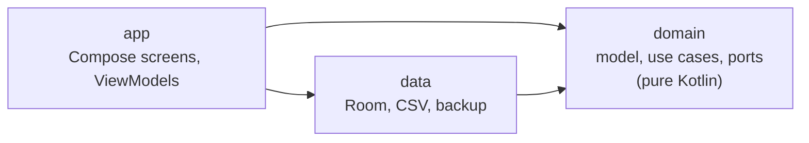
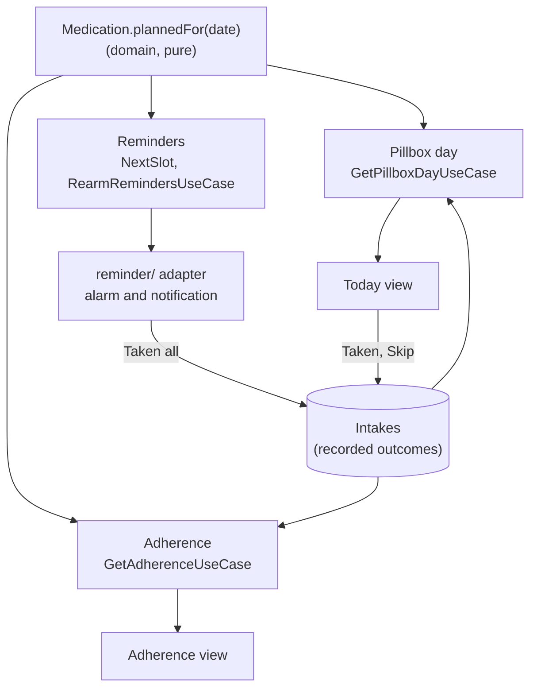

# Architecture

Health Journal uses **hexagonal architecture** (also called ports and adapters). The decision and its trade-offs are in [ADR 0002](../adr/0002-hexagonal-architecture.md). This page is the practical tour.

## The idea in one paragraph

The rules of the app (what a valid blood pressure is, which band a reading falls in, what a use case does) live in a core that knows nothing about Android, databases or screens. The core defines **ports**: Kotlin interfaces for the things it needs from the outside, such as "save a blood pressure entry". Outside code provides **adapters** that implement those ports (Room, CSV) or call into the core (the UI). Because the core has no framework dependencies, its tests run in milliseconds on the JVM.

## The three modules

**The dependency rule:** `app` and `data` depend on `domain`. `domain` depends on nothing. `app` depends on `data` only in one place: the Hilt modules in `app/src/main/java/nl/healthjournal/app/di/` build the `DataModule` and wire everything together ([ADR 0035](../adr/0035-hilt-for-dependency-injection.md)). Screens and ViewModels use the domain's interfaces, not Room classes. Hilt, Dagger and `javax.inject` exist in `app` only; a guardrail test fails the build if `domain` or `data` imports them.

If you ever want to import `androidx.*` or `android.*` into `domain`, stop: the logic belongs in `domain` precisely because it does not need them.

### `domain`

Located at `domain/src/main/kotlin/nl/healthjournal/domain/`.

- `model/metrics/` holds value objects and entries: `BloodPressureReading` (validates ranges in its `init` block), `GlucoseLevel`, `WeightKg`, `WaistCircumferenceCm`, and entries such as `BloodPressureEntry`.
- `model/nhg/` holds the classifiers that map a value to a range, for example `NhgBloodPressureCategory.classify`.
- `model/medication/` holds the pillbox model: `Medication`, `Dosage`, `ScheduleVersion`, `Intake`, the pure derivation of the day (slots, Pending and Missed), `NextSlot` (the next reminder) and `Adherence` (taken against planned over 7, 30 or 90 days). See [ADR 0020](../adr/0020-medication-model-and-pillbox.md) and the [pillbox page](pillbox.md).
- `model/migraine/` holds the Migraine log: `MigraineEntry` (with an optional end time, so it can be ongoing), the code enums for areas, symptoms, triggers and relief, `MigraineTag` (a personal trigger or relief label) and `MigraineStatistics` (pure counts by day, weekday and time of day, with no thresholds). See [ADR 0025](../adr/0025-migraine-log-data-model.md) and the [Migraine page](migraine.md).
- `model/mindfulness/` holds the pure Mindfulness logic: breathing patterns and `BreathingTimer`, `MeditationTimer`, `StartHere`, the `GuidedExerciseCatalogue` with its credits, and `ExerciseSession` with `CueChoices` and `ToneSynth` (tones as samples). It has no clock and stores nothing: callers pass elapsed milliseconds. See [Mindfulness (the feature)](mindfulness-feature.md).
- `model/profile/` holds `Profile`, the aggregate root (height, birth date, optional sex, BMI calculation).
- `usecase/` holds one class per action: `RecordBloodPressureUseCase`, `UpdateBloodPressureUseCase`, `DeleteBloodPressureUseCase`, and so on.
- `port/secondary/` holds the interfaces the core needs: `HealthLogRepositoryPort`, `ProfileRepositoryPort`, `MedicationRepositoryPort`, `ReminderSchedulerPort`, `DataExportPort`, `DataImportPort` `MigraineRepositoryPort`, and the medication and migraine export and import ports (`MedicationDataPorts.kt`, `MigraineDataPorts.kt`).

A **use case** is a small class with one `operator fun invoke`. It builds and validates the model, applies the rules, and calls a port. It is the only place that decides *what happens* when a user records something.

### `data`

Located at `data/src/main/java/nl/healthjournal/data/`.

- `local/` has the Room `HealthJournalDatabase`, one `*Entity` and one `*Dao` per table, and `mapper/` which converts between entities and domain objects.
- `repository/` has `RoomHealthLogRepository`, `RoomProfileRepository`, `RoomMedicationRepository` and `RoomMigraineRepository`, the adapters that implement the ports.
- `csv/` has `CsvDataExportAdapter`, `CsvDataImportAdapter` and the medication pair `CsvMedicationExportAdapter`, `CsvMedicationImportAdapter`, and the migraine pair `CsvMigraineExportAdapter`, `CsvMigraineImportAdapter`.
- `backup/` has `HjBackupCodec` (container, JSON and AES-GCM), `Argon2KeyDerivation`, `RoomBackupSnapshot` and `FreshDatabaseBackupSnapshot` (restore after a lost key).
- `DataModule.kt` creates the database and exposes the ports as ready-made objects.

Entities are deliberately separate from domain objects. Storage details (a `Long` timestamp, an enum stored as a `String`) never leak into the core. The price is mapping code; see the trade-off in ADR 0002.

### `app`

Located at `app/src/main/java/nl/healthjournal/app/`.

- `di/` is the **composition root**, written as [Hilt](https://dagger.dev/hilt/) modules ([ADR 0035](../adr/0035-hilt-for-dependency-injection.md), which supersedes the "no framework" stance of ADR 0003 for the app): `DataPortsModule` creates the one `DataModule` and exposes each port, `UseCaseModule` builds every use case from its ports (the domain carries no annotations, so they are `@Provides` functions here), and `PlatformModule` holds the preferences, `AppLockManager` and `ReminderCoordinator` as singletons. `ReminderEntryPoint` lets the broadcast receivers, which the system creates, read the coordinator from the graph. `HealthJournalApp` is only the `@HiltAndroidApp` that starts the graph.
- `ui/` has one package per screen area (`logging`, `history`, `profile`, `medication`, `migraine`, `mindfulness`), each with a `*Screen` (Compose) and a `*ViewModel`. The History list is grouped by month in `ui/history/HistoryTimeline`; the year and month chips are derived from the scroll position and a tap is only a jump to a list index, so the two cannot disagree ([spec](../../openspec/specs/entry-management/spec.md)). The graph view is in `ui/history/charts` (statistics, trend sections and the Vico chart primitives; see [Graphs](graphs.md)). The migraine step form lives in `ui/migraine` and is hosted in two places: as a tab of the Log screen and, for editing, in place of the History list. History shows each migraine in `MigraineHistoryCard` and its graph view in `MigraineGraphSection`. Shared pieces are in `ui/common`, `ui/theme` and `ui/nhg` (range labels and colours).
- `reminder/` is the second driving adapter next to the screens: `AlarmReminderScheduler` implements `ReminderSchedulerPort` with `AlarmManager`, `ReminderNotifier` posts the notification, and the receivers handle the alarm, Taken all, Snooze and a restart or clock change by calling the same use cases as the UI ([ADR 0022](../adr/0022-medication-reminders.md)).
- The app shell is split so `MainActivity` keeps only what needs the Activity (result launchers, `recreate()`, window flags, the biometric and device-credential prompts, settings intents, `attachBaseContext`). `AppContent` arranges the bars, tabs, full-screen areas and dialogs once the app is unlocked. The state it needs lives in plain holders with no Activity reference in `ui/shell`: `AppNavigationState` (tab, pillbox, Mindfulness, with a `Saver`), `ViewModelRefresher` (clears messages on a tab change, reloads after a restore), `ReminderPermissionState` (the ask-once rule), `AppSettingsState` (write-through to the preferences and the app lock) and `ProfileRoute` (the Profile tab wired to the settings). Whatever only the Activity can do reaches them as lambdas (`ShellActions`). Every ViewModel is a `@HiltViewModel` that `MainActivity` (an `@AndroidEntryPoint`) gets with `by viewModels()`; there are no factories. The holders are plain classes, not ViewModels, so they are unit-tested on the JVM with fakes; the rationale is in the `split-main-activity` change.
- `ui/mindfulness/` is the 🪷 area (`MindfulnessArea` routes between the screens). `ExerciseSessions` and `CuePlayer` are the Android side of an exercise: screen-on flag, audio focus, tones, offline text-to-speech, vibration. It is a driving adapter with no port, because nothing in it leaves the device or is stored.
- `settings/` holds display preferences: language and region, display units, `MetricDisplayOrderPreference` with the `MetricSlot` enum (the order of the Log tabs and History chips, ADR 0034), and `MindfulnessPreferences` (pattern, length, picture, cues; never anything about sessions). See [ADR 0014](../adr/0014-units-presentation.md).
- `res/values/strings.xml` and `res/values-nl/strings.xml` hold all user-facing text.

A ViewModel exposes a `StateFlow` of a UI state class. The screen renders that state and sends events back as function calls. ViewModels never hold Android `Context` or resolved strings; they hold a `UiText` that the screen resolves ([ADR 0015](../adr/0015-localized-viewmodel-messages.md)). Screens collect the flow with `collectAsStateWithLifecycle()`, so nothing is collected while the app is in the background. A ViewModel outlives the Activity that created it, so it never holds the Activity, directly or through a lambda: what it needs from the platform comes from singletons in the Hilt graph (preferences, the app lock, the use cases, and the application `Context` through `@ApplicationContext`), and what it needs the screen to do leaves it as an event. `BackupViewModel.events` is the example: a restore sends `BackupEvent.Restored`, and `MainActivity` collects it while started, refreshes the screens and recreates itself when display settings were applied. `AppLockManager` is a `@Singleton` for the same reason, so recreating the Activity does not lock the app. Each ViewModel keeps a plain primary constructor for the unit tests and adds a secondary `@Inject` one for Hilt. The lost-key screen uses `RecoveryBackupViewModel`, a separate type, so it never shares an instance with the normal `BackupViewModel`.

## One plan, three consumers

The medication feature shows how the hexagon stays small. Planned times are never stored. `Medication.plannedFor(date)` computes them from the schedule version in force, and three things read it:

| Consumer | Entry point | Needs from outside |
|---|---|---|
| Today view | `GetPillboxDayUseCase` | `MedicationRepositoryPort`, a `Clock` |
| Reminders | `RearmRemindersUseCase`, `TakeAllForSlotUseCase` | `ReminderSchedulerPort`, `MedicationRepositoryPort` |
| Adherence | `GetAdherenceUseCase` | `MedicationRepositoryPort`, a `Clock` |

Because the three share one source, a schedule edit from today changes the plan from today on and leaves earlier days as they were, in the pillbox, the reminders and the percentages alike.

## Ideas that shape the code

- **Metric-only storage.** Everything is stored in metric units (kg, cm, mmol/L, metres). The unit a user sees is a display choice, converted at the edge ([ADR 0014](../adr/0014-units-presentation.md)).
- **Nothing recorded for Mindfulness.** The area keeps display choices only; there is no table, no history and no session log.
- **Offline first.** There is no network code. Data lives in a local Room database and can be exported as CSV.
- **Ranges, not verdicts.** Labels read "name · range" and never name a condition. Details in [ADR 0005](../adr/0005-dutch-nhg-guidelines.md) and the [range-labels spec](../../openspec/specs/health-metrics/range-labels/spec.md).
- **Few dependencies.** First-party Android, Jetpack and Kotlin libraries, plus Hilt for wiring in `app` only ([ADR 0003](../adr/0003-dependency-minimization.md), [ADR 0035](../adr/0035-hilt-for-dependency-injection.md)).

## Where to go next

- [Dependency injection](dependency-injection.md) explains how Hilt builds and hands out the objects.
- [C4 diagrams](c4.md) show the same structure at four zoom levels, with the reminder and adherence scenarios as sequence diagrams.
- [Design](design.md) holds the principles, the screen map and the layout rules.
- [Life of an entry](life-of-an-entry.md) walks through all of this with real code.
- [Backup and restore](backup.md) describes the encrypted portable backup and how the data is structured in the file; the byte-level format is in [docs/backup-format](../backup-format/README.md).
- All decisions are in `docs/adr/`.
