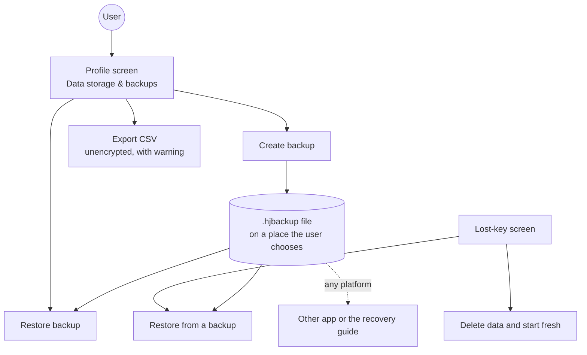
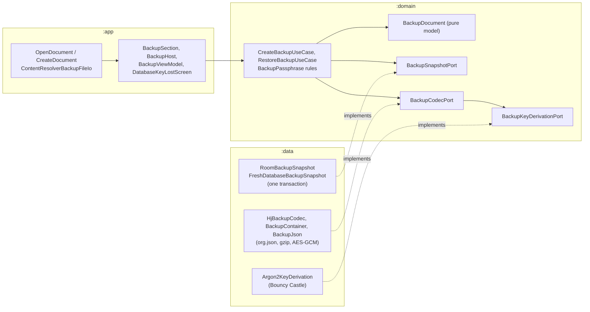
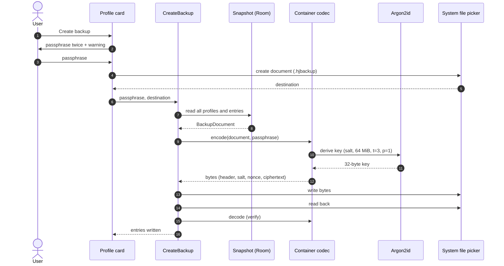
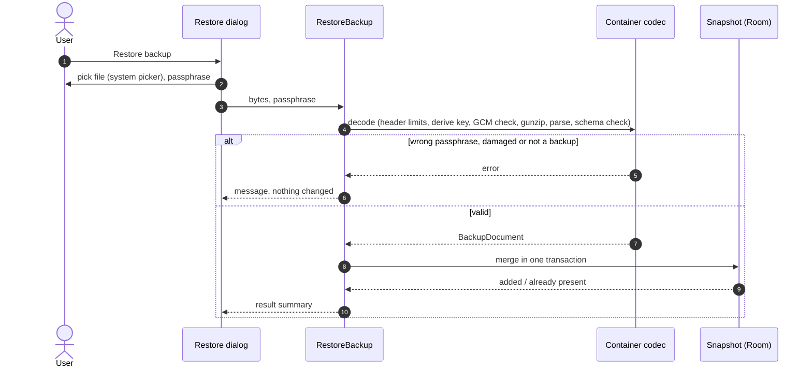
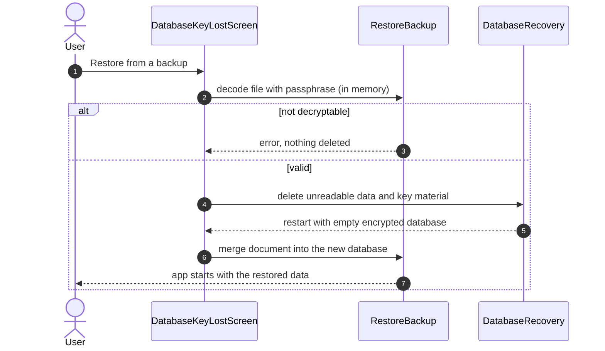

# Backup and restore

> **Status: implemented** (manual backup and restore, since 1.6.0). The requirements are in [`openspec/specs/data-backup`](../../openspec/specs/data-backup/spec.md), the decision in [ADR 0024](../adr/0024-portable-encrypted-backup.md), the published file format with a working reference decoder and test vectors in [`docs/backup-format`](../backup-format/README.md). Scheduled backup is not built (section 3).

The database is encrypted with a key that never leaves the phone ([ADR 0023](../adr/0023-database-encryption-and-app-lock.md)), so a new phone, a reset or a lost key would otherwise lose the data. The backup is the user's own, encrypted, portable copy: one `.hjbackup` file that the user creates, keeps wherever they like, and restores when needed.

## 1. Functional view

### What the user can do

| Action | What happens |
|--------|--------------|
| Create backup | Choose a passphrase (at least 8 characters, typed twice, with a hint to prefer three or four random words and a warning that it cannot be recovered), choose a destination in the system file picker. The app writes the file, reads it back to check it, and reports how many entries it holds. |
| Restore backup | Choose the file, enter the passphrase, optionally tick "Also restore settings". The content is **merged**: what already exists (same identifier) is kept, the rest is added. The result says how many entries were added and how many already existed. |
| Restore on the lost-key screen | Same, but the unreadable data is deleted only after the file has been decrypted and validated, then the new database is filled from the backup. A wrong passphrase destroys nothing. |
| Export CSV | Unchanged plaintext export, now with a clear "not encrypted" warning. Meant for spreadsheets, not as a backup. |

Display preferences (language, region, units, theme, snooze length) are in the file and applied only when the user ticks "Also restore settings". **Never** in the file: app lock and its timeout, secure screen, lock-screen details and other per-device state, so a backup can never weaken a device's protection.

### What is in the file

Everything a person would want back: every profile, all weights, blood pressures, glucose values, waist circumferences, activities and migraines (with the person's own trigger and relief tags) with their comments, and all medication with its schedule versions and intake log. The structure is in [the format description](../backup-format/README.md#4-the-document).

### What the user must know

- **No passphrase, no data.** There is no recovery. The app says so before creating a backup.
- The app does not remember the passphrase and does not keep a copy of the file.
- The file works without the app: [Recover your data](../backup-format/recover-your-data.md) explains how, which matters if the app is ever no longer maintained.

## 2. Technical view

### Where it lives in the hexagon

- `:domain` (`model/backup`, `port/secondary/BackupPorts.kt`, `usecase/BackupUseCases.kt`) knows the document as plain Kotlin data, the rules (passphrase length, merge counts) and three ports. It has no crypto library, no JSON library and no Android type.
- `:data` implements the ports: Room read and merge, the container and JSON codec, and Argon2id. Argon2id comes from the one new library, Bouncy Castle `bcprov-jdk18on` ([ADR 0024](../adr/0024-portable-encrypted-backup.md)); AES-GCM, gzip, `SecureRandom` and `org.json` are platform classes.
- `:app` (`ui/backup/`) shows the dialogs and owns the system picker. `BackupHost` holds the pickers and dialogs and is shared by the Profile tab and the lost-key screen; each screen has its own `BackupViewModel` instance (the recovery one is created with the key `recovery`). `settings/BackupPreferenceBridge.kt` maps the display preferences to and from the file. The file bytes pass through `ContentResolver` streams; the app never needs a storage permission.

### Create

The key derivation runs on `Dispatchers.Default` and the file work on the IO dispatcher; the passphrase lives in a `CharArray` that is cleared afterwards. Reading the file back and comparing it byte for byte with what was written is what catches a picker that saved only part of the file.

### Restore

### Restore after a lost key

### Merge rules

| Data | Key | When it exists already |
|------|-----|------------------------|
| profile | `id` | kept as it is |
| weight, blood pressure, glucose, waist, activity | `id` | kept as it is |
| migraine, migraine tag | `id` | kept as it is |
| medication | `id` | kept as it is |
| schedule version | medication `id` + `effectiveFrom` | kept as it is |
| daily times | with their schedule version | follow their schedule version |
| intake | `id`; also medication + `planned` (unique) | kept as it is |

A file written by a newer app can hold a tag kind or an enum code this version does not know. `BackupJson.read` leaves those out and counts them (`BackupDocument.unreadableItems`); the restore dialog shows the count in a note ("N item(s) … will be left out. The file itself is not changed.") so nothing is dropped silently. `BackupFormatTest` covers the count.

The active profile of the app is not changed when it has one; otherwise the active profile of the file is used. The whole merge is one Room transaction (`withTransaction`, insert-or-ignore DAO methods), so a failure part-way leaves the database as it was. After a restore the view models reload and reminders are rescheduled; ticking "Also restore settings" recreates the activity so a new language or theme shows at once.

### Two version numbers, one rule

The container version and the document `schemaVersion` live in the file and are independent of the Room version (7 now, next 7 to 8). A Room migration changes how the snapshot is read, not what the file looks like. A change to the file format updates, in one commit: the [format page](../backup-format/README.md), the [schema](../backup-format/healthjournal-backup.schema.json), the [test vectors](../backup-format/test-vectors/README.md), [`docs/backup-format/hjbackup.py`](../backup-format/hjbackup.py) and the app's tests.

### Testing plan

| Layer | What |
|-------|------|
| JVM, `:domain` | passphrase rules (`BackupPassphraseTest`), use cases with fake ports (`BackupUseCasesTest`) |
| JVM, `:data` | `BackupFormatTest`: the published test vectors decode to `sample.json` (so app and documentation cannot drift); wrong passphrase, one flipped byte in header, salt, nonce and ciphertext, truncated file, hostile header values (memory, iterations, lanes, unknown ids, non-zero reserved bytes); NFKC equivalence; round trip through an in-memory database including medication schedule versions (`RoomBackupSnapshotTest`) |
| JVM, `:app` | `PrivacyChecksTest` (no logging in production sources, no INTERNET permission) covers the backup code too |
| Android (instrumented) | not added: the Room round trip, including a rollback on a real foreign-key failure, runs in `RoomBackupSnapshotTest` |
| Reference decoder | `python docs/backup-format/hjbackup.py decode` on each vector, run in CI |
| Manual (done on the emulator for 1.6.0) | create, restore into a cleared app, restore twice, wrong passphrase, cancelled picker, lost-key restore, restore with settings, English and Dutch, light and dark. Screenshots: [Screenshots](../screenshots.md) |

## 3. Later: scheduled backup

A periodic backup to a folder the user picks (a persisted document-tree permission and `WorkManager`) is possible without changing the file format, but it needs the passphrase at run time. Keeping it on the device (wrapped by the Keystore) means the phone can decrypt its own backups; asking each time is not automatic. That trade-off is a separate decision ([design, decision 10](../../openspec/changes/archive/2026-10-21-add-portable-backup/design.md)).

## 4. See also

- [Privacy and security](privacy-and-security.md) for the encryption of the database itself
- [Database](database.md) for the tables the snapshot reads
- [OpenSpec change](../../openspec/changes/archive/2026-10-21-add-portable-backup/proposal.md), [ADR 0024](../adr/0024-portable-encrypted-backup.md), [Format](../backup-format/README.md), [Recover your data](../backup-format/recover-your-data.md)
