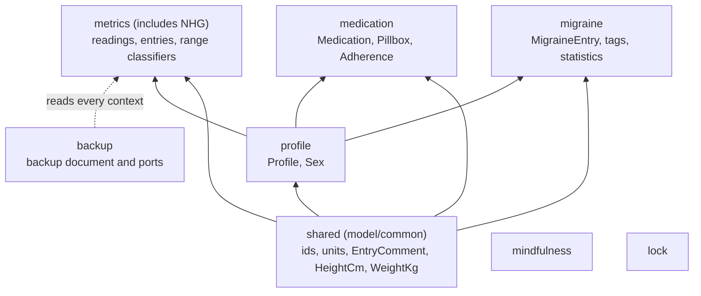

# Context map and glossary

The domain is divided into bounded contexts, one folder each under `domain/src/main/kotlin/nl/healthjournal/domain/model/`. [ADR 0038](../adr/0038-bounded-contexts-and-tactical-roles.md) records the decision. This page is the working copy: what may import what, and what the words mean.

## Context map

| Context | May import |
|---|---|
| `shared` | nothing |
| `profile` | `shared` |
| `metrics` (with `nhg`), `medication`, `migraine` | `shared`, `profile`; never each other |
| `backup` | every context |
| `mindfulness`, `lock` | nothing |

`ArchitectureGuardrailsTest.domainModelContextsOnlyImportWhatTheContextMapAllows` scans the imports in `model/` and fails with the file name and the forbidden edge. If a coupling is ever accepted, it goes in `knownCouplings` in that test with the reason beside it. The list is empty now.

## Where new code goes

- **A new value object, entry or classifier:** the context folder under `model/`.
- **A new command, query or handler:** `<context>/command/` (for example `metrics/command/WeightCommands.kt`). The `Dispatcher` and the shared types are in `command/`.
- **A new port:** `port/secondary/`, one file per port. (A later change moves ports and old use cases into the contexts.)

## Roles

| Role | Examples | Rule |
|---|---|---|
| Entity | `WeightEntry`, `MigraineEntry`, `Profile` | has an id; `MigraineEntry.endedAt(at)` owns the end-of-episode rule |
| Value object | `WeightKg`, `BloodPressureReading`, `EntryComment` | immutable; `of(...)` returns a `DomainResult`, the constructor still checks |
| Aggregate root | `Medication` | the only root with invariants over time; metrics stay plain records |
| Domain service | NHG classifiers, `Pillbox`, `Adherence` | pure functions, no ports |
| Application service | handlers | uses ports and a `Clock`, no UI types |

## Glossary

| Word | Meaning in this app |
|---|---|
| **Entry** | One logged measurement with an id, a profile, a time, a value and an optional comment. |
| **Profile** | A person whose data the app holds: height, birth date, optional sex. The active profile owns every new entry. |
| **Reading** | The value part of an entry, as a value object (`BloodPressureReading`). Always in metric units. |
| **Range label** | The text "name · range" that places a reading in a published range (NHG). It is never a verdict: it names no condition and gives no advice ([ADR 0005](../adr/0005-dutch-nhg-guidelines.md)). Metrics without ranges show none. |
| **Slot** | A planned time of day for a medication (for example 08:00). A schedule version lists its slots. Planned times are computed, never stored. |
| **Intake** | The recorded outcome for one medication at one slot on one day: taken or skipped. A slot with no intake is Pending, or Missed once its time has passed. |
| **Pillbox** | The derived view of one day: every planned slot with its intake status. See [Pillbox](pillbox.md). |
| **Schedule version** | A medication's schedule from a start date on. A change adds a version, so earlier days keep the plan they had. |
| **Adherence** | Taken against planned intakes over 7, 30 or 90 days. |
| **Episode** | One migraine from its start to its optional end. An episode without an end is ongoing. |
| **Command** | A request to change state, sent to the `Dispatcher` ([ADR 0036](../adr/0036-application-boundary-commands-and-queries.md)). |
| **Query** | A request to read, once or as a stream (`ObserveQuery`). |
| **Handler** | The application service that carries out exactly one command or query. |
| **Port** | A Kotlin interface the domain needs from outside (storage, export, reminders). One per metric, so a handler sees only what it uses. |
| **Domain error** | A typed failure (`Invalid`, `NotFound`, `Backup`, `Storage`) with a code and parameters and no text; the UI picks the string ([ADR 0037](../adr/0037-typed-domain-errors-and-single-source-for-rules.md)). |
