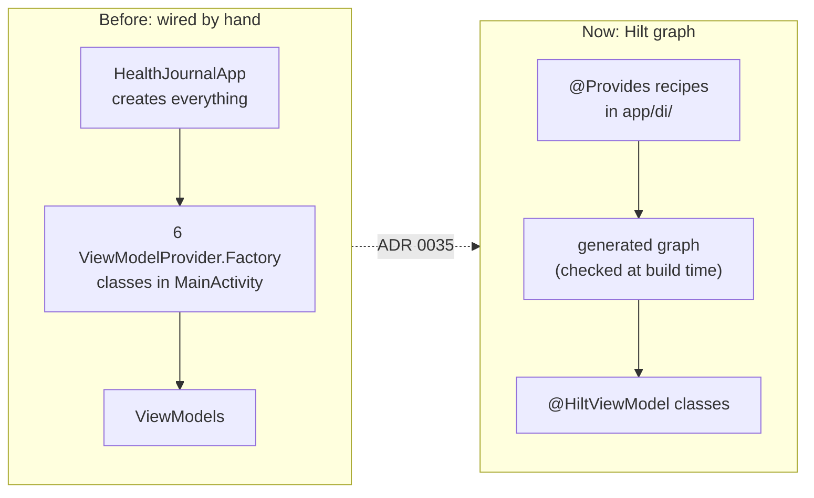
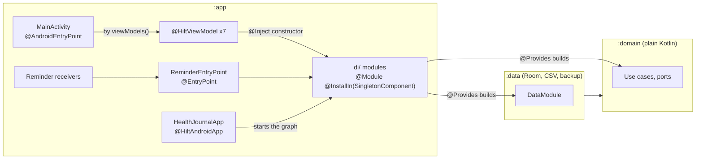
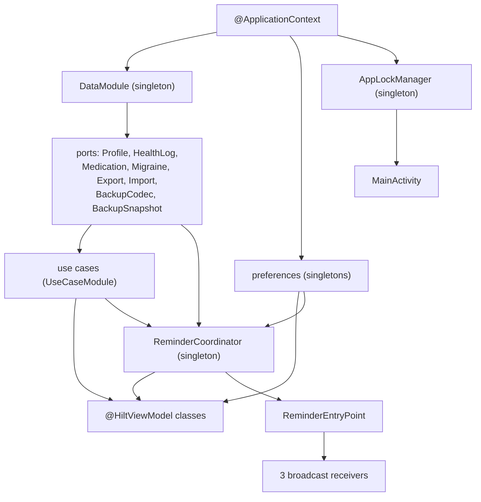
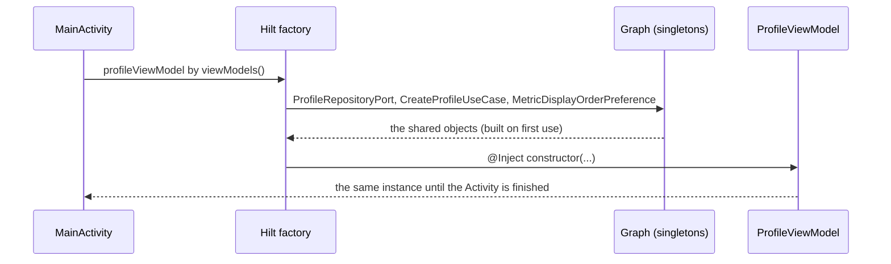
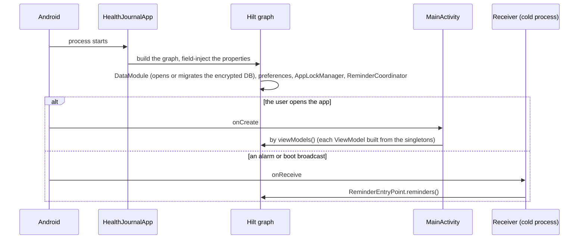

# Dependency injection (Hilt)

The app wires its objects with [Hilt](https://dagger.dev/hilt/), in `app` only. The decision, the alternatives and the measured cost are in [ADR 0035](../adr/0035-hilt-for-dependency-injection.md). This page explains how it works and how it is set up, so you can add to it without reading the Hilt manual.

## The idea in one paragraph

A class does not build the things it needs; it asks for them in its constructor. Something else, the **graph**, knows how to build each type and hands the right object over. Hilt generates that graph at compile time from annotations (through KSP), so a dependency that nobody provides is a **build error**, not a crash on a user's phone. Nothing is looked up by name or by reflection at run time.



## Where Hilt lives



`domain` and `data` never import Hilt, Dagger or `javax.inject`. `RepositoryGuardrailsTest.domainAndDataDoNotUseHiltDaggerOrJavaxInject` fails the build if they do (it also checks their build files). That is why use cases, which are plain classes in `domain`, are built by `@Provides` functions in `app/di/` and not annotated themselves.

## The pieces

| Annotation | Where | What it does here |
|---|---|---|
| `@HiltAndroidApp` | `HealthJournalApp` | Starts the graph when the process starts. Without it nothing else works. |
| `@Module` + `@InstallIn(SingletonComponent::class)` | the three files in `app/di/` | A bag of recipes (`@Provides` functions). Installed in the singleton component, so the objects live as long as the process. |
| `@Provides` | functions in the modules | "To get a `RecordWeightUseCase`, call this with these arguments." The argument types are themselves looked up in the graph. |
| `@Singleton` | on some `@Provides` functions | One instance for the whole process. Without it Hilt builds a new object each time something asks. |
| `@ApplicationContext` | a `Context` parameter | The application context, safe to keep. Never an Activity. |
| `@HiltViewModel` + `@Inject constructor` | the seven ViewModels | Hilt builds the ViewModel; the Activity's `ViewModelStore` keeps it across rotation. |
| `@AndroidEntryPoint` | `MainActivity` | Lets `by viewModels()` use Hilt's factory. There is no `hilt-navigation-compose`; the Activity owns the ViewModels. |
| `@EntryPoint` + `EntryPointAccessors` | `ReminderEntryPoint` | A way into the graph for classes the system creates itself (broadcast receivers). |

### The three modules (`app/src/main/java/nl/healthjournal/app/di/`)

- **`DataPortsModule`** creates the one `DataModule` (`@Singleton`, so the database opens once) and exposes each port from it: the profile, health log, medication and migraine repositories, the export and import ports, the backup codec and snapshot. A ViewModel asks for the port; it never sees Room.
- **`UseCaseModule`** has one `@Provides` function per use case, built from the ports. `EntryUseCases` and `MedicationUseCases` are small bundles that keep a ViewModel's constructor short.
- **`PlatformModule`** has the `@Singleton` preferences (`UnitPreference`, `ReminderPreference`, `MetricDisplayOrderPreference`, `BackupPreferenceBridge`), `AppLockManager`, `AlarmReminderScheduler` and `ReminderCoordinator`. These hold state or are shared with the receivers, so there must be exactly one.

### What gets built from what



Everything is a recipe over types, so a ViewModel's whole dependency list is its constructor. Nothing reaches back into `HealthJournalApp`.

## How a ViewModel is built



Each ViewModel has **two constructors**:

```kotlin
@HiltViewModel
class ProfileViewModel(
    private val profileRepository: ProfileRepositoryPort,
    private val createProfileUseCase: CreateProfileUseCase,
    val metricOrder: StateFlow<List<MetricSlot>> = ...,
    private val saveMetricOrder: (List<MetricSlot>) -> Unit = {}
) : ViewModel() {

    @Inject
    constructor(
        profileRepository: ProfileRepositoryPort,
        createProfileUseCase: CreateProfileUseCase,
        metricDisplayOrder: MetricDisplayOrderPreference
    ) : this(profileRepository, createProfileUseCase, metricDisplayOrder.order, metricDisplayOrder::save)
```

The primary constructor takes plain values and functions, so a JVM unit test passes fakes with no Hilt and no Android. The secondary `@Inject` constructor is the one Hilt calls; it adapts graph objects to the primary one. If the argument types fit both, upcast one argument (`reminders as ReminderHooks`) so Kotlin does not pick the secondary constructor and delegate to itself.

Two screens that need separate instances of one ViewModel get two types, not a key: the lost-key screen uses `RecoveryBackupViewModel`, a subclass of the open `BackupViewModel`, so the two never share state.

## How a broadcast receiver gets its object

The system creates `ReminderReceiver`, `ReminderActionReceiver` and `RescheduleReceiver`, so they cannot take constructor arguments. They read the coordinator from the graph:

```kotlin
EntryPointAccessors.fromApplication(context.applicationContext, ReminderEntryPoint::class.java).reminders()
```

If the graph cannot be read the receiver returns without doing anything: a failed reminder must never crash the app. It is the same `ReminderCoordinator` singleton that `MainActivity` and the pillbox ViewModel use, so there is one alarm scheduler.

## Start-up order



The singletons the Application injects are built eagerly at start; the cold-start cost is in [ADR 0035](../adr/0035-hilt-for-dependency-injection.md). `HealthJournalApp.instance` and its properties remain only for the few places that still read them (the Activity's lazy helpers); new code takes its objects by constructor.

## Set up (build files)

| File | What it holds |
|---|---|
| `gradle/libs.versions.toml` | `hilt = "2.58"`, `ksp`, the `hilt-android` and `hilt-compiler` libraries and the `com.google.dagger.hilt.android` plugin. |
| `build.gradle.kts` (root) | the Hilt and KSP plugins with `apply false`. |
| `app/build.gradle.kts` | applies both plugins, `implementation(libs.hilt.android)` and `ksp(libs.hilt.compiler)`. Hilt is only on the `app` module. It also forces `kotlin-metadata-jvm` to the Kotlin version, because Hilt 2.58 bundles an older one that cannot read classes compiled by Kotlin 2.4. |
| `.github/dependabot.yml` | a Hilt group, and an ignore for 2.59 and later until the AGP upgrade ([CI](ci.md)). |

Hilt stays on 2.58 because 2.59 and later need AGP 9, and the build is on AGP 8.13.2.

## Add something

| You want to | Do this |
|---|---|
| a new use case | one `@Provides` function in `UseCaseModule` (see [Add a metric](how-to/add-a-metric.md)) |
| a new port adapter | expose it from `DataModule`, then one `@Provides` function in `DataPortsModule` |
| a new preference or process-wide object | a `@Singleton` `@Provides` function in `PlatformModule` |
| a new ViewModel | `@HiltViewModel`, keep the primary constructor for tests, add a secondary `@Inject constructor`, get it in the Activity with `by viewModels()` |
| an object for a receiver or other system-created class | a function on an `@EntryPoint` interface, read with `EntryPointAccessors.fromApplication` |

Never import Hilt, Dagger or `javax.inject` in `domain` or `data`.

## Reading a Hilt error

Errors come from the generated code and look long. Read the first `error:` line.

| Message | Meaning and fix |
|---|---|
| `[Dagger/MissingBinding] X cannot be provided…` | No module builds `X`. Add a `@Provides` function, and check the module has `@InstallIn(SingletonComponent::class)`. |
| `[Dagger/DuplicateBindings]` | Two `@Provides` functions return the same type. Keep one, or add a qualifier. |
| `[Dagger/DependencyCycle]` | Two types ask for each other. Break it with a function or a holder. |

## Testing

Unit tests do not use Hilt. They construct the ViewModel with the primary constructor and fakes (see [Testing](testing.md)). The graph itself is verified by the build (a missing binding fails compilation) and by running the app; the guardrail test keeps Hilt out of `domain` and `data`.
