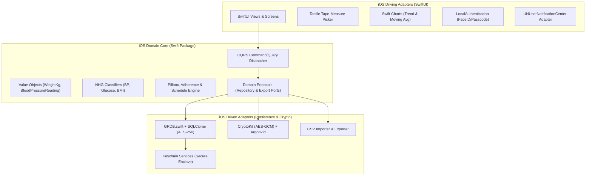

# iOS Port Architecture & Greenfield Modernization Guide

This document evaluates the strategy for bringing **Health Journal** to the iPhone (iOS) and outlines how to structure a modern greenfield rewrite if starting the Android project fresh today.

---

## 1. Executive Summary

Health Journal is a 100% offline, privacy-first personal health logging and reminder application. It is strictly **not a medical device** (EU MDR compliant) and adheres to Dutch GP guidelines (*Nederlands Huisartsen Genootschap* / NHG).

When considering an iPhone version:
- **.NET MAUI is not recommended.** Because the existing Android app is already built in Kotlin and Jetpack Compose, .NET MAUI provides **zero cross-platform code-sharing leverage**. Furthermore, MAUI introduces substantial friction on iOS: lack of native charting, sluggish custom touch gestures (critical for the tape-measure ruler pickers), large runtime overhead, and fragile local notification bindings.
- **Native iOS (Swift 6 + SwiftUI) is the recommended primary route.** It delivers 120Hz ProMotion fluid rendering for custom pickers, first-class charting via **Swift Charts**, hardware-backed encryption via **Keychain / Secure Enclave**, and seamless local background reminders via `UNUserNotificationCenter`.
- **Kotlin Multiplatform (KMP) + SwiftUI is the recommended alternative for code sharing.** Because `:domain` is pure Kotlin with zero Android/UI dependencies, the business logic, NHG classifiers, and medication scheduling can be shared directly as an XCFramework to a native SwiftUI app.

---

## 2. Why Not .NET MAUI?

While .NET MAUI is marketed for cross-platform applications, analyzing it against Health Journal's specific requirements reveals severe mismatches:

### No Code Sharing with the Existing Android App
The main advantage of MAUI is sharing C# logic between platforms. However, Health Journal Android is already complete, optimized, and maintained in Kotlin. Porting to MAUI would require either:
1. Throwing away the polished Android Kotlin/Compose codebase and rewriting everything in C#; or
2. Writing a separate C# MAUI app solely for iOS, meaning two completely divergent tech stacks to maintain with no shared code.

### Custom Tactile UI and Inertia Pickers
Health Journal relies on tactile, horizontal measuring tape ruler pickers for Weight and Waist logging (ADR 0018, ADR 0033). These require sub-pixel gesture tracking, momentum physics, and micro-haptics (`UIImpactFeedbackGenerator`). MAUI's cross-platform abstraction over UIKit gesture recognizers is prone to touch latency, dropped frames, and imprecise snapping.

### Charting and Data Visualizations
The app provides pinch-to-zoom trend charts, moving averages, and NHG guideline threshold bands (ADR 0006). 
- **Native iOS** offers **Swift Charts** (`import Charts`), a declarative, performant, and accessible charting framework built into the OS.
- **.NET MAUI** has no built-in chart framework. You would need to rely on expensive commercial component suites (e.g. Syncfusion, Telerik) or unmaintained open-source libraries.

### Security, Cryptography, and `.hjbackup` Compatibility
Health Journal encrypts its local database with SQLCipher (AES-256) and exports `.hjbackup` files encrypted with Argon2id and AES-256-GCM (ADR 0023, ADR 0024):
- In MAUI on iOS, native cryptographic bindings (`sqlite-net-sqlcipher`, Bouncy Castle, or libsodium) frequently suffer from iOS Ahead-Of-Time (AOT) compilation and IL linker/trimming bugs.
- Native iOS has native `CryptoKit` (for AES-GCM) and seamless C/Swift interop for Argon2id.

### Local Reminders and Background Scheduling
Medication reminders must fire reliably offline with interactive actions (Taken, Snooze) while adhering to Apple's 64 pending local notification limit. In native iOS, `UNUserNotificationCenter` handles this natively. In MAUI, cross-platform notification plugins are notoriously brittle across major iOS version releases.

### App Footprint and App Store Review
- **Binary Size & Startup:** MAUI bundles the Mono/CoreCLR runtime and Base Class Libraries, yielding 40–80 MB binaries with slower cold start times. A native Swift app compiles to 8–15 MB with instantaneous launch.
- **Privacy Audit:** Apple's App Store Review strictly evaluates health applications (Guideline 1.4). Native Swift apps with zero third-party telemetry pass the review with a clean "Data Not Collected" privacy label.

---

## 3. Recommended Approach A: Pure Native iOS (Swift & SwiftUI)

The cleanest, most maintainable architecture for iPhone is a pure native application implementing the same **Hexagonal Architecture** as the Android project.



### Component Architecture

| Area | Android Implementation | iOS Native Equivalent | Implementation Details |
| :--- | :--- | :--- | :--- |
| **Language & Concurrency** | Kotlin, Coroutines, Flow | Swift 6, `async`/`await`, `AsyncStream` | Value types (`struct`), immutable models, Swift actors for thread confinement. |
| **UI Framework** | Jetpack Compose (Material 3) | SwiftUI | Declarative views, `@Observable` view models, native iOS typography and styling. |
| **Adaptive Layout** | Bottom bar / Navigation Rail | `TabView` / `NavigationSplitView` | Bottom tab bar on iPhone portrait; sidebar rail / split view on iPad and wide orientations. |
| **Custom Ruler Pickers** | Custom Compose Canvas + Drag | SwiftUI `Canvas` + `DragGesture` | Smooth sub-pixel ruler dragging, snap-to-tick inertia, and `UIImpactFeedbackGenerator(style: .light)` haptic feedback. |
| **Charts & Trends** | Vico Compose | **Swift Charts** (`import Charts`) | Native `LineMark`, `AreaMark`, and `RuleMark` for NHG thresholds, with interactive touch selection scrubbers. |
| **Persistence** | Room (SQLite v9) | **GRDB.swift** with **SQLCipher** | Robust SQLite toolkit supporting migrations, record decoding, type-safe queries, and full AES-256 database encryption. |
| **Key Storage** | Android Keystore (StrongBox/TEE) | **Keychain Services** | Master database key stored with `kSecAttrAccessibleAfterFirstUnlockThisDeviceOnly` tied to the Secure Enclave. |
| **App Lock** | `BiometricPrompt` (AndroidX) | **`LocalAuthentication`** | `LAContext.evaluatePolicy(.deviceOwnerAuthenticationWithBiometrics)`. Supports Face ID, Touch ID, and device passcode fallback. |
| **Screen Privacy** | Window `FLAG_SECURE` | Scene Lifecycle Masking | In `sceneWillResignActive`, overlay a privacy blur or splash shield over the window to obscure App Switcher snapshots. |
| **Local Reminders** | `AlarmManager` + Exact Alarms | **`UNUserNotificationCenter`** | Interactive categories with "Taken" and "Snooze" actions. Maintains a rolling scheduler for the 64 pending notification limit. |
| **Backup Format** | Bouncy Castle Argon2id + AES-GCM | `CryptoKit` + C/Swift Argon2 | Parses and generates exact `.hjbackup` format (Argon2id, salt, nonce, AES-256-GCM, gzip JSON). Tested with repo test vectors. |
| **Mindfulness Audio** | Memory PCM AudioTrack (`ToneSynth`) | **`AVAudioEngine`** | Generates real-time sine wave PCM audio in memory for meditation bells and breathing cues with zero disk latency. |
| **Localization** | `res/values/strings.xml` (en, nl) | String Catalogs (`.xcstrings`) | Clean key-value localization for English and Dutch with native plural rules. |

---

## 4. Recommended Approach B: Kotlin Multiplatform (KMP) Core + Native SwiftUI

If code sharing between Android and iOS is a high priority, KMP provides the optimal path without compromising iOS UI quality.

### How KMP Fits Health Journal
Because the `:domain` module is already written in pure Kotlin with no Android dependencies:
1. **Multiplatform Domain:** Convert `:domain` from `jvm` to `multiplatform`.
2. **Standardize Time & Decimals:** Replace `java.time.*` with `kotlinx-datetime` and replace `java.math.BigDecimal` with scaled integer arithmetic or a multiplatform decimal library.
3. **Compile to XCFramework:** Build a shared XCFramework containing the domain value objects, NHG classifiers, adherence calculation, and backup schema validators.
4. **SwiftUI on Top:** Build the UI, charts, and iOS platform adapters natively in Xcode using Swift.

This avoids duplicating complex domain tests (such as NHG boundary checks and medication schedule window calculations) across two languages.

---

## 5. Greenfield Redesign: How to Approach Building it Anew for Android

If Health Journal were rebuilt from scratch today for Android, incorporating the lessons learned and modernization patterns identified in the codebase, the ideal architecture would look like this:

### 1. Unified CQRS Application Boundary from Day One
- **The Problem in Legacy:** Early versions accumulated dozens of fine-grained, single-method use case classes, eventually leading to synthetic parameter tuples (e.g. `EntryUseCases` containing 14 use cases) to satisfy ViewModel constructors.
- **The Modern Approach:** Adopt a unified **CQRS Dispatcher** from the start:
  - Commands (`RecordWeightCommand`, `TakeMedicationCommand`) for state mutations.
  - Queries (`GetPillboxDayQuery`, `ObserveWeightTrendsQuery`) for reads.
  - Handlers (`CommandHandler<C, R>`, `QueryHandler<Q, R>`) that encapsulate single business operations.
  - ViewModels inject only the `Dispatcher` and their specific query stream, keeping ViewModel constructors clean (1–3 dependencies maximum).

### 2. Rich Domain Aggregates & Typed Results (No Exceptions for Control Flow)
- **The Problem in Legacy:** Domain models occasionally relied on unchecked `IllegalArgumentException` thrown in `init` blocks, which ViewModels caught via generic `catch (e: Exception)` blocks.
- **The Modern Approach:**
  - Value objects use factory constructors returning typed results:
    ```kotlin
    data class BloodPressureReading private constructor(
        val systolic: Int,
        val diastolic: Int
    ) {
        companion object {
            fun create(systolic: Int, diastolic: Int): DomainResult<BloodPressureReading, ValidationError> {
                if (systolic !in 60..300) return DomainResult.Failure(ValidationError.SystolicOutOfRange)
                if (diastolic !in 30..200) return DomainResult.Failure(ValidationError.DiastolicOutOfRange)
                if (systolic <= diastolic) return DomainResult.Failure(ValidationError.SystolicNotGreaterThanDiastolic)
                return DomainResult.Success(BloodPressureReading(systolic, diastolic))
            }
        }
    }
    ```
  - ViewModels map typed `DomainError` directly to localized `UiText` without try/catch overhead.

### 3. Interface Segregation for Repositories (ISP)
- **The Problem in Legacy:** Earlier iterations had monolithic repository interfaces (e.g. `HealthLogRepositoryPort`) coupling 6+ distinct metric aggregates together.
- **The Modern Approach:** Keep repositories segregated per aggregate (`WeightRepositoryPort`, `BloodPressureRepositoryPort`, `MedicationRepositoryPort`). A command handler should depend strictly on the ports it reads or modifies.

### 4. Modern Multiplatform Room & Pre-Encrypted Schema
- **The Problem in Legacy:** Starting with plain SQLite required building complex plain-to-encrypted migration logic and crash-recovery file swaps when SQLCipher was introduced at database version 6.
- **The Modern Approach:**
  - Use **Room KMP (2.7+)** with SQLCipher enabled from **Version 1**.
  - No legacy migration gymnastics or file-swap rollbacks.
  - Hardware-backed Android Keystore wrapping the 256-bit AES master key from the initial release.

### 5. Compose Architecture: MVI & Design System
- **State Management:** Strict Model-View-Intent (MVI) / Unidirectional Data Flow (UDF):
  - Every screen has a single immutable `UiState` data class.
  - User actions are emitted as sealed `UiEvent`s to the ViewModel.
  - One-time side effects (navigation, snackbars) are exposed via a shared effect channel.
- **Navigation:** Use Jetpack Compose Navigation with type-safe Kotlin Serializable routes (`@Serializable` route objects), replacing custom destination enums or string-based routes.
- **Adaptive Layouts:** Leverage Compose's official `NavigationSuiteScaffold` and `WindowSizeClass` utilities to transition cleanly between bottom bar (compact), navigation rail (medium), and split-pane detail views (expanded).

### 6. Build Logic & Tooling
- **Convention Plugins:** Use Gradle `build-logic` convention plugins instead of repeating plugin declarations, compiler options, and JaCoCo configurations across `:app`, `:data`, and `:domain`.
- **Strict ArchUnit / Guardrails:** Embed architectural fitness tests from day one to enforce hexagonal boundaries, ensure zero framework imports in domain, and prevent unwanted Android permissions.

---

## 6. Summary Checklist for an iOS Port

When beginning the iOS implementation:
1. **Specification:** Create `platform-ios/spec.md` (under OpenSpec) detailing iOS-specific framework choices while keeping all metric, medication, and compliance specs intact.
2. **Domain Core:** Port `:domain` to Swift value objects and classifiers (or compile as KMP XCFramework).
3. **Storage:** Set up GRDB.swift with SQLCipher, matching the database tables and columns in `docs/dev/database.md`.
4. **Backup Compatibility:** Implement `.hjbackup` decoding and encoding according to `docs/backup-format/README.md` and verify against existing test vectors.
5. **UI & Pickers:** Build the SwiftUI screens using Swift Charts and a custom horizontal ruler picker with haptics.
6. **Reminders:** Configure `UNUserNotificationCenter` with a 64-notification rolling window.
7. **Compliance Review:** Verify all strings against `openspec/specs/compliance/spec.md` to ensure zero medical claims, no diagnosis labels, and neutral NHG terminology.
