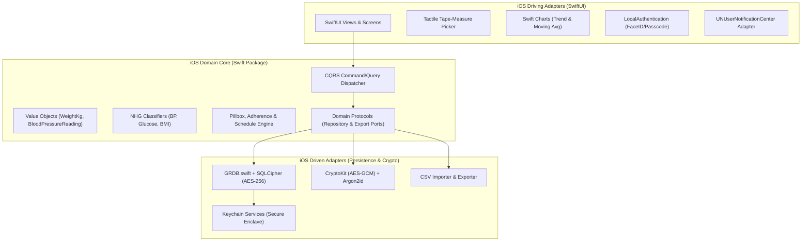
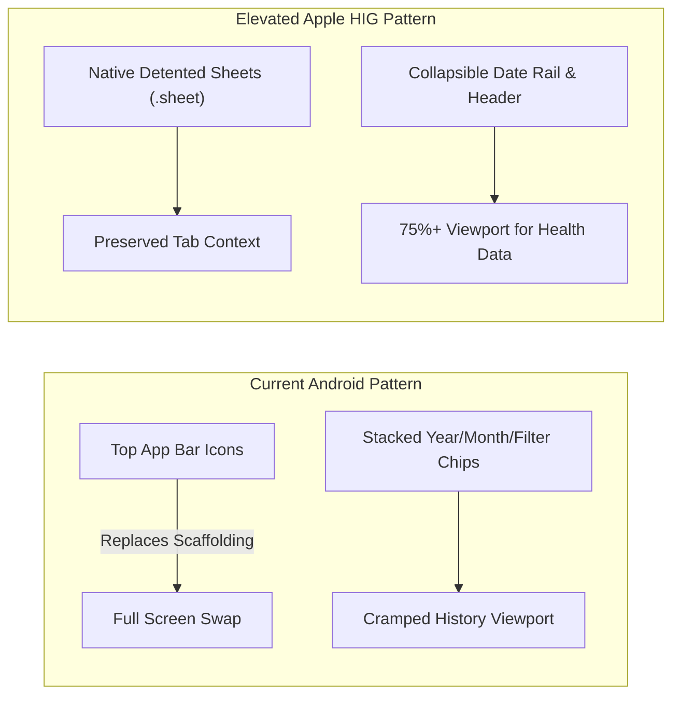
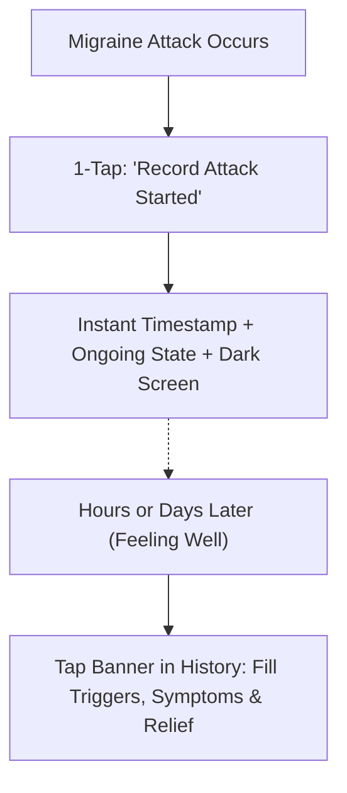
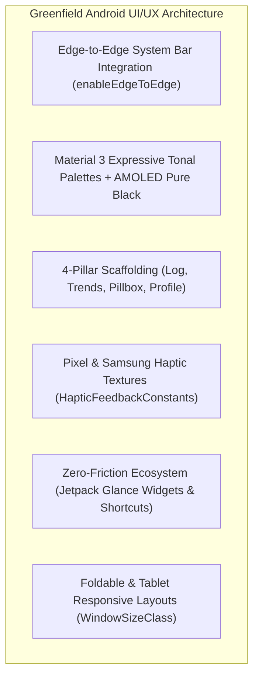

# iOS Port Architecture & Greenfield Modernization Guide

This document evaluates the strategy for bringing **Health Journal** to the iPhone (iOS), provides a complete blueprint for developing iOS apps from a Linux workstation using cloud CI/CD at €0 hardware cost, and outlines how to structure a modern greenfield rewrite if starting the Android project fresh today.

---

## 1. Executive Summary

Health Journal is a 100% offline, privacy-first personal health logging and reminder application. It is strictly **not a medical device** (EU MDR compliant) and adheres to Dutch GP guidelines (*Nederlands Huisartsen Genootschap* / NHG).

When considering an iPhone version:
- **.NET MAUI is not recommended.** Because the existing Android app is already built in Kotlin and Jetpack Compose, .NET MAUI provides **zero cross-platform code-sharing leverage**. Furthermore, MAUI introduces substantial friction on iOS: lack of native charting, sluggish custom touch gestures (critical for the tape-measure ruler pickers), large runtime overhead, and fragile local notification bindings.
- **Native iOS (Swift 6 + SwiftUI) is the recommended primary route.** It delivers 120Hz ProMotion fluid rendering for custom pickers, first-class charting via **Swift Charts**, hardware-backed encryption via **Keychain / Secure Enclave**, and seamless local background reminders via `UNUserNotificationCenter`.
- **Kotlin Multiplatform (KMP) + SwiftUI is the recommended alternative for code sharing.** Because `:domain` is pure Kotlin with zero Android/UI dependencies, the business logic, NHG classifiers, and medication scheduling can be shared directly as an XCFramework to a native SwiftUI app.
- **You do not need to buy a Mac to develop for iPhone.** A Linux workstation (e.g. Dell XPS with Ubuntu) can write Swift code and trigger automated cloud compilation via **GitHub Actions (`macos-latest`)**, deploying test builds directly to a physical iPhone via **Apple TestFlight** for €0 in hardware expenses.

---

## 2. Why Not .NET MAUI?

While .NET MAUI is marketed for cross-platform applications, analyzing it against Health Journal's specific requirements reveals severe mismatches:

### No Code Sharing with the Existing Android App
The main advantage of MAUI is sharing C# logic between platforms. However, Health Journal Android is already complete, optimized, and maintained in Kotlin. Porting to MAUI would require either:
1. Throwing away the polished Android Kotlin/Compose codebase and rewriting everything in C#; or
2. Writing a separate C# MAUI app solely for iOS, meaning two completely divergent tech stacks to maintain with no shared code.

### Custom Tactile UI and Inertia Pickers
Health Journal relies on tactile, horizontal measuring tape ruler pickers for Weight and Waist logging (ADR 0018, ADR 0033). These require sub-pixel gesture tracking, momentum physics, and micro-haptics (`UIImpactFeedbackGenerator`). MAUI's cross-platform abstraction over UIKit gesture recognizers is prone to touch latency, dropped frames, and imprecise snapping.

### Charting and Data Visualizations
The app provides pinch-to-zoom trend charts, moving averages, and NHG guideline threshold bands (ADR 0006). 
- **Native iOS** offers **Swift Charts** (`import Charts`), a declarative, performant, and accessible charting framework built into the OS.
- **.NET MAUI** has no built-in chart framework. You would need to rely on expensive commercial component suites (e.g. Syncfusion, Telerik) or unmaintained open-source libraries.

### Security, Cryptography, and `.hjbackup` Compatibility
Health Journal encrypts its local database with SQLCipher (AES-256) and exports `.hjbackup` files encrypted with Argon2id and AES-256-GCM (ADR 0023, ADR 0024):
- In MAUI on iOS, native cryptographic bindings (`sqlite-net-sqlcipher`, Bouncy Castle, or libsodium) frequently suffer from iOS Ahead-Of-Time (AOT) compilation and IL linker/trimming bugs.
- Native iOS has native `CryptoKit` (for AES-GCM) and seamless C/Swift interop for Argon2id.

### Local Reminders and Background Scheduling
Medication reminders must fire reliably offline with interactive actions (Taken, Snooze) while adhering to Apple's 64 pending local notification limit. In native iOS, `UNUserNotificationCenter` handles this natively. In MAUI, cross-platform notification plugins are notoriously brittle across major iOS version releases.

### App Footprint and App Store Review
- **Binary Size & Startup:** MAUI bundles the Mono/CoreCLR runtime and Base Class Libraries, yielding 40–80 MB binaries with slower cold start times. A native Swift app compiles to 8–15 MB with instantaneous launch.
- **Privacy Audit:** Apple's App Store Review strictly evaluates health applications (Guideline 1.4). Native Swift apps with zero third-party telemetry pass the review with a clean "Data Not Collected" privacy label.

---

## 3. Recommended Approach A: Pure Native iOS (Swift & SwiftUI)

The cleanest, most maintainable architecture for iPhone is a pure native application implementing the same **Hexagonal Architecture** as the Android project.



### Component Architecture

| Area | Android Implementation | iOS Native Equivalent | Implementation Details |
| :--- | :--- | :--- | :--- |
| **Language & Concurrency** | Kotlin, Coroutines, Flow | Swift 6, `async`/`await`, `AsyncStream` | Value types (`struct`), immutable models, Swift actors for thread confinement. |
| **UI Framework** | Jetpack Compose (Material 3) | SwiftUI | Declarative views, `@Observable` view models, native iOS typography and styling. |
| **Adaptive Layout** | Bottom bar / Navigation Rail | `TabView` / `NavigationSplitView` | Bottom tab bar on iPhone portrait; sidebar rail / split view on iPad and wide orientations. |
| **Custom Ruler Pickers** | Custom Compose Canvas + Drag | SwiftUI `Canvas` + `DragGesture` | Smooth sub-pixel ruler dragging, snap-to-tick inertia, and `UIImpactFeedbackGenerator(style: .light)` haptic feedback. |
| **Charts & Trends** | Vico Compose | **Swift Charts** (`import Charts`) | Native `LineMark`, `AreaMark`, and `RuleMark` for NHG thresholds, with interactive touch selection scrubbers. |
| **Persistence** | Room (SQLite v9) | **GRDB.swift** with **SQLCipher** | Robust SQLite toolkit supporting migrations, record decoding, type-safe queries, and full AES-256 database encryption. |
| **Key Storage** | Android Keystore (StrongBox/TEE) | **Keychain Services** | Master database key stored with `kSecAttrAccessibleAfterFirstUnlockThisDeviceOnly` tied to the Secure Enclave. |
| **App Lock** | `BiometricPrompt` (AndroidX) | **`LocalAuthentication`** | `LAContext.evaluatePolicy(.deviceOwnerAuthenticationWithBiometrics)`. Supports Face ID, Touch ID, and device passcode fallback. |
| **Screen Privacy** | Window `FLAG_SECURE` | Scene Lifecycle Masking | In `sceneWillResignActive`, overlay a privacy blur or splash shield over the window to obscure App Switcher snapshots. |
| **Local Reminders** | `AlarmManager` + Exact Alarms | **`UNUserNotificationCenter`** | Interactive categories with "Taken" and "Snooze" actions. Maintains a rolling scheduler for the 64 pending notification limit. |
| **Backup Format** | Bouncy Castle Argon2id + AES-GCM | `CryptoKit` + C/Swift Argon2 | Parses and generates exact `.hjbackup` format (Argon2id, salt, nonce, AES-256-GCM, gzip JSON). Tested with repo test vectors. |
| **Mindfulness Audio** | Memory PCM AudioTrack (`ToneSynth`) | **`AVAudioEngine`** | Generates real-time sine wave PCM audio in memory for meditation bells and breathing cues with zero disk latency. |
| **Localization** | `res/values/strings.xml` (en, nl) | String Catalogs (`.xcstrings`) | Clean key-value localization for English and Dutch with native plural rules. |

---

## 4. Recommended Approach B: Kotlin Multiplatform (KMP) Core + Native SwiftUI

If code sharing between Android and iOS is a high priority, KMP provides the optimal path without compromising iOS UI quality.

### How KMP Fits Health Journal
Because the `:domain` module is already written in pure Kotlin with no Android dependencies:
1. **Multiplatform Domain:** Convert `:domain` from `jvm` to `multiplatform`.
2. **Standardize Time & Decimals:** Replace `java.time.*` with `kotlinx-datetime` and replace `java.math.BigDecimal` with scaled integer arithmetic or a multiplatform decimal library.
3. **Compile to XCFramework:** Build a shared XCFramework containing the domain value objects, NHG classifiers, adherence calculation, and backup schema validators.
4. **SwiftUI on Top:** Build the UI, charts, and iOS platform adapters natively in Xcode using Swift.

This avoids duplicating complex domain tests (such as NHG boundary checks and medication schedule window calculations) across two languages.

---

## 5. Developing for iOS from a Linux Workstation (€0 Hardware Cost via Cloud CI/CD)

A common assumption is that developing an iOS app requires owning an Apple Mac. While Apple requires macOS to run the Xcode compiler and iOS Simulator, you can develop an iOS app from an **Ubuntu Linux workstation (e.g. Dell XPS)** using **GitHub Actions cloud runners** and a physical iPhone for testing.

```mermaid
flowchart LR
    subgraph Local_Linux["Ubuntu Workstation (Dell XPS)"]
        VSCODE["VS Code / Swift LSP"] --> CODE["Write Swift & SwiftUI"]
        CODE --> TEST["Local Unit Tests (swift test)"]
        TEST --> GIT["git push origin master"]
    end

    subgraph GitHub_Cloud["GitHub Actions Cloud (Free macOS Runner)"]
        GIT --> RUNNER["runs-on: macos-latest<br/>(Apple Silicon M-Series)"]
        RUNNER --> XCODE["xcodebuild & Code Signing"]
        XCODE --> IPA["Build .ipa Package"]
        IPA --> TF_UPLOAD["Upload to Apple TestFlight"]
    end

    subgraph Physical_Device["Physical Device"]
        TF_UPLOAD --> IPHONE["iPhone with TestFlight App"]
        IPHONE --> RUN["Test Real Sensors, Touch & Haptics"]
    end
```



### 5.1 Local Linux Workstation Setup

You can write and test Swift code on Ubuntu without any emulation:

1. **Install Swift for Linux:**
   Apple maintains official Swift toolchains for Ubuntu. You can install it via the official `swiftly` tool or apt packages:
   ```bash
   curl -O https://download.swift.org/swiftly/swiftly-install.sh
   bash swiftly-install.sh
   swiftly install latest
   ```
2. **IDE & Editor:**
   Install **VS Code** on Ubuntu with the official **Swift** extension (backed by Apple's `SourceKit-LSP`). This gives you full autocomplete, syntax highlighting, type hover documentation, jump-to-definition, and refactoring on Linux.
3. **Local Unit Testing:**
   All domain logic (NHG calculations, BMI formulas, medication schedules, and string formatting) lives in pure Swift structs and runs natively on Linux:
   ```bash
   swift test
   ```
   You only offload the UI and platform assembly steps to CI.

### 5.2 Headless Code Signing Without Xcode UI

Signing an iOS app on CI requires certificates and provisioning profiles. These can be automated headlessly without ever opening the Xcode GUI:

1. **App Store Connect API Key:**
   Generate an API Key in App Store Connect (*Users and Access -> Integrations -> App Store Connect API*). Download the `.p8` private key and record the Key ID and Issuer ID.
2. **Automated Certificates via Fastlane Match:**
   Using Fastlane Match (or manual script), generate an Apple Distribution Certificate and Provisioning Profile. Store them encrypted in a private GitHub repository or as base64 environment variables in **GitHub Actions Secrets**:
   - `APP_STORE_CONNECT_KEY_ID`
   - `APP_STORE_CONNECT_ISSUER_ID`
   - `APP_STORE_CONNECT_PRIVATE_KEY`
   - `IOS_SIGNING_CERTIFICATE_BASE64`
   - `IOS_SIGNING_CERTIFICATE_PASSWORD`
   - `IOS_PROVISIONING_PROFILE_BASE64`

### 5.3 Automated Cloud Build Pipeline (GitHub Actions `macos-latest`)

GitHub provides hosted macOS runners (`macos-latest`, powered by Apple Silicon) with the latest Xcode pre-installed. Public repositories receive unlimited free minutes; private repositories receive free monthly runner minutes.

Here is an example workflow for building and uploading the iOS app:

```yaml
name: iOS CI & TestFlight Deploy

on:
  push:
    branches: [ "master", "main" ]
  workflow_dispatch:

jobs:
  build-and-deploy:
    name: Build iOS IPA & Upload to TestFlight
    runs-on: macos-latest

    steps:
      - name: Checkout code
        uses: actions/checkout@v7

      - name: Select latest Xcode
        run: sudo xcode-select -switch /Applications/Xcode.app/Contents/Developer

      - name: Set up signing keychain
        env:
          CERT_BASE64: ${{ secrets.IOS_SIGNING_CERTIFICATE_BASE64 }}
          CERT_PASSWORD: ${{ secrets.IOS_SIGNING_CERTIFICATE_PASSWORD }}
          PROFILE_BASE64: ${{ secrets.IOS_PROVISIONING_PROFILE_BASE64 }}
        run: |
          # Create temporary keychain
          KEYCHAIN_PATH=$RUNNER_TEMP/build.keychain
          KEYCHAIN_PASSWORD=$(uuidgen)
          security create-keychain -p "$KEYCHAIN_PASSWORD" "$KEYCHAIN_PATH"
          security set-keychain-settings -lut 21600 "$KEYCHAIN_PATH"
          security unlock-keychain -p "$KEYCHAIN_PASSWORD" "$KEYCHAIN_PATH"

          # Import distribution certificate
          echo -n "$CERT_BASE64" | base64 --decode -o $RUNNER_TEMP/certificate.p12
          security import $RUNNER_TEMP/certificate.p12 -k "$KEYCHAIN_PATH" -P "$CERT_PASSWORD" -T /usr/bin/codesign
          security set-key-partition-list -S apple-tool:,apple: -s -k "$KEYCHAIN_PASSWORD" "$KEYCHAIN_PATH"

          # Install provisioning profile
          mkdir -p ~/Library/MobileDevice/Provisioning\ Profiles
          echo -n "$PROFILE_BASE64" | base64 --decode -o ~/Library/MobileDevice/Provisioning\ Profiles/profile.mobileprovision

      - name: Build Archive & IPA
        run: |
          xcodebuild clean archive \
            -project HealthJournal.xcodeproj \
            -scheme HealthJournal \
            -configuration Release \
            -archivePath $RUNNER_TEMP/HealthJournal.xcarchive \
            CODE_SIGN_STYLE=Manual

          xcodebuild -exportArchive \
            -archivePath $RUNNER_TEMP/HealthJournal.xcarchive \
            -exportOptionsPlist ExportOptions.plist \
            -exportPath $RUNNER_TEMP/build

      - name: Upload to Apple TestFlight
        env:
          API_KEY_ID: ${{ secrets.APP_STORE_CONNECT_KEY_ID }}
          API_ISSUER: ${{ secrets.APP_STORE_CONNECT_ISSUER_ID }}
          API_PRIVATE_KEY: ${{ secrets.APP_STORE_CONNECT_PRIVATE_KEY }}
        run: |
          mkdir -p ~/.appstoreconnect/private_keys
          echo -n "$API_PRIVATE_KEY" > ~/.appstoreconnect/private_keys/AuthKey_${API_KEY_ID}.p8
          xcrun altool --upload-app \
            -f $RUNNER_TEMP/build/HealthJournal.ipa \
            -t ios \
            --apiKey "$API_KEY_ID" \
            --apiIssuer "$API_ISSUER"
```

### 5.4 Distribution & Real Device Testing via Apple TestFlight

1. **Install TestFlight:** Install the free **TestFlight** app from the App Store on your personal iPhone.
2. **Push to Deploy:** Every time you push a commit or merge a PR, GitHub Actions compiles the app in 3–5 minutes and pushes the new build to TestFlight.
3. **Install & Test:** TestFlight notifies your iPhone that a new build is available. Tap **Update** and test the build directly on hardware.

### 5.5 Trade-offs of the Linux-to-Cloud Workflow

| Aspect | Cloud CI + Physical iPhone | Local Mac (e.g. Mac Mini) |
| :--- | :--- | :--- |
| **Hardware Expense** | **€0** (uses existing Dell XPS & iPhone) | ~€350–€450 for a headless Mac Mini |
| **SwiftUI Previews** | None locally (preview via TestFlight) | Real-time live SwiftUI canvas in Xcode |
| **Feedback Loop** | 3–5 minutes per full build | Instantaneous on local simulator |
| **Hardware Fidelity** | **100% real:** Tests real Face ID, screen refresh rate, haptics, and background alarms | Simulated Face ID / haptics in software |
| **Local OS Freedom** | 100% Linux (Ubuntu) environment | macOS required locally |

---

## 6. UI/UX Systems Engineering & Apple HIG Translation

Translating Health Journal to iPhone requires elevating the interaction patterns to match Apple's **Human Interface Guidelines (HIG)** while preserving the app's calm, non-judgmental philosophy.

### 6.1 UX Audit: Strengths & Interaction Debt of Current App

| Aspect | Current Android (Material 3) Implementation | UX Assessment & Cognitive Impact |
| :--- | :--- | :--- |
| **Calm Informatics** | Neutral blue-grey ramps, `"name · range"` text labels, zero red alarms. | **Masterclass in ethical UX:** Eliminates health anxiety (*nosophobia*) by treating measurements as neutral observations rather than moral verdicts. |
| **Data Entry** | Horizontal measuring tape ruler with snap-to-tick inertia. | **High tactile satisfaction:** Reduces cognitive friction compared to numeric keyboard input. Pre-filling from latest entry enables sub-3-second logging. |
| **Dutch Typography** | `ChoiceRow` dynamically wraps segmented rows to stacked columns at >1.3x font scale. | **Defensive localization:** Prevents truncated Dutch compound nouns (*Bloeddrukmeting*, *Nuchtere bloedsuikerspiegel*) when accessibility scaling is active. |
| **Navigation Scaffolding** | 💊 Pillbox and 🪷 Mindfulness buttons in the top app bar replace the entire tab view. | **Interaction Debt:** Breaks mental model. The user is unsure whether these are tabs, modal sheets, or separate sub-apps. Reaching the top bar strains the thumb. |
| **History Viewport** | Filter chips, Year chips, Month chips, and List/Graph toggles stack vertically. | **Viewport Crowding:** Consumes over 40% of vertical screen height before the first health record appears. |
| **Migraine Crisis Input** | Multi-step form (intensity, location, type, symptoms, triggers, relief). | **Cognitive Overload during Attack:** Users in the middle of a migraine attack suffer from light and cognitive sensitivity and abandon detailed questionnaires. |



### 6.2 Translating Material 3 to Apple HIG

1. **Large Titles with Inline Collapse:**
   Use SwiftUI's native `.navigationBarTitleDisplayMode(.large)`. On scroll, the large heading seamlessly contracts into the top navigation bar, expanding vertical reading space.
2. **Interactive Modal Sheets for Pillbox and Mindfulness:**
   Instead of replacing the main tab container, open the Pillbox and Mindfulness workflows as **detented modal sheets**:
   ```swift
   .sheet(isPresented: $showPillbox) {
       PillboxView()
           .presentationDetents([.medium, .large])
           .presentationDragIndicator(.visible)
   }
   ```
   This maintains the user's spatial orientation and allows dismissing with a natural downward swipe.
3. **Apple Materials & Grouped Lists:**
   Replace flat container surfaces with native iOS grouped styles (`List` styled with `.insetGrouped`) using dynamic background materials (`Color(uiColor: .systemGroupedBackground)` and `.ultraThinMaterial`).

### 6.3 Apple Taptic Engine Language (The Haptic Palette)

On iPhone, haptics provide physical feedback that reinforces digital interactions. The app should implement a unified haptic grammar:

| User Interaction | Core Haptics / UIKit Haptic API | Physical Sensation |
| :--- | :--- | :--- |
| **Ruler: Whole integer tick** | `UIImpactFeedbackGenerator(style: .rigid)` | Solid physical notch |
| **Ruler: Decimal step (0.1)** | `UIImpactFeedbackGenerator(style: .light)` | Subtle mechanical click |
| **Medication: Taken All action** | `UINotificationFeedbackGenerator().notificationOccurred(.success)` | Double-pulse confirmation |
| **Fluid: Quick-add drink** | `UIImpactFeedbackGenerator(style: .soft)` | Soft liquid bubble tap |
| **Chart: Scrubbing across NHG boundary** | `UIImpactFeedbackGenerator(style: .medium)` | Physical boundary resistance |

### 6.4 Interactive Swift Charts with Floating Glass Scrubbers

In place of static graph toggles, implement interactive scrubbing with floating HUDs:
- As the user drags a finger across a trend chart, an animated vertical rule line tracks the touch.
- A floating capsule styled with `.ultraThinMaterial` displays the timestamp, reading value, and guideline range label.
- Tapping two data points simultaneously draws an interactive delta indicator calculating the change between entries.

### 6.5 Greenfield Ergonomics: The "One-Handed Thumb Zone"

On modern 6.7-inch displays, interactive elements must be placed where the thumb naturally rests:

```
+-----------------------------------+
| Top 20%: Status & Summary Only    |  <-- Passive Glance Zone (No primary buttons)
+-----------------------------------+
| Middle 35%: Chart & Trends        |  <-- Viewing Zone
+-----------------------------------+
| Lower 45%: Tactile Pickers,       |  <-- Active Thumb Zone (Effortless Reach)
| Primary Save & Navigation         |
+-----------------------------------+
```

- **Ruler Positioning:** Place horizontal ruler pickers in the lower third, immediately above the tab bar.
- **Floating Bottom Bar Save:** Replace top-bar checkmark actions with a full-width bottom floating action pill.

### 6.6 The 2-Phase Migraine UX: "Crisis Stamp" vs. "Retrospective Detail"

To respect user cognitive bandwidth during acute attacks:



1. **Phase 1 (Active Crisis):** A single large button: *"Record Attack Started"*. Tapping records the current timestamp, flags the episode as ongoing, emits a soft haptic pulse, and dims the display to minimize light exposure.
2. **Phase 2 (Retrospective Enrichment):** When the attack has ended, a neutral prompt on the History screen invites the user to add symptoms, triggers, medications, and end time at their own pace.

### 6.7 Accessibility & Audio Graphs (WCAG 2.2 AAA)

- **Apple Audio Graphs:** Implement the accessibility audio graph protocol. VoiceOver users scrubbing a chart hear pitch variations that rise and fall with systolic pressure or blood glucose levels.
- **Multimodal Status:** Range bands must never rely solely on color. Every indicator pairs an explicit text string (`"Normaal"`, `"Verhoogd"`), a geometric glyph (circle, triangle, diamond), and compliant 4.5:1 text contrast.

---

## 7. Greenfield Redesign: How to Approach Building it Anew for Android

If Health Journal were rebuilt from scratch today for Android, incorporating the lessons learned and modern design patterns, both the backend architecture and the UI/UX systems should be reimagined from a clean slate.

### 7.1 Architectural & Backend Foundation

1. **Unified CQRS Application Boundary from Day One:**
   - Adopt a unified **CQRS Dispatcher** from the start (`Command`, `Query`, `Dispatcher`, `DomainResult<T, DomainError>`). ViewModels inject only the `Dispatcher` and their specific query stream, keeping ViewModel constructors clean (1–3 dependencies maximum).
2. **Rich Domain Aggregates & Typed Results (No Exceptions for Control Flow):**
   - Value objects use private constructors with factory methods returning typed results (`DomainResult<T, ValidationError>`), eliminating unchecked `IllegalArgumentException` thrown across layer boundaries.
3. **Interface Segregation for Repositories (ISP):**
   - Keep repositories segregated per aggregate (`WeightRepositoryPort`, `BloodPressureRepositoryPort`, `MedicationRepositoryPort`). A command handler depends strictly on the ports it reads or modifies.
4. **Modern Multiplatform Room & Pre-Encrypted Schema:**
   - Use **Room KMP (2.7+)** with SQLCipher enabled from **Version 1**. Hardware-backed Android Keystore wrapping the 256-bit AES master key from the initial release, eliminating migration gymnastics and file-swap rollbacks.
5. **Compose Architecture: MVI & Type-Safe Navigation:**
   - Single immutable `UiState` and sealed `UiEvent`s per screen.
   - Use Jetpack Compose Navigation with type-safe Kotlin Serializable routes (`@Serializable` route objects), replacing custom destination enums or string-based routes.
6. **Convention Plugins & Strict ArchUnit Guardrails:**
   - Use Gradle `build-logic` convention plugins instead of repeating plugin declarations across modules. Embed architectural fitness tests from day one to enforce hexagonal boundaries.

---

### 7.2 UI/UX Systems Engineering & Modern Android Design Patterns

A greenfield Android rewrite should elevate Health Journal into a benchmark of modern Android design engineering:



#### 1. Material 3 "Expressive" & Immersive Edge-to-Edge
- **Full Edge-to-Edge:** Implement `enableEdgeToEdge()` from Day 1 with fully transparent status and navigation bars. Use Compose `WindowInsets` (`safeDrawing`, `ime`) so scrolling lists flow naturally behind system bars.
- **Organic Theming (Dynamic Color with Clinical Neutrality):** Allow users to select a calming thematic accent (Nordic Slate, Calm Sage, or Lavender), while strictly isolating healthcare metric range labels to immutable, non-judgmental neutral palettes.
- **Eliminate Top-Bar Heaviness:** Replace the fixed navy bar with a tonally elevated, collapsible top bar that blends seamlessly into the screen canvas.

#### 2. Information Architecture: 4-Pillar Navigation Without Top-Bar Hijacking
- **The 4 Primary Destinations:**
  1. **Log:** Tactile, rapid single-handed measurement recording.
  2. **Trends:** Unified history timeline, range distribution, and interactive trend charts.
  3. **Pillbox:** First-class destination for Today’s schedule, Taken/Skip actions, and 7/30/90-day adherence.
  4. **Profile:** Personal parameters, units, security, app lock, and encrypted backups.
- **Ambient Mindfulness Integration:** Instead of abruptly replacing the screen, present Mindfulness as an ambient sanctuary accessed via a calm card or detented modal sheet.
- **Predictive Back Navigation:** Integrate Android 14+ predictive back gestures (`PredictiveBackHandler`) so users preview the prior screen during swipe-back gestures without accidental loss of entered data.

#### 3. Tactile Feedback & Precision Haptics Engine
Modern Android devices (Google Pixel, Samsung Galaxy) feature precision linear resonant actuators. Greenfield UI should leverage `HapticFeedbackConstants`:
- `SEGMENT_TICK` (API 34+) on every 0.1 decimal step of the measuring tape ruler.
- `GESTURE_END` / `CONFIRM` when the ruler snaps to an integer value or matches the user's previous measurement anchor.
- `TOGGLE_ON` / `TOGGLE_OFF` with distinct acoustic pitch when marking pills as Taken vs. Skipped.
- **Physical Wheel Physics:** Combine Compose `Animatable` with spring and decay animations so flicking the ruler feels like spinning a weighted mechanical dial.

#### 4. The Zero-Friction Android Quick-Add Ecosystem
Health logging friction is highest when users must unlock, launch, find a tab, and type. Greenfield Android should reduce time-to-log to under 2 seconds:
- **Jetpack Glance Home Screen Widgets:**
  - *Quick Fluid Widget:* Tap a +250 ml button directly on the home screen to log fluid without opening the app.
  - *Next Dose Glance:* Displays the next upcoming medication slot with a direct "Take" button on the widget.
- **App Shortcuts (`shortcuts.xml`):** Long-pressing the launcher icon reveals instant direct shortcuts: *"Log Weight"*, *"Log Blood Pressure"*, *"Take Morning Dose"*.
- **Quick Settings Tile:** A system notification shade tile that triggers a floating quick-entry dialog from anywhere in the OS.

#### 5. Adaptive Window Size Classes (Foldables & Tablets)
Support modern foldable phones (Pixel Fold, Galaxy Fold/Flip) and tablets via official `WindowSizeClass`:
- **Compact (Phones):** Single-column vertical layout with bottom navigation bar.
- **Medium (Foldable unfolded / Dual-screen):** Dual-pane layout respecting the physical hinge crease via Compose `TwoPane` layout (History on the left pane, interactive trend chart and statistics on the right pane).
- **Expanded (Tablets / DeX mode):** 3-column master-detail layout (Permanent Navigation Rail -> Metric feed -> Side-by-side chart and deep statistical analysis).

#### 6. Progressive Disclosure in Data Entry
- Primary view exposes **only the core value picker** (e.g. Systolic & Diastolic ruler).
- Secondary fields (Pulse, Date/Time, Note/Comment, Situation context) remain tucked inside an expandable "Add details" chip that smoothly unfolds only when needed.

#### 7. AMOLED Midnight Mode (Circadian Eye Comfort)
Health logging often occurs late at night (bedtime medications, nocturnal blood pressure checks, acute migraine attacks). A greenfield build should provide a true **AMOLED Pure Black (`#000000`)** mode alongside standard dark theme, eliminating backlight glare and preserving night-adjusted vision.

---

## 8. Summary Checklist for an iOS Port

When beginning the iOS implementation:
1. **Specification:** Create `platform-ios/spec.md` (under OpenSpec) detailing iOS-specific framework choices while keeping all metric, medication, and compliance specs intact.
2. **Domain Core:** Port `:domain` to Swift value objects and classifiers (or compile as KMP XCFramework).
3. **Storage:** Set up GRDB.swift with SQLCipher, matching the database tables and columns in `docs/dev/database.md`.
4. **Backup Compatibility:** Implement `.hjbackup` decoding and encoding according to `docs/backup-format/README.md` and verify against existing test vectors.
5. **UI & Pickers:** Build the SwiftUI screens using Swift Charts and a custom horizontal ruler picker with haptics.
6. **Reminders:** Configure `UNUserNotificationCenter` with a 64-notification rolling window.
7. **CI/CD Pipeline:** Set up the GitHub Actions `macos-latest` workflow with TestFlight distribution for headless deployment from Linux.
8. **Compliance Review:** Verify all strings against `openspec/specs/compliance/spec.md` to ensure zero medical claims, no diagnosis labels, and neutral NHG terminology.
