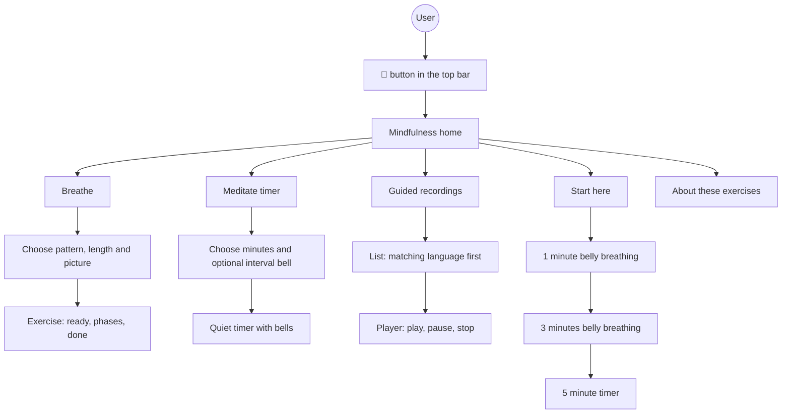
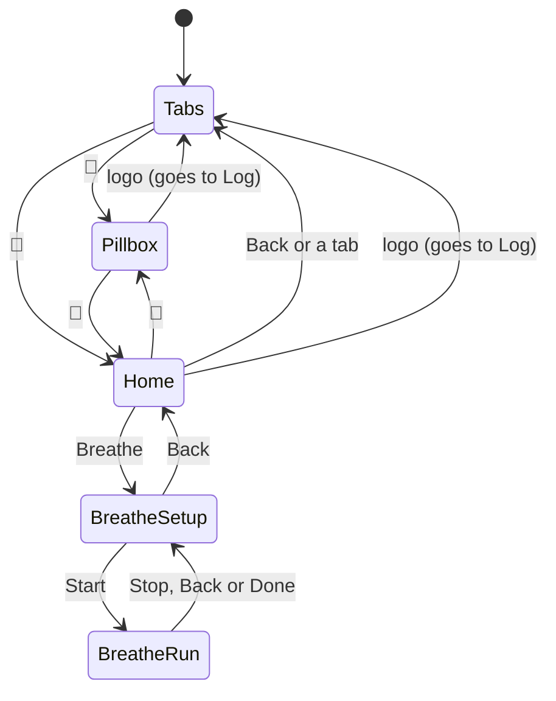
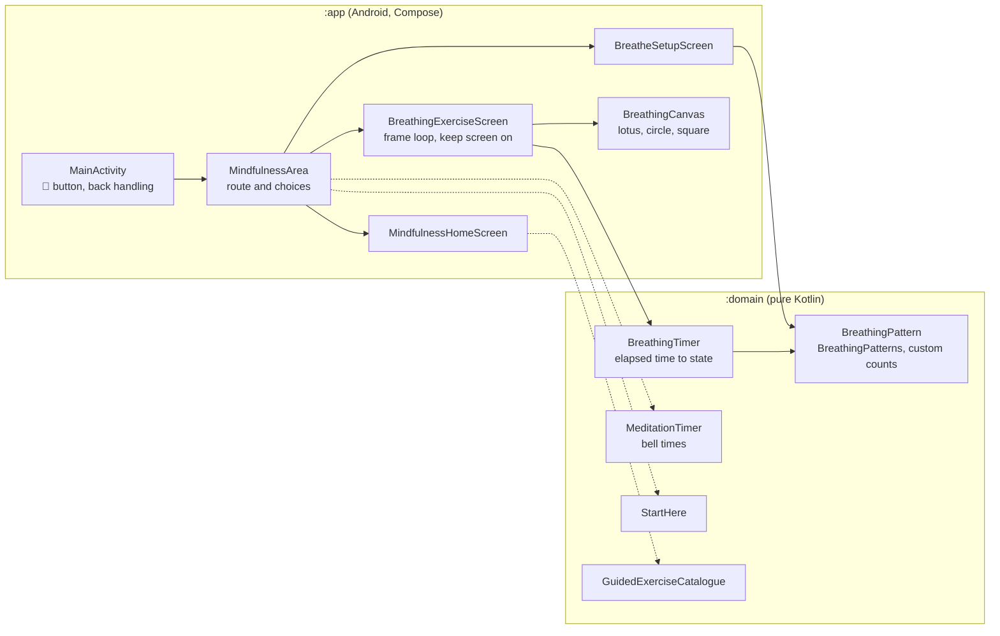
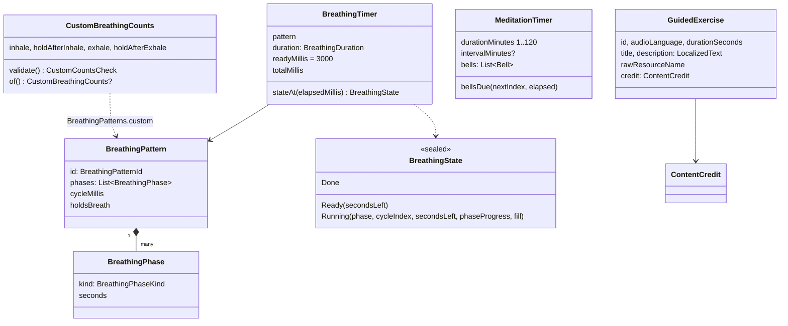
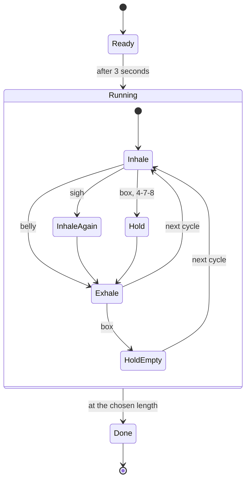
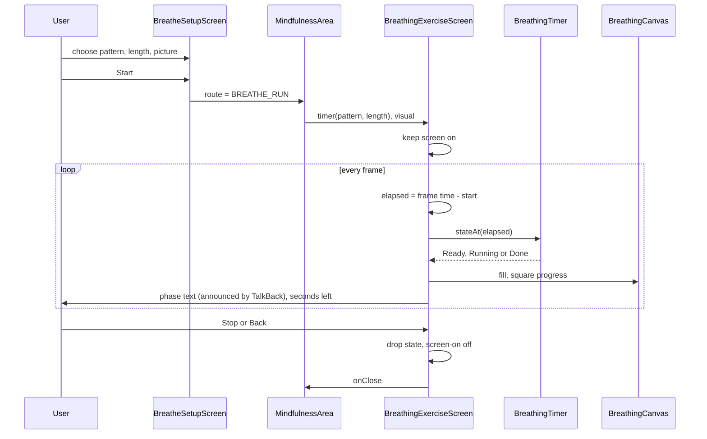
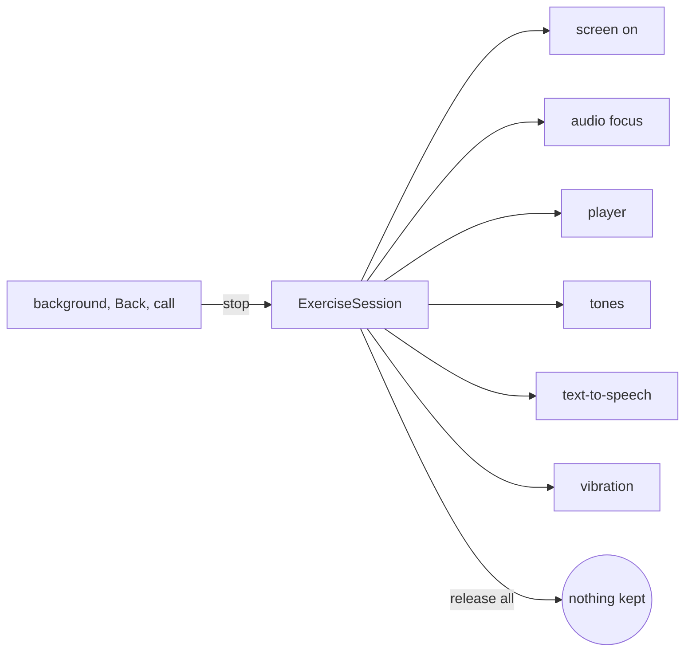

# Mindfulness (the feature)

> **Status: in progress.** The pure logic in `:domain` is done and tested. In `:app` the 🪷 button, the home screen and the breathing flow exist; the meditation timer, guided player, spoken cues, tones, safety note and saved choices are not built yet. The [status table](#7-status) says exactly what is where. The requirements are in the open change [`openspec/changes/add-mindfulness`](../../openspec/changes/add-mindfulness/proposal.md); the ideas, the agreed safety wording and the content licences are in [Mindfulness (ideas and wording)](mindfulness.md).

The 🪷 button in the top bar, next to 💊, opens a quiet area with a few ways to slow down: paced **breathing**, a **meditation timer**, short **guided recordings** and a **Start here** ladder for a first time. The app gives no advice and keeps no record of what the user practised.

## 1. Functional view

### What the user can do

Not every branch is built yet; see the [status table](#7-status).

### Breathing patterns

| Pattern | Phases (seconds) | Breath hold | Picture |
|---------|------------------|-------------|---------|
| Box breathing | in 4, hold 4, out 4, hold 4 | yes | lotus, circle or square |
| 4-7-8 breathing | in 4, hold 7, out 8 | yes | lotus or circle |
| Physiological sigh | in 2, in again 1, out 6 | no | lotus or circle |
| Belly breathing | in 4, out 6 | no | lotus or circle |
| Your own pattern | in 1 to 20, hold 0 to 20, out 1 to 20, hold 0 to 20 (0 = no hold) | if a hold is set | lotus or circle |

Lengths are 1, 3 or 5 minutes. Every exercise starts with a 3 second "Get ready" countdown and ends exactly at the chosen length, even in the middle of a phase.

### The rules the user can rely on

- **Nothing is recorded.** No history, streaks, counts or results. The only stored values (planned) are display choices: last length, picture, cues on or off, custom counts, and whether the safety note was acknowledged.
- **Works offline.** No network permission. Spoken cues use the phone's own text-to-speech; recordings are inside the app.
- **The screen stays on** during an exercise and returns to normal afterwards.
- **Soft, calm pictures.** No hard edges: the lotus is four rings of rounded petals, the circle is soft gradient layers, and the square has rounded corners with a dot that leaves a fading trail. Shapes ease in and out and turn only a few degrees.
- **Reduced motion.** When system animations are off, the picture jumps between full and empty instead of moving.
- **Language.** Everything is in English and Dutch. Recordings are English for now; items whose audio matches the app language are listed first.
- **Safety first.** A short note on first open, a reminder on pausing the breath, and the full text under "About these exercises". Wording: [mindfulness.md](mindfulness.md#2-safety-note).

## 2. Screen map

The Mindfulness area and the pillbox are screens drawn over the tabs. They are never open at the same time, and Back returns to the tab the user came from. The area keeps only its current screen and the last choices on the setup screen; both survive a configuration change except the running exercise, which starts again.

## 3. Technical view

### Where it lives in the hexagon

Solid arrows are built, dotted arrows are planned. Nothing in `:data` changes: there is no table, no migration, and Room stays at version 6. `:domain` has no clock, no Android type and no session record; the caller passes elapsed milliseconds.

### Domain model

| File in `domain/src/main/kotlin/nl/healthjournal/domain/model/mindfulness` | Holds |
|---|---|
| [`BreathingPattern.kt`](../../domain/src/main/kotlin/nl/healthjournal/domain/model/mindfulness/BreathingPattern.kt) | phases, the four built-in patterns, durations, custom counts and their validation |
| [`BreathingTimer.kt`](../../domain/src/main/kotlin/nl/healthjournal/domain/model/mindfulness/BreathingTimer.kt) | maps elapsed time to Ready, Running or Done |
| [`MeditationTimer.kt`](../../domain/src/main/kotlin/nl/healthjournal/domain/model/mindfulness/MeditationTimer.kt) | start, interval and end bell times for the timer |
| [`StartHere.kt`](../../domain/src/main/kotlin/nl/healthjournal/domain/model/mindfulness/StartHere.kt) | the three steps of the first-time ladder |
| [`GuidedExercise.kt`](../../domain/src/main/kotlin/nl/healthjournal/domain/model/mindfulness/GuidedExercise.kt) | the catalogue of recordings, languages, credits and ordering |

### How the breathing timer turns time into a picture

The timer is a pure function. For elapsed time `t`: before `readyMillis` it is **Ready**; at or after `readyMillis + duration` it is **Done**; in between, `t - readyMillis` modulo the cycle length selects the phase, and progress inside the phase gives `secondsLeft` (rounded up) and `fill`.

`fill` runs from 0 (breathed out) to 1 (breathed in) and is linear inside a phase: it grows on an inhale, holds on a hold, shrinks on an exhale. The sigh is the one special case: its first inhale ends at 0.75 and the second at 1.

The screen draws `fill` directly. The square picture ignores `fill` and moves a dot one side per phase (`phaseIndex + phaseProgress` over the number of phases), so it only reads as a true "box" for box breathing. Every picture eases `fill` with a smoothstep (`soft` in `BreathingCanvas.kt`) before drawing, which is only a drawing choice: the timer's `fill` stays linear and is what the tests check.

### What happens while an exercise runs

There is no place in this flow that stores anything. Leaving the screen simply drops the state.

### Meditation timer and bells

`MeditationTimer(durationMinutes, intervalMinutes?)` lists its bells up front: a **start** bell at 0, an **interval** bell every k minutes strictly before the end, and an **end** bell at the duration, so no interval bell rings together with the end bell. The caller asks `bellsDue(nextIndex, elapsed)` on each tick and gets every bell not yet rung, in order, so a late tick never skips one.

### Guided recordings

The catalogue is data. Each entry has an audio language, a duration, English and Dutch title and description, the resource name of the bundled file, and a credit (original title, author, source, licence with version and links). `GuidedExerciseCatalogue.orderedFor(appLanguage)` sorts entries whose audio matches the app language first and keeps the catalogue order inside each group; nothing is left out. Dutch text falls back to English when missing. The three first recordings come from the Free Mindfulness Project under Attribution-NonCommercial-ShareAlike 3.0 Unported, so the app must stay free and ad-free while they are included, and the files are used unchanged. Details and the licence check before each release: [mindfulness.md](mindfulness.md#3-content-and-licences).

### Planned: one session object

Task 2.3c puts everything an exercise holds in one place, so nothing can leak after the screen is gone.

The session starts on the exercise screen and releases everything on stop, on going to the background, on Back and on an incoming call. While it runs, the app's own dialogs and the app lock are held back. Medication reminders stay unchanged, by decision.

## 4. Privacy and safety in the code

| Rule | Where it is enforced |
|------|---------------------|
| No network | no `INTERNET` permission; `PrivacyChecksTest` |
| No logging | `PrivacyChecksTest` forbids log calls outside the database class |
| Nothing recorded | the timer and screens hold no history; the area keeps only the route and the last choices in memory |
| Neutral figures | counts and lengths are shown as numbers, never as a target or a benefit |
| Credit and licence | every catalogue entry must have a complete credit with https links (checked in the constructor and in tests) |
| Safety wording | texts agreed once, in English and Dutch, in [mindfulness.md](mindfulness.md#2-safety-note) |

## 5. Tests

| What | Where |
|------|-------|
| Patterns, custom count validation | [`BreathingPatternTest.kt`](../../domain/src/test/kotlin/nl/healthjournal/domain/model/mindfulness/BreathingPatternTest.kt) |
| Phase boundaries, fill, sigh, end of exercise | [`BreathingTimerTest.kt`](../../domain/src/test/kotlin/nl/healthjournal/domain/model/mindfulness/BreathingTimerTest.kt) |
| Bell times, late ticks, limits | [`MeditationTimerTest.kt`](../../domain/src/test/kotlin/nl/healthjournal/domain/model/mindfulness/MeditationTimerTest.kt) |
| Catalogue entries, credits, ordering by language | [`GuidedExerciseCatalogueTest.kt`](../../domain/src/test/kotlin/nl/healthjournal/domain/model/mindfulness/GuidedExerciseCatalogueTest.kt) |
| The first-time ladder | [`StartHereTest.kt`](../../domain/src/test/kotlin/nl/healthjournal/domain/model/mindfulness/StartHereTest.kt) |

Run them with `./gradlew :domain:test`. The screens are checked by hand on the emulator (task 2.10): each pattern, both languages, light and dark, animations off, a narrow phone.

## 6. How to extend it

**Add a breathing pattern**

1. Add an id to `BreathingPatternId` and a pattern to `BreathingPatterns` in `BreathingPattern.kt`, and add it to `builtIn` in the order it should appear.
2. Add its name string in `values` and `values-nl`, and a branch in the pattern name `when` in [`BreatheSetupScreen.kt`](../../app/src/main/java/nl/healthjournal/app/ui/mindfulness/BreatheSetupScreen.kt).
3. Add tests for its phases, cycle length and `holdsBreath`.

**Add a guided recording**

1. Check and write down its licence; add the audio file unchanged to the app's raw resources with a lowercase name.
2. Add an entry to `GuidedExerciseCatalogue` with both titles and descriptions and a complete credit.
3. Add it to the credits record, and extend the catalogue test.

**Add a picture**

Add a value to `BreathingVisual`, a draw function in [`BreathingCanvas.kt`](../../app/src/main/java/nl/healthjournal/app/ui/mindfulness/BreathingCanvas.kt) driven by `fill`, and a label string in both languages.

## 7. Status

| Part | Task | State |
|------|------|-------|
| Patterns, custom counts, timer, meditation timer, Start here, catalogue, tests | 1.1 to 1.4 | done |
| 🪷 button, back handling, home screen | 2.1, 2.2 | done |
| Breathing setup and exercise screen with lotus, circle, rounded square | 2.3 | built, partly: no saved picture choice, no custom pattern input, no fading controls |
| Guided list and player | 2.3a | not started |
| Session object | 2.3c | not started |
| Meditation timer screen | 2.4 | not started |
| Tones, vibration, spoken cues | 2.5 | not started |
| Safety note and acknowledgement | 2.6 | not started |
| Saved display choices | 2.7 | not started |
| Strings in English and Dutch | 2.8 | done for the built screens |
| `VIBRATE` permission, privacy checks | 2.9 | not started |
| Emulator check | 2.10 | not started |
| Credits screen (Credits / Bronnen) and credits record | 3.3, 3.3a | not started |

The living list is [`tasks.md`](../../openspec/changes/add-mindfulness/tasks.md).
