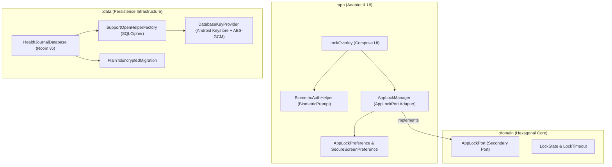
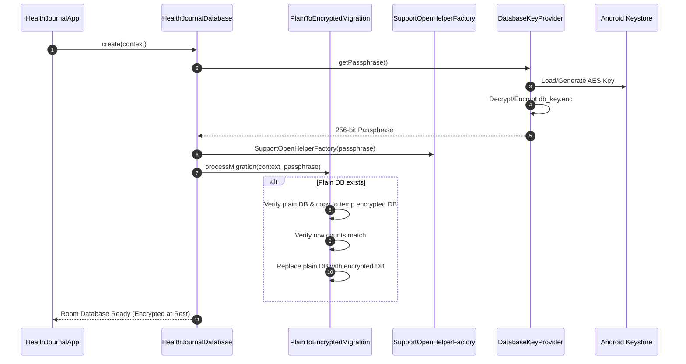
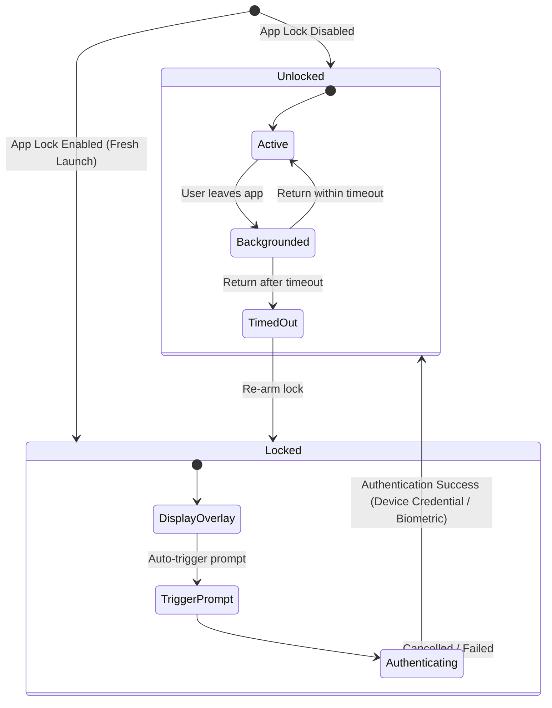
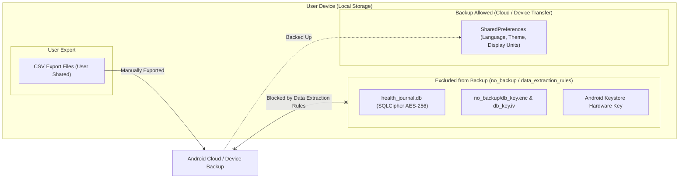

# Privacy, Database Encryption and App Lock

Health Journal is built around **privacy by design**: all sensitive personal health data remains strictly on the user's device. To safeguard health records against unauthorized physical or digital access, the application incorporates **AES-256 database encryption at rest**, an **opt-in App Lock (biometric / device credential)**, **`FLAG_SECURE` screen protection**, and **selective backup exclusion rules**.

For architectural decisions and regulatory context, see [ADR 0023](../adr/0023-database-encryption-and-app-lock.md).

---

## 1. Functional Overview

### Privacy by Design
- **100% Offline-First:** The `AndroidManifest.xml` contains no `INTERNET` permission. Built-in CI checks enforce that no network capability can be introduced.
- **Zero Telemetry:** No analytics, crash reporting, tracking SDKs, or cloud sync services exist in the project.
- **Data Sovereignty:** Data belongs entirely to the user. Backup and migration across devices are performed manually via CSV export and import.

### Database Encryption (SQLCipher)
- The Room database file (`health_journal.db`) is encrypted on-disk using 256-bit AES encryption via **SQLCipher**.
- Unencrypted database files from earlier versions are automatically and transparently migrated to the encrypted format on first launch with row-count verification.

### App Lock & Biometric Authentication
- Users can enable an **App Lock** from the Profile screen under *Security & Privacy*.
- Authentication leverages the system's native **Device Credential** (PIN, pattern, password) or **Biometrics** (fingerprint, face unlock) via AndroidX `BiometricPrompt`.
- The app stores no password or PIN of its own; device lock configuration is handled entirely by the Android OS.
- Configurable auto-lock timeout options: **Immediately**, **1 minute**, or **5 minutes** after the app is backgrounded.
- Weakening the lock needs the device credential first: turning the lock off or choosing a longer timeout opens a `BiometricPrompt` (`BiometricAuthHelper.confirm`), so someone holding an unlocked phone cannot simply disable it. Turning it on or choosing a shorter timeout needs no confirmation.
- **What the lock is, and is not:** the lock is a UI gate. It hides and blocks the app, but the database key is not bound to the lock, because binding it to biometrics would make the data unreadable after a fingerprint change (ADR 0023). Someone with root access or a debugger on an unlocked device could bypass the gate; the at-rest protection against other threats (a copied database file, a backup) comes from the encryption, not from the lock.

### Secure Screen (`FLAG_SECURE`)
- An optional *Secure Screen* toggle applies `WindowManager.LayoutParams.FLAG_SECURE` to the application window.
- This prevents screenshots/screen recordings and obscures the app's contents in the Android recent apps switcher.
- While the app lock is on the window is always secure (the toggle shows as on and cannot be switched off), so the recent-apps thumbnail never shows health data.

### Selective Backup Exclusion
- `allowBackup="true"` is maintained so user preferences (language, theme, units) can be preserved by system backups.
- Android `data_extraction_rules.xml` and `backup_rules.xml` explicitly exclude `health_journal.db`, SQLCipher encryption keys, and Keystore material from cloud or device-to-device transfers.

---

## 2. Architecture & Technical Implementation

Following **Hexagonal Architecture** (Ports and Adapters), security controls are split across the three modules:

### Key Management (`DatabaseKeyProvider`)
1. On first initialization, `DatabaseKeyProvider` checks for an existing wrapped key in `no_backup/db_key.enc`.
2. If missing, a random 256-bit passphrase is generated using `SecureRandom`.
3. The passphrase is encrypted (AES-GCM-NoPadding) using a non-exportable hardware-backed key created in the **Android Keystore** (TEE / StrongBox).
4. The encrypted passphrase and IV are saved in no-backup storage (`no_backup/db_key.enc` and `no_backup/db_key.iv`).
5. Key generation requires no user authentication binding, ensuring key availability survives biometric enrollment changes or credential resets.
6. Both files are written atomically (temporary file, then rename; key file last), so an interrupted write never leaves a half-written key that would be mistaken for a lost one.
7. StrongBox is tried first (API 28+); a device without it throws `StrongBoxUnavailableException` from `generateKey()` and the key is created in the TEE instead.

### Failure handling
`HealthJournalDatabase.create()` publishes the outcome in `DatabaseEncryptionStatus` and logs it (tag `HealthJournalDb`, reasons only, no health data).

| State | When | What the user sees |
|-------|------|--------------------|
| `Active` | The database is encrypted and its key unwraps. | Normal app. |
| `NotActive(reason)` | The migration failed or SQLCipher could not load, so the plain database stays in use. The next start retries. | The Profile "Data storage & backups" card says the data is currently not encrypted. |
| `KeyLost` | The database is encrypted but the key files are missing or the Keystore key is gone or invalidated (`DatabaseKeyLostException`). | `DatabaseKeyLostScreen` replaces the app. After a confirmation, `DatabaseRecovery` deletes the unreadable data and key material and the app restarts empty. |

- Only permanent failures (missing or invalidated key, failed GCM authentication) count as `KeyLost`. Transient Keystore errors propagate, so a temporary glitch never offers to delete data.
- While `KeyLost`, the app runs on an empty in-memory database so receivers and reminders do not crash.
- A stale, unreadable key next to a still-plain database is discarded and replaced during the migration, because no data depends on it.

### Database Encryption Flow Sequence

---

## 3. App Lock State & Lifecycle

The App Lock state is governed by `AppLockManager` and rendered using `LockOverlay`:

### Timeout Management
- When the app is sent to the background (`onBackgrounded()`), `AppLockManager` records a timestamp from the monotonic clock (`SystemClock.elapsedRealtime()`), so changing the phone's date or time does not stretch the timeout.
- Upon returning to the foreground (`onForegrounded()`), the elapsed time is evaluated with `LockTimeout.hasElapsed` (`IMMEDIATELY`, `ONE_MINUTE`, `FIVE_MINUTES`).
- If the elapsed duration exceeds the configured timeout, `LockState` transitions to `Locked` / `TimedOut`, causing `LockOverlay` to obscure the UI and prompt for authentication.

---

## 4. Privacy & Data Backup Exclusion Boundaries

---

## 5. Developer Checklist for Security & Privacy

When introducing or modifying features:
1. **No Network Access:** Never add `<uses-permission android:name="android.permission.INTERNET" />` to `AndroidManifest.xml`.
2. **Zero Sensitive Data in Overlay:** Ensure `LockOverlay` composes no health metrics or profile data behind it.
3. **No Unencrypted Logging:** Never log patient identifiers, health values, or SQLCipher passphrases in production code.
4. **Docs & Specs:** Run `npx --no-install openspec validate --all --strict` and `bash scripts/check-docs.sh` to confirm all security specs and documentation links remain valid.
