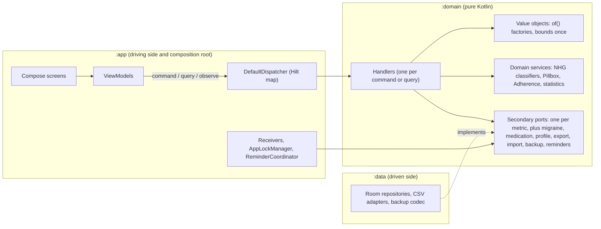

## Context

The hexagon is sound at the module level: `:domain` has no framework dependency, DI stays in `:app` ([ADR 0035](../../../../docs/adr/0035-hilt-for-dependency-injection.md)) and `RepositoryGuardrailsTest` already enforces that. The friction is inside the application layer ([ADR 0002](../../../../docs/adr/0002-hexagonal-architecture.md) names Use Cases but never defined a primary boundary). Messages shown to the user must stay localized ([ADR 0015](../../../../docs/adr/0015-localized-viewmodel-messages.md)); metrics stay plain, with no assessment ([ADR 0026](../../../../docs/adr/0026-oxygen-saturation-without-assessment.md) and the later ones).

## Target architecture

Rules the diagram stands for: ViewModels know only the dispatcher; handlers know only ports, value objects and a clock; adapters implement ports; Hilt wires everything and exists only in `:app`. Platform entry points (alarm receivers, app lock, reminder coordinator) are driving or driven adapters themselves and keep using their own narrow ports and use cases; they are the allowed set in the guardrail.

## Also needed (not in the review)
1. **Streams.** ViewModels observe history and today's pillbox as `Flow`, and the dispatcher as the review wrote it is `suspend` only. Add `ObserveQuery<R>` with `fun <R> observe(query: ObserveQuery<R>): Flow<DomainResult<R>>`, or handlers cannot replace the current observe paths.
2. **Cancellation.** The dispatcher and handlers must rethrow `CancellationException` and never turn it into `DomainError.Storage` (the 1.6.5 backup fix was exactly this bug).
3. **Active profile.** Five ViewModels call `profileRepository.getActiveProfile()`. Provide a `GetActiveProfileQuery` and let commands take the profile from the handler or the caller, so no ViewModel needs the profile port.
4. **Shared test fakes.** Six ports means six hand-written fakes in every test class today's way. Put in-memory fakes of the ports in one shared test fixture so handler and ViewModel tests reuse them.
5. **Main-safety.** Handlers stay main-safe by relying on Room's own dispatching; the dispatcher does not switch threads. Write this in ADR 0036 so nobody adds `withContext` per handler.
6. **Cost check.** Like ADR 0035, record the debug APK size and cold start before and after, and the build time impact of the new multibinding.
7. **R8.** The map is keyed by class literals, not reflection, so no keep rules are expected. Verify with a release-minified build once, not only the debug APK CI builds.
8. **Commit shape.** One commit per phase on a branch (or master with green CI per phase), so any phase can be reverted alone; the final change is archived only after the emulator pass.

## Goals / Non-Goals

**Goals:** ISP-sized ports; ViewModels that touch only the application boundary; typed validation errors with no duplicated bounds; fewer classes per new metric; checks that stop the drift coming back.
**Non-Goals:** any user-visible change, database or backup change, domain events, richer metric aggregates, a new DI framework, changes to the `Medication` aggregate or `Pillbox`, a Gradle module per context, and the physical move of existing models and use cases into context packages (a follow-up change).

## What the review got right, wrong and missed

**Confirmed against the code:** the fat port (30 methods, 67 lines); `EntryUseCases` (14) and `MedicationUseCases` (8); `HistoryViewModel` injecting `ProfileRepositoryPort`, `MigraineRepositoryPort` and four export/import ports; the duplicated waist bounds (`LoggingViewModel` lines 384 and 533); `require` in value objects and `catch (e: Exception)` in ViewModels; no primary port layer; the long `when (selectedMetric)` save switch.

**Corrected:**
- The leak is wider than two ViewModels. Six import secondary ports (Logging, History, Medication, MigraineLog, Profile, RecoveryBackup). The review's migration plan and its new guardrail `viewModelsDoNotImportSecondaryPorts` would fail on the four it never mentions.
- `MedicationUseCases` is counted as a smell, but no task in the review's plan removes it, and its own `noSyntheticUseCaseBundlesExist` test would fail on it.
- The review says `TakeAllForSlotUseCase` and `SaveMedicationUseCase` call `RearmRemindersUseCase` directly. They do not: re-arming is driven from `ReminderCoordinator` in `:app`. So the "procedural chaining" hot spot, and the case for domain events, does not exist. Domain events are out of scope.
- The review's error mapping uses `UiText.Dynamic(message)`. That type does not exist (`UiText` has `Res` and `Plain`), and passing the domain's English message would show English to Dutch users. Errors carry codes and parameters; the UI maps them to string resources.
- The review's file list names tests that do not exist (`HistoryViewModelTest`, `LoggingViewModelTest`). The real ones are `ViewModelsTest`, `UseCasesTest`, `CsvAdaptersTest`, `MedicationViewModelTest`, `MigraineLogViewModelTest` and tests under `ui/history`, `ui/profile`, `ui/backup`.
- "Anemic metric aggregates" is a deliberate property here: metrics are plain records with no assessment. Not a defect to fix.

**Missed by the review:**
- CSV routing by metric name strings in `HistoryViewModel` (`"bp"`, `"spo2"`, ...). Becomes a `MetricKind` enum.
- `LoggingViewModel` has nullable port and use case parameters with defaults, plus a second `@Inject` constructor, only so tests can build it. The dispatcher removes the need.
- `Instant.now()` is used as a default in 8 places in `:domain`. Handlers take a `Clock`.
- The sample `DeleteEntryHandler` injects all seven repositories, which is a fat dependency list again.
- `CsvDataExportAdapter` and `CsvDataImportAdapter` in `:data` also depend on the fat port.
- The `add-a-metric` how-to and playbook describe the old shape and must change, or every later metric reintroduces it.
- Six metric changes are in flight and each adds port methods and use cases in the old shape (see decision 9).

## Decisions

### 1. Segregated ports
One port per metric in `domain/port/secondary/`: `WeightRepositoryPort`, `BloodPressureRepositoryPort`, `GlucoseRepositoryPort`, `ActivityRepositoryPort`, `WaistCircumferenceRepositoryPort`, `OxygenSaturationRepositoryPort`. Method names and semantics are unchanged (`save`, `get...History`, `observe...History`, `update` returning Boolean, `delete` returning Boolean). `RoomHealthLogRepository` implements all six and `DataModule` exposes it once under each type; no new Room classes. `HealthLogRepositoryPort` is deleted (clean cut, no deprecation period: it has no consumers outside this repository). Alternative, a generic `EntryStore<E>` base: rejected for now because the entries differ in shape (`ActivitySession` vs `*Entry`) and named ports read better at call sites. The six ports share identical method shapes, so a generic base stays possible later.

### 2. Application boundary: typed commands and a dispatcher
- `:domain/command/`: `Command<R>`, `Query<R>`, `CommandHandler<C, R>`, `QueryHandler<Q, R>`, `DomainResult<T>`, `DomainError`, and an interface `Dispatcher` with `suspend fun <R> dispatch(command: Command<R>): DomainResult<R>` and `suspend fun <R> query(query: Query<R>): DomainResult<R>`. The result type is carried by the command, so a call site cannot state a wrong `R` (the review's `dispatch<C, R>` signature allows that).
- `:app/command/DefaultDispatcher` looks the handler up by command class in a Hilt `@Multibinds` map (`@ClassKey`). `:domain` has no Hilt, so handlers are plain classes and `CommandModule` in `:app` provides and registers them.
- A missing handler is a programming error and fails a unit test at build time (a test enumerates every `Command` and `Query` subclass under `command/` and checks each has a registered handler), not a runtime `DomainError`.
- Alternative considered: grouped application services per area (`EntryService`, `ExchangeService`, `PillboxService`) injected directly, no dispatcher. Smaller and easier to read, but the dispatcher was the stated choice. This is decided last (task 4.4): ports, typed errors, the clock and the guardrails land first and do not depend on it, so the fallback costs only sections 5 and 6, not the earlier work.
- Existing use cases that carry real logic and are not CRUD (`GetHealthHistoryUseCase`, `GetPillboxDayUseCase`, `GetAdherenceUseCase`, `RearmRemindersUseCase`, the backup use cases) stay as classes, wrapped by a query handler only where a ViewModel needs them. They are not rewritten.

**Spike result (task 4.4).** `DefaultDispatcher` (one file, `app/command/`) plus `CommandModule` with one real handler (`DeleteEntryHandler`) compile under KSP and Hilt, and `DefaultDispatcherTest` and `HandlerRegistryTest` pass. Measured wiring cost:
- Per handler: one `@Provides @IntoMap @ClassKey(X::class)` function, two lines including the constructor call. No reflection, no keep rules expected (checked once with a minified build in 8.x).
- Unchecked casts: three, one in each of `dispatch`, `query` and `observe`, all in `DefaultDispatcher`, each guarded by the class-keyed lookup and covered by a test. This is above the "more than one" line written in 4.4 only because there are three request kinds; the count does not grow with handlers.
- Registration is checked at build time by `HandlerRegistryTest` (reads the sources), so a forgotten handler fails the unit tests, not a user.
- Decision: keep the dispatcher; the grouped-service fallback is not needed, so sections 5 and 6 stand as written.
- The spike's `DeleteEntryHandler` depends on `EntryGateway` (one interface over the seven stores, implemented by `PortEntryGateway`) instead of seven ports; task 5.2 builds on it.

### 3. Consolidation
- `DeleteEntryCommand(kind: EntryKind, id)` and `UpdateEntryCommand` replace the seven `Delete*` and six `Update*` classes. The handler reaches the ports through a small `EntryGateway` (a map from `EntryKind` to the narrow port operations), not seven constructor parameters. `EntryKind` covers the six metrics and migraine.
- `RecordEntryCommand` is a sealed hierarchy (`RecordWeight`, `RecordBloodPressure`, ...) so each keeps its own typed fields. Handlers share validation and clock handling. Adding a metric then means one command, one handler, one port.
- `ExportCsvQuery(profile, kind: MetricKind)` and `ImportCsvCommand(profile, kind, content)` replace the string switch. The old string keys are mapped once, at the edge, where the Profile screen produces them.

### 4. Typed errors, safe factories
- `DomainError`: `Invalid(field, rule, params)`, `NotFound(kind, id)`, `Storage(cause)`. No display text. `ValidationRule` is an enum (`OutOfRange`, `SystolicNotAboveDiastolic`, `Required`, ...).
- Value objects gain `of(...)` factories returning `DomainResult`. The primary constructor keeps its `require` checks, so Room mapping, tests and any missed caller still cannot build an invalid object. The review proposed private constructors; that breaks the mapper layer and the 71 `require` sites for little gain, and is a non-goal here.
- Bounds exist once, as constants on the value object. `LoggingViewModel` stops using `takeIf { in MIN..MAX }`: it passes typed input to the command and renders the returned error. Live previews (waist and glucose range chips) keep calling the pure classifiers.
- The UI maps `DomainError` to `UiText.Res` with the existing strings (`log_err_waist` and the like). Where a rule has no specific string today, the generic one is used; no new copy unless a task says so. `UiTextException` stays for UI-only parse errors (a field that is not a number) and is no longer used for domain rules.

### 5. Time
Handlers take a `java.time.Clock` (already used by `TakeAllForSlotUseCase`). Commands carry the timestamp the user chose, or `null` for "now", resolved in the handler. No `Instant.now()` default remains in command classes.

**Handler details settled while writing section 5:**
- **Backup errors are typed.** `DomainError.Backup(BackupProblem)` carries the four reasons a file can fail to open (`NOT_A_BACKUP`, `UNSUPPORTED`, `WRONG_PASSPHRASE_OR_CORRUPT`, `MALFORMED`). `OpenBackupHandler` maps `BackupException`, so the UI no longer needs its own `BackupException.toUiText`. The passphrase rules (too short, mismatch) are `Invalid(PASSPHRASE, TOO_SHORT | MISMATCH)` and are checked in `CreateBackupHandler`, not in the ViewModel. `CreateBackupCommand` and `OpenBackupQuery` are plain classes so the secrets stay out of `equals` and `toString`.
- **Existence is pre-checked, not caught.** The medication use cases throw `requireNotNull` and `IllegalArgumentException` for an unknown id. The handlers ask `MedicationRepositoryPort.firstProblem(ids)` first and return `NotFound("MEDICATION", id)`; any other exception becomes `Storage`. The use cases keep their behaviour.
- **Tag outcomes stay success values.** `AddTagResult.LimitReached` and `RenameTagResult.LabelTaken` or `UnknownTag` are results the picker shows, not failures. Only a blank label (`Invalid(NAME, REQUIRED)`) and archiving an unknown tag (`NotFound("MIGRAINE_TAG", id)`) are errors.
- **Local time for medication dates.** The injected `Clock` is UTC. Handlers that default a date to "today" get `localClock(clock)`, the same instant source in the device zone. The pillbox, adherence and take-all use cases take the system default clock because they need the person's local day.
- **The end-of-migraine rule lives on the model.** `MigraineEntry.endedAt(at)` returns null when the entry already ended or `at` is before the start. `EndMigraineUseCase` and `EndMigraineHandler` both use it; the handler turns null into `Invalid(TIME_RANGE, END_NOT_AFTER_START)`.
- **Shared in-memory fakes.** `FakeProfileRepository`, `FakeMigraineRepository` and `FakeMedicationRepository` moved to `domain/src/testFixtures`, next to `FakeHealthLogRepository`, so the handler tests and the ViewModel tests use the same ones.

### 6. ViewModels
All six ViewModels depend on the dispatcher plus preferences and display state only. Nullable test-only parameters and second constructors go away; tests pass a fake `Dispatcher` or real handlers over in-memory fakes.

### 7. Guardrails
Added next to `RepositoryGuardrailsTest`: no ViewModel imports `domain.port.secondary`; no `data class *UseCases(` bundle; no `catch (e: Exception)` around a dispatcher call in a ViewModel; handlers under `domain/command/` return `DomainResult`; no `Instant.now()` in `domain/command/`; `HealthLogRepositoryPort` does not exist. A failure names the file. Non-ViewModel app classes that legitimately use ports (Hilt modules, `AppLockManager`, `ReminderCoordinator`, alarm scheduling) are the allowed set.

### 8. Behaviour preservation
This is a refactor under test. The existing JVM, CSV and migration tests are the safety net and keep their assertions; only setup may change. An emulator pass at the end covers log, edit, delete, export and import for every metric, in English and Dutch.

### 9. Order against the in-flight metric changes
Six `add-*` changes (body temperature, daily activity, energy, fluid, mood, sleep) each add port methods and use cases in the old shape. Recommended: land this change first, then update their tasks and designs, which name `HealthLogRepositoryPort` and `Record/Update/DeleteX` classes. The updated add-a-metric playbook then makes each of them smaller. If some must land first, they land unchanged and this change absorbs their ports at the cost of one more port and handler each.

### 10. Order and documentation
- **Work order:** (1) segregated ports, (2) typed errors, factories and clock, (3) guardrails that already hold, (4) the dispatcher spike and its decision checkpoint, (5) handlers, (6) ViewModel migration and the remaining guardrails, then docs and verification. Each step compiles and passes the tests on its own. The highest-value, lowest-risk work comes first, and the dispatcher is an informed choice instead of an assumption.
- **ADR 0036, "Application boundary: commands and queries".** The model stated explicitly: hexagonal with a command and query application layer. Covers the dispatcher (or grouped services), handlers, observe queries and main-safety. Clean Architecture's use case idea is borrowed; presenters and per-use-case response models are not adopted, because the ViewModel maps the typed result.
- **ADR 0037, "Typed domain errors and a single source for rules".** `DomainResult`, `DomainError` with code and parameters and no display text, `of(...)` factories beside the validating constructors, bounds once, `Clock`.
- The two ADRs are separate because 0037 and the segregated ports stand even when 0036 falls back to grouped services; a single ADR would then need rewriting.
- **Amend ADR 0002:** a "Primary ports" section. **Amend ADR 0035:** one line that the handler map lives in `:app`, so the no-Hilt-in-`:domain` rule holds.

### 11. Bounded contexts
The domain already splits into contexts by folder (`profile`, `metrics`, `medication`, `migraine`, `mindfulness`, `backup`, `lock`, plus `nhg` and `common`), but nothing enforces it. An import scan of `model/` shows four real couplings:
- `medication`, `migraine` and `metrics` all use `metrics.EntryComment`. It is a shared concept and belongs in the shared kernel.
- `profile.Profile` uses `metrics.HeightCm` and `metrics.WeightKg`. Height is profile data; the question is whether `Profile` belongs upstream of `metrics` (then `HeightCm` and `WeightKg` move to the shared kernel) or on top of it.
- `metrics` entries hold `nhg` categories, while `nhg` classifiers read `metrics` readings and `profile`. That is a cycle between `metrics` and `nhg`. Either `nhg` becomes part of `metrics`, or the entries stop storing the category and it is derived.
- `backup` reads everything, which is correct: it is the one allowed consumer of all contexts.

Resolved by the user: **`nhg` joins `metrics`** (the NHG classifiers are metric domain services), and **`profile` and `metrics` are separate contexts**. Because `Profile` imports `metrics` types and `nhg` reads `profile.Sex`, keeping both contexts separate means one direction only, `profile` upstream of `metrics`:
- `HeightCm` and `WeightKg` move into the shared kernel (body measures used by both `profile` and `metrics`), as does `EntryComment`. This is the smaller change: `Profile.calculateBmi(weight)` keeps working unchanged.
- Only `Profile.classifyWaistCircumference(waist)` still reaches into `metrics` (`WaistCircumferenceCm` and the NHG waist category). It becomes a domain service in `metrics` that takes the sex as an argument, for example `classifyWaist(sex, waist)`. Its callers (`LoggingViewModel`, `BackupJson`, `CsvDataImportAdapter`, the waist use cases and `ProfileTest`) are updated; results are unchanged and covered by the existing classifier tests.
- Result: `profile` imports only the shared kernel; `metrics` (with `nhg`) imports `profile.Sex` and the shared kernel; no cycle.

Decisions:
- **Context map.** `shared` (ids, units, `EntryComment`) is upstream of all. `profile` is upstream of `metrics`, `medication` and `migraine`. `metrics` (including the NHG classifiers), `medication` and `migraine` do not import each other. `backup` may import every context. `mindfulness` and `lock` import nothing.
- **Guardrail.** A test scans `model/` imports against this map and names the file and the forbidden edge. It starts report-only (task 3.4) listing the four couplings above; each is then fixed or recorded as an accepted exception in the test, and it becomes failing once the list is empty.
- **Package layout for new code.** New ports, commands and handlers live in their context: `domain/<context>/{port,command}` for what this change adds (for example `metrics/port/WeightRepositoryPort.kt`, `metrics/command/RecordWeight...`). Existing models and the 30 use cases stay where they are. This keeps the refactor behaviour-preserving and the diff reviewable. The physical move of existing code is a separate follow-up change, so nothing is moved twice.
- **Language and entities.** ADR 0038 fixes the vocabulary and the tactical roles: entries are entities with a `MeasurementId`, readings are immutable value objects validated through `of(...)`, NHG classifiers are pure domain services (no ports), handlers are application services (ports, clock, transactions). `docs/dev` gets a context map and a glossary (slot, intake, pillbox, range label which is never a verdict, episode).
- **Aggregates.** `Medication` stays the aggregate root it is. Plain metrics stay plain records on purpose (no invariants over time), so no aggregate roots are added there. `MigraineEntry` has a lifecycle (ongoing, then ended); task 5.8 checks whether ending an episode belongs on the entry instead of being rebuilt in a use case, and moves it if so.
- **Non-goals:** no Gradle module per context, no domain events.

## Risks / Trade-offs
- **Large diff touching every screen.** Mitigated by phase order: each phase compiles and passes tests on its own, and phases 1 and 2 add structure without moving behaviour.
- **Dispatcher indirection** hides the call graph from "find usages". Mitigated by one handler per command and a naming rule (`FooCommand` / `FooHandler`).
- **Hilt multibinding with generic handlers** needs `@JvmSuppressWildcards` and one unchecked cast, contained in `DefaultDispatcher` and covered by its test.
- **Error mapping drift:** a new `ValidationRule` without a string. A test iterates the enum and resolves a string for each rule in both languages.

## Open Questions
- Confirm the dispatcher over grouped application services (decision 2, fallback noted).
- Release on its own (1.8.0, CHANGELOG "Changed: internal structure, no behaviour change") or fold into the next feature release.
